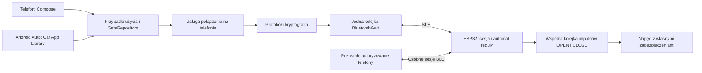

# Sterowanie bramą — plan aplikacji Android i specyfikacja firmware ESP32

**Wersja dokumentu:** 1.5  
**Wersja protokołu na łączu:** 2 (`0x02`), niezgodna z ramkami protokołu 1 ze specyfikacji 1.0  
**Data:** 28.10.2026  
**Platformy:** telefon Android, Android Auto, ESP32-WROOM  
**Język aplikacji:** Kotlin, projekt w Android Studio  
**Status:** projekt do implementacji; zgodność interfejsu Android Auto i połączenie z konkretnym napędem wymagają sprawdzenia w etapie 0.

## 1. Cel i najważniejsze decyzje

Aplikacja steruje jedną skonfigurowaną bramą przez BLE. Telefon jest centralą BLE, a ESP32 urządzeniem peryferyjnym. Android Auto wyświetla interfejs aplikacji działającej na telefonie; jednostka samochodowa nie łączy się bezpośrednio z ESP32.

Dostępne są dokładnie dwie **komendy sterowania bramą**:

| Komenda | Parametry | Znaczenie |
|---|---|---|
| `OPEN` — otwarcie bramy | `autoCloseOnDisconnect: Boolean` | Podanie sygnału OPEN; opcjonalne uzbrojenie automatycznego CLOSE po utracie połączenia z tym telefonem. |
| `CLOSE` — zamknięcie bramy | Brak | Podanie sygnału CLOSE i anulowanie uzbrojonej reguły automatycznego zamknięcia. |

Komunikaty parowania, uwierzytelniania, potwierdzania i diagnostyki reguły są elementami protokołu transportowego. Nie stanowią dodatkowych komend ruchu bramy.

Najważniejsze decyzje:

1. **Położenie bramy jest zawsze nieznane.** Nie ma komendy odczytu położenia ani modelu, który ustala położenie na podstawie historii komend.
2. Potwierdzenie `OUTPUT_TRIGGERED` oznacza wyłącznie rozpoczęcie impulsu na odpowiednim wyjściu sterownika. Nie oznacza zakończenia ruchu.
3. Napęd musi udostępniać **osobne, jednoznaczne wejścia OPEN i CLOSE**. Wejście typu „krok po kroku”, `START`, `TOGGLE` lub „otwórz/stop/zamknij” nie spełnia tego wymagania bez dodatkowej informacji o położeniu.
4. Automatyczne zamykanie wykonuje ESP32. Nie zależy ono od tego, czy Android zdąży wysłać CLOSE podczas zaniku zasięgu.
5. Parowanie wymaga otwarcia okna rejestracji — przyciskiem sterownika albo komendą już zarejestrowanego telefonu (9.4) — i unikalnego sekretu z QR albo 6-cyfrowego PIN-u sterownika uzgadnianego przez EC-JPAKE (11.4). Zwykłe BLE „Just Works” nie jest jedyną ochroną.
6. Wszystkie wiadomości sesji są szyfrowane i uwierzytelniane AES-256-GCM. Liczniki, świeże sesje i pamięć duplikatów chronią przed ponownym wykonaniem komendy.
7. Telefon i Android Auto korzystają z jednej kolejki komend i jednego połączenia BLE.
8. W pierwszej wersji: jedna brama w aplikacji, maksymalnie osiem autoryzowanych telefonów z równoległymi połączeniami do ESP32. Firmware rezerwuje dodatkowy, dziewiąty kontekst łącza na rejestrację; każdy klient ma osobną sesję i jedną kolejkę GATT na swoim telefonie.
9. `autoCloseOnDisconnect` dotyczy rzeczywistego rozłączenia BLE właściciela. Uśpienie CPU, brak PING i opóźnienie kodu aplikacji nie są dodatkowym warunkiem zamknięcia.
10. Reguła ma jawny stan techniczny i kod błędu raportowany w szyfrowanej sesji. FAULT nie może być prezentowany jako działające monitorowanie.
11. CLOSE jest poleceniem bezpiecznym i nie zależy od pamięci Flash. Nawet nieudany reset autoryzacji (9.6) albo nieczytelny obraz NVS (14.5, pkt 5) przy uzbrojonej regule kończy się jedną próbą auto-CLOSE.
12. **Normalna praca nie zapisuje NVS.** Do NVS zapisują wyłącznie: zmiany autoryzacji (rejestracja telefonu, w tym ponowna rejestracja i naprawa bondu, oraz reset autoryzacji), provisioning i ponowny provisioning oraz zmiana konfiguracji lokalnej (komendy konsoli serwisowej, 15.4), usunięcie klienta i zmiana nazwy telefonu z telefonu w sesji READY (13.1, `client_management_design.md`), a także jednorazowa migracja schematu po aktualizacji firmware (15.2). Aktualizacja OTA (15.5) zapisuje wyłącznie partycje aplikacji i `otadata`, nie NVS. Komendy OPEN/CLOSE, auto-CLOSE, FAULT, połączenia, sesje i subskrypcje GATT zmieniają tylko RAM oraz kopię reguły w pamięci RTC. Kopia przetrwa restart programowy, ale nie zanik zasilania (14.5). Po zaniku zasilania otwartą bramę zamyka napęd po powrocie zasilania (założenie instalacji z 2.2).
13. **Aktualizacja firmware z telefonu** (1.5): sparowany telefon w sesji READY przesyła podpisany obraz wybrany przez użytkownika; sterownik przyjmuje wyłącznie obraz z poprawnym podpisem ECDSA i nie starszym numerem bezpieczeństwa, przy rozbrojonej regule autozamykania. Nieudany start nowego obrazu wraca do poprzedniego (15.5).

### Zmiany w wersji 1.5

Decyzja właściciela projektu (28.10.2026): sparowany telefon może zaktualizować firmware sterownika przez BLE plikiem wybranym z pamięci telefonu, bez fizycznego potwierdzenia na sterowniku (15.5). Obraz jest podpisany ECDSA P-256 i weryfikowany przez sterownik; nieudany start nowego obrazu wraca do poprzedniego. Dodane: typy `50`–`53` i `81`, bit 6 `capabilities`, obowiązkowa usługa Device Information z wersją firmware, tabela partycji dla flash 4 MB, teksty rozdziału 3 i testy A76–A81. Migracja schematu NVS następuje dopiero po potwierdzeniu nowego obrazu (15.4).

Poprawki redakcyjne (28.10.2026), bez zmiany protokołu: `minSdk = 34` zamiast proponowanego 26 (7, 18); odwołania do „wersji 1.3” jako zakresu produktu zastąpione „pierwszą wersją” albo „protokołem v2”; stan wektorów w 16.3. Decyzje właściciela przy projekcie OTA na Androidzie: tekst ostrzeżenia „Rozłącz” w trakcie przesyłania firmware (3, 15.5); odrzucony `OTA_END` odnawia 30-sekundowy limit bezczynności transferu (15.5 pkt 4, A77). Od 13.11.2026 `minSdk = 33` (7, 18, testy).

Decyzje właściciela przy projekcie naprawy bondu (28.10.2026, `doc/bond_repair_design.md`), bez zmiany formatu ramek: telefon bez bondu pokazuje instrukcję i akcję „Napraw połączenie” zamiast ponawiać połączenie; naprawę uruchamia świadoma akcja użytkownika (9.5); teksty naprawy w rozdziale 3; `REPLACEMENT_BLOCKED` także wtedy, gdy adres tożsamości nowego bondu należy do innego ACTIVE (12.4); odmowa naprawy rozłącza łącze CANDIDATE po wysłaniu odmowy.

Decyzja właściciela (28.10.2026, `doc/phone_window_design.md`): płytka może być zamknięta w obudowie sterownika głównego bez dostępu do przycisku podczas parowania. Przycisk zostaje bez zmian (okno 3 s, reset 10 s), a dodatkowo zarejestrowany telefon z sesją READY może otworzyć to samo okno komendą `OPEN_PAIRING_WINDOW` (typ `03`, wynik ACK `08` `WINDOW_OPENED`, bit 7 `capabilities`, 13.1, 13.2, 8.2). Okno z telefonu zeruje globalny licznik nieudanych potwierdzeń PIN-u najwyżej raz na godzinę (11.4). Zgubiony telefon odwołuje się jak dotąd resetem przyciskiem (otwarcie skrzynki). Zmienione teksty WINDOW_CLOSED i BOND_MISSING, nowy tekst wyniku (3), test A82.

Decyzja właściciela (18.11.2026, `doc/client_management_design.md`): zarejestrowany telefon z sesją READY może pobrać listę telefonów zapisanych na sterowniku, usunąć inny telefon i zmienić własną nazwę. Nowe typy `04` `LIST_CLIENTS`, `05` `REMOVE_CLIENT`, `06` `SET_CLIENT_NAME`, `82` `CLIENT_LIST`, nowe wyniki ACK `09`–`0D`, nazwa telefonu (≤ 20 B) w rekordzie klienta (schemat obrazu NVS 2, bez migracji: wdrożenie przez reset autoryzacji i ponowną rejestrację, bo jest jeden egzemplarz sterownika). Usunięcie nie zmienia `auth_generation` i nie rozbraja reguły; sterownik odmawia usunięcia telefonu żądającego i właściciela uzbrojonej reguły. Zgubiony telefon można więc odwołać z innego telefonu, a reset przyciskiem pozostaje drogą awaryjną. Rozdziały 3, 4.1, 9.1, 9.4, 13.1, 13.2, 15.2, 15.2.1, 15.4, 16.3, testy A90–A93.

Poprawka (12.11.2026, pierwsze uruchomienie na płytce), bez zmiany protokołu: konsola serwisowa UART z pełnym zestawem komend jest dostępna także w normalnej pracy, bez wejścia przyciskiem przy starcie (15.4, 15.2.1, A59); w prototypie `PAIR_BUTTON` leży na IO0 (2.2).

Protokół na łączu pozostaje w wersji 2; typy OTA są rozszerzeniem przed zamrożeniem kontraktu w etapie 1. Zachowana wersja 1.4 znajduje się w `archiwum/PLAN_I_SPECYFIKACJA_BRAMY_v1.4.md`.

### Zmiany w wersji 1.4

Decyzje właściciela projektu (27.10.2026):

- usunięte potwierdzenie CLOSE na telefonie, w powiadomieniu i w Android Auto (3, 4.1, 5.2);
- powiadomienie „brama w zasięgu” z przyciskami OTWÓRZ/ZAMKNIJ, uruchamiane przez obecność urządzenia towarzyszącego; połączenie od razu po pojawieniu się powiadomienia; powiadomienie tylko przy aplikacji w tle, odrzucane dotknięciem lub przesunięciem; odrzucenie rozłącza, także przy uzbrojonej regule własnej, a powrót dopiero po wyjściu z zasięgu i 30 s histerezy (19.11.2026, 4.3);
- przyciski powiadomienia działają na zablokowanym ekranie (4.3, 9.1);
- po utracie łącza nieaktualna własna uzbrojona reguła utrzymuje próby połączenia tylko przez ograniczony czas, po którym sterownik na pewno już ją wykonał albo wstrzymał przez blokadę instalacji (4.2, A73);
- rejestracja 6-cyfrowym PIN-em sterownika przez EC-JPAKE jako alternatywa dla QR; QR zawiera `K_setup` i PIN (9.2, 11.4);
- powiadomienie w samochodzie z przyciskiem OTWÓRZ przy podjeździe do bramy (5.4).

Protokół na łączu pozostaje w wersji 2. Typy `26`–`29` (PAKE) i bit 5 `capabilities` są rozszerzeniem przed zamrożeniem kontraktu w etapie 1; nie istnieje jeszcze firmware ani plik wektorów v2. Pole `p` w QR jest obowiązkowe. Zachowana wersja 1.3 znajduje się w `archiwum/PLAN_I_SPECYFIKACJA_BRAMY_v1.3.md`.

### Zmiany po review

Wersja 1.3 porządkuje braki wykryte w przeglądzie wersji 1.2:

- nowa, nieuwierzytelniona ramka podpowiedzi `HANDSHAKE_REJECT` (`0x0E`) z ogólnym kodem odmowy handshake (12.4);
- budżety czasu po stronie Androida bez dostępu do parametrów połączenia (10.4);
- polityka reklamy i przyjmowania połączeń BLE (8.3);
- stan reguły przeniesiony z NVS do RAM z kopią w pamięci RTC; NVS zapisywany wyłącznie przy zmianach autoryzacji (decyzja 12, 14.5, 15.2);
- zdefiniowane wejście interlock, jego semantyka i brakujące przejścia BLOCKED (2.2, 14.1, 14.4);
- provisioning fabryczny, konfiguracja lokalna i migracja schematu (15.4);
- przerwa między impulsami, zachowanie przycisku i wzorce LED (2.2, 9.4);
- uzupełniony model Kotlin i teksty UI (3), ostrzeżenia przy resecie i usuwaniu konfiguracji (4.1, 9.4);
- doprecyzowania fragmentacji, IO_FAULT po zmianie reguły, startu T_attempt i czasu auto-CLOSE;
- testy A47–A66;
- założenie instalacji: wspólne zasilanie ESP32 i napędu, napęd zamyka otwartą bramę po powrocie zasilania (2.2).

Protokół na łączu pozostaje w wersji 2. Dodanie typu `0x0E` jest rozszerzeniem przed zamrożeniem kontraktu w etapie 1; nie istnieje jeszcze żadna implementacja ani plik wektorów v2, więc nie jest potrzebna nowa wersja ramek. Zachowana wersja 1.2 znajduje się w `archiwum/PLAN_I_SPECYFIKACJA_BRAMY_v1.2.md`.

Wersja 1.2 rozwiązuje R8–R10 z ponownego review: definiuje pełny reset aktywnego dostępu, jednego autora wszystkich transakcji NVS oraz odrębne skutki timeoutu oczekiwania i zakończenia operacji. Dodaje testy A42–A46 i rozszerza A06/A29/A41. Zachowana wersja 1.1 znajduje się w `archiwum/PLAN_I_SPECYFIKACJA_BRAMY_v1.1.md`.

Protokół na łączu pozostaje w wersji 2: format ramek, QR, payloady i domeny kryptograficzne nie zmieniają się. Zmieniły się wymagania wykonania i wewnętrzny schemat magazynu.

Wersja 1.1 rozwiązuje R1–R7 z review wersji 1.0: usuwa obowiązkowy heartbeat, definiuje cykl życia bondów i odzyskiwanie rejestracji, dopuszcza równoległych klientów, dodaje `RuleSnapshot` oraz poprawia fragmentację i timeouty. Archiwalny dokument znajduje się w `archiwum/PLAN_I_SPECYFIKACJA_BRAMY_v1.0.md`.

Zmiana payloadów SESSION_READY, ACK i PONG jest niezgodna binarnie, dlatego wszystkie ramki używają wersji `0x02`, QR używa `v=2`, a domeny kryptograficzne prefiksu `BRAMA/2/`. Nie negocjować automatycznego powrotu do wersji 1.

## 2. Zakres i warunki sprzętowe

### 2.1. Zakres pierwszej wersji

- Dodanie sterownika na telefonie: skan QR albo wpisanie PIN-u, znalezienie BLE, parowanie, zapis poświadczenia.
- Powiadomienie „brama w zasięgu” z przyciskami OPEN/CLOSE (4.3).
- Ręczne OPEN z ustawioną wartością boolean oraz ręczne CLOSE.
- Obsługa tych samych akcji na Android Auto.
- Łączenie, rozłączanie, odtwarzanie bezpiecznej sesji i komunikaty o błędach.
- Automatyczne CLOSE realizowane lokalnie przez ESP32.
- Lokalna historia ostatnich prób sterowania bez przedstawiania jej jako położenia bramy.
- Usunięcie konfiguracji z telefonu; fizyczny reset autoryzacji sterownika.
- Aktualizacja firmware sterownika przez BLE z pliku w pamięci telefonu (15.5).

Nie są wymagane: konto użytkownika, chmura, Internet, GPS, geofencing, automatyczne otwieranie przy zbliżaniu się (powiadomienie z 4.3 wymaga dotknięcia przycisku), sterowanie silnikiem bezpośrednio z ESP32 ani Android Automotive OS. Wsparcie Android Automotive OS byłoby osobnym rozszerzeniem.

### 2.2. Napęd i instalacja

ESP32 podaje izolowane impulsy do wejść napędu, np. przez przekaźniki ze stykami bezpotencjałowymi. Parametry napięć, polaryzacji i czasu impulsu trzeba odczytać z dokumentacji konkretnego napędu.

Warunek wdrożenia: napęd sam obsługuje krańcówki, fotokomórki, ograniczenie siły i pozostałe zabezpieczenia wymagane w instalacji. CLOSE musi być bezpiecznym poleceniem także wtedy, gdy brama jest już zamknięta. ESP32 nie może omijać zabezpieczeń napędu.

Proponowane przypisanie dla klasycznego ESP32-WROOM, do potwierdzenia na schemacie płytki. Kolumna „Prototyp” to aktualna konfiguracja firmware (`sdkconfig.defaults`, 12.11.2026):

| Sygnał | GPIO (propozycja) | Prototyp | Wymaganie |
|---|---|---|---|
| `OPEN_OUT` | 21 | 17 | Aktywne wysokim poziomem; zewnętrzny rezystor wymuszający stan nieaktywny podczas resetu. |
| `CLOSE_OUT` | 22 | 18 | Jak wyżej; sprzętowe lub programowe wykluczenie jednoczesnej aktywacji obu wyjść. |
| `PAIR_BUTTON` | 27 | 0 (IO0, aktywny niskim) | Przycisk lokalny, filtracja drgań styków. IO0 trzymany przy resecie uruchamia tryb download ESP32; w wersji docelowej unikać pinów rozruchowych. |
| `STATUS_LED` | 23 | 19 (aktywna niskim, `CONFIG_BRAMA_LED_ACTIVE_LOW`) | Informuje o parowaniu i łączności, nigdy o położeniu bramy. |
| `INTERLOCK_IN` | 33 | 5 | Opcjonalne wejście blokady instalacji, izolowane (np. transoptor). Włączane konfiguracją lokalną. |

Wyjścia aktywne wysokim poziomem są założeniem tego projektu. Moduł przekaźnikowy aktywny stanem niskim wymaga odpowiedniego odwrócenia i sprawdzenia zachowania przy starcie. Nie używać pinów pamięci Flash ani pinów rozruchowych bez analizy schematu.

**Interlock.** Wejście jest typu fail-safe: zwarty styk normalnie zamknięty oznacza „brak blokady”, a rozwarcie, przerwany przewód lub brak zasilania obwodu — „blokada”. Stan filtrować przez co najmniej 50 ms. Gdy interlock jest wyłączony w konfiguracji lokalnej, firmware nie sprawdza wejścia, a w snapshotach nie występuje BLOCKED/INTERLOCK. Aktywna blokada zatrzymuje **każdy** nowy impuls, OPEN i CLOSE, ręczny i automatyczny (13.2, 14.4). Nie przerywa trwającego impulsu: ograniczenie ruchu w czasie pracy należy do zabezpieczeń napędu.

Domyślny impuls: **500 ms**. Dopuszczalny lokalnie skonfigurowany czas impulsu: 100–1000 ms, zgodnie z napędem. Między impulsami obowiązują jednocześnie dwa warunki, wspólne dla obu wyjść: co najmniej **1000 ms** między początkami impulsów i co najmniej **200 ms** przerwy od końca jednego impulsu do początku następnego. Efektywny minimalny odstęp początków wynosi więc `max(1000, czas_impulsu + 200)` ms, czyli najwyżej 1200 ms. Tych ustawień nie zmienia zwykła komenda BLE; konfigurację lokalną opisuje 15.4.

**Zachowanie po zaniku zasilania (założenie instalacji).** Na tych założeniach opiera się brak trwałego zapisu reguły (decyzja 12, 14.5):

1. ESP32 i napęd są zasilane z tego samego napięcia. Zanik zasilania ESP32 oznacza zanik zasilania napędu i odwrotnie.
2. Po powrocie zasilania napęd sam zamyka bramę, jeśli była otwarta, z użyciem własnych zabezpieczeń. W czasie braku zasilania brama pozostaje w położeniu, w którym się zatrzymała.
3. Awaria przetwornicy DC-DC ESP32 jest trwałą awarią sterownika (brak sterowania i autozamykania do naprawy), a nie stanem pracy, który protokół miałby obsługiwać. Nie rozważa się przypadku zaniku zasilania samego ESP32 przy zasilonym napędzie.

Funkcję zamykania po powrocie zasilania potwierdzić w dokumentacji napędu i testem na instalacji (etap 0 i 5, A62). Instrukcja użytkownika informuje, że po powrocie zasilania napęd zamknie bramę także wtedy, gdy została otwarta celowo, np. przez OPEN(false); jest to zachowanie napędu, nie ESP32.

Wyjścia mają być nieaktywne podczas startu, aktualizacji, resetu i awarii. Dla instalacji produkcyjnej zastosować sprzętowe ograniczenie maksymalnej długości impulsu lub udokumentować równoważne zabezpieczenie wejścia napędu. Sam harmonogram zadania RTOS nie zapewnia ograniczenia impulsu przy dowolnym zawieszeniu procesora.

## 3. Model danych i zasady interfejsu

Nie tworzyć pola `isGateOpen` ani `isGateClosed`. Rozdzielić:

```kotlin
enum class GatePosition { UNKNOWN }

enum class ConnectionState {
    DISCONNECTED, SCANNING, CONNECTING, SECURING_LINK,
    AUTHENTICATING, READY, REKEYING, ERROR
}

enum class CredentialState { NONE, UNCONFIRMED, ACTIVE }

enum class CommandOutcome {
    IDLE, IN_FLIGHT, OUTPUT_TRIGGERED, REJECTED, OUTCOME_UNKNOWN
}

enum class AckResult {
    OUTPUT_TRIGGERED, BUSY, LEASE_OWNED_BY_OTHER, INTERLOCK_BLOCKED,
    STORAGE_FAILURE, IO_FAULT, INVALID_ARGUMENT, UNSUPPORTED_TYPE
}

enum class AutoClosePhase {
    DISARMED, MONITORING, WAITING, BOOT_WAIT, BLOCKED, FAULT
}

enum class OwnerRelation { NONE, SELF, OTHER }

enum class RuleReason {
    NONE, LINK_LOST, REBOOT, INTERLOCK, IO_FAULT, STORAGE_FAILURE, BUSY_TIMEOUT
}

enum class HandshakeRejectReason {
    AUTH_FAILED, UNAVAILABLE, RATE_LIMITED, NO_CAPACITY,
    CLIENT_ALREADY_ACTIVE, REPLACEMENT_BLOCKED, STORAGE_FAILURE, WINDOW_CLOSED
}

data class RuleSnapshot(
    val revision: Long,
    val phase: AutoClosePhase,
    val ownerRelation: OwnerRelation,
    val reason: RuleReason,
    val remainingMs: Long,
)

data class RuleView(
    val snapshot: RuleSnapshot?,
    val fresh: Boolean,
)

data class LastCommand(
    val command: GateCommand,
    val outcome: CommandOutcome,
    val ackResult: AckResult?,
)

sealed interface GateCommand {
    data class Open(val autoCloseOnDisconnect: Boolean) : GateCommand
    data object Close : GateCommand
}
```

`OUTPUT_TRIGGERED` dotyczy konkretnej komendy. `REJECTED` zawsze niesie konkretny `AckResult`. `OUTCOME_UNKNOWN` oznacza, że po wysłaniu nie udało się uzyskać wiarygodnego wyniku. Rozłączenie i udane ponowne połączenie nie zmieniają położenia `UNKNOWN`. `RuleView.fresh` jest `true` wyłącznie po snapshocie z bieżącej sesji READY; po utracie sesji i podczas odświeżania (4.2) wynosi `false`. `REKEYING` oznacza świeży handshake na zachowanym łączu (12.1).

Poniższa lista jest **zamknięta** dla komunikatów o stanie połączenia, reguły, wynikach komend, handshake, błędach systemowych i ostrzeżeniach o skutkach. Nowe komunikaty z tych kategorii dodaje się przez zmianę specyfikacji. Treść instrukcji (np. kroki dodawania bramy) i etykiety przycisków nie są objęte listą, ale nie mogą sugerować położenia bramy. Treść można skracać na ekranie samochodowym, zachowując znaczenie (5.2).

Położenie i połączenie:

- „Położenie bramy: nieznane” (w samochodzie: „Położenie nieznane”).
- „Połączono ze sterownikiem” — wyłącznie po pełnym uwierzytelnieniu.
- „Łączenie ze sterownikiem…”, „Brak połączenia ze sterownikiem”.
- „Skonfiguruj aplikację na telefonie po zatrzymaniu” — tylko w samochodzie.

Błędy systemowe telefonu (A27):

- „Bluetooth jest wyłączony — włącz Bluetooth, aby sterować bramą”.
- „Brak uprawnień Bluetooth — nadaj je w ustawieniach aplikacji”.
- „Brak uprawnienia do aparatu — zeskanuj QR systemowym skanerem lub wprowadź dane ręcznie”.
- „Nie można uruchomić połączenia w tle — otwórz aplikację na telefonie” — polecenie nie zostało wysłane.
- „Poświadczenie niedostępne do pierwszego odblokowania telefonu” — po restarcie telefonu (9.3).

Wyniki komend:

- „Sterownik potwierdził sygnał otwarcia” / „Sterownik potwierdził sygnał zamknięcia” — OUTPUT_TRIGGERED.
- „Brak potwierdzenia. Wynik polecenia jest nieznany” — OUTCOME_UNKNOWN.
- „Sterownik zajęty — polecenie nie zostało wykonane” — BUSY.
- „Otwarcie zablokowane: regułę autozamykania ustawił inny telefon” — LEASE_OWNED_BY_OTHER, niezależnie od fazy tej reguły (także FAULT/BLOCKED).
- „Polecenie zablokowane przez blokadę instalacji” — INTERLOCK_BLOCKED.
- „Błąd zgodności aplikacji i sterownika” — STORAGE_FAILURE w ACK; kod zarezerwowany, którego firmware nie wysyła dla komend (13.2).
- „Błąd wyjścia sterownika — brak potwierdzenia sygnału” — IO_FAULT.
- „Błąd zgodności aplikacji i sterownika” — INVALID_ARGUMENT, UNSUPPORTED_TYPE.

Reguła autozamykania (z `owner_relation`):

- „Reguła autozamykania: monitorowanie aktywne” — tylko dla świeżego MONITORING/SELF.
- „Autozamykanie innego telefonu jest aktywne” — MONITORING/OTHER.
- „Utracono połączenie z właścicielem — zamknięcie za ok. N s” — WAITING; N z `remaining_ms`, orientacyjnie.
- „Sterownik uruchomiony ponownie — oczekiwanie na właściciela, ok. N s” — BOOT_WAIT.
- „Autozamykanie wstrzymane przez blokadę instalacji” — BLOCKED.
- „Autozamykanie zatrzymane: błąd sterownika (przyczyna)” — FAULT; wymaga ręcznej reakcji. Przyczyna: IO_FAULT — „błąd wyjścia”, STORAGE_FAILURE — „błąd pamięci przy resecie autoryzacji”, BUSY_TIMEOUT — „sterownik zajęty zbyt długo”.
- „Stan reguły nieaktualny — brak połączenia” / „Odświeżanie stanu reguły…” — `fresh = false`.
- „Brak aktywnej reguły autozamykania” — świeży DISARMED/NONE.
- „Sterownik uruchomił się po zaniku zasilania. Autozamykanie zostało wyłączone; napęd powinien był sam zamknąć bramę.” — świeży DISARMED/REBOOT (14.5, 2.2). Na telefonie, który przed utratą sesji widział własną uzbrojoną regułę, pokazać to jako powiadomienie, nie tylko w opisie ekranu.

Ostrzeżenia i potwierdzenia:

- „Po utracie połączenia z tym telefonem sterownik poda sygnał zamknięcia po ok. 30 s. Może to nastąpić także po wyłączeniu Bluetooth lub zatrzymaniu aplikacji.” — przy włączaniu `autoCloseOnDisconnect` (4.1).
- „Rozłączenie uruchomi autozamykanie: sterownik poda sygnał zamknięcia po ok. 30 s” — „Rozłącz” przy MONITORING/SELF (4.2).
- „Usunięcie zerwie połączenie i sterownik może podać sygnał zamknięcia za ok. 30 s” — usuwanie konfiguracji (4.1).
- „Usunięcie z telefonu nie odwołuje dostępu w sterowniku. Aby odwołać ten telefon, usuń go na liście „Telefony z dostępem” w innym zarejestrowanym telefonie albo wykonaj reset autoryzacji.” — „Usuń z telefonu” (9.4).
- „Usunąć „{nazwa}”? Ten telefon straci dostęp do bramy. Aby wrócił, trzeba go zarejestrować od nowa (okno rejestracji).” — „Usuń” na liście telefonów (9.4).
- „Reset nie podaje sygnału i wyłącza autozamykanie. Brama otwarta przed resetem pozostanie otwarta.” — instrukcja resetu (9.4) i ponownego provisioningu (15.4).

Telefony z dostępem (9.4, 13.2):

- „Usunięto telefon” — `CLIENT_REMOVED`; „Ten telefon został już usunięty” — `CLIENT_NOT_FOUND`; „Nie można usunąć tego telefonu” — `CANNOT_REMOVE_SELF`; „Ten telefon zarządza otwartą bramą — zamknij bramę albo poczekaj na autozamknięcie i spróbuj ponownie” — `CLIENT_OWNS_RULE`; „Nie udało się zapisać zmiany w sterowniku” — `STORAGE_FAILURE`; „Nazwa telefonu zapisana” — `NAME_SET`.

Rejestracja:

- „Telefon zarejestrowany. Połączono ze sterownikiem” — po pierwszym SESSION_READY (11.3, krok 8).
- „Rejestracja niezakończona — połącz się ponownie ze sterownikiem” — UNCONFIRMED bez potwierdzenia.

Aktualizacja firmware (15.5):

- „Sterownik uruchomi się ponownie i przez kilka sekund nie będzie można sterować bramą. Pozostań w zasięgu do końca przesyłania.” — potwierdzenie „wersja X → Y” przed wysłaniem.
- „Przesyłanie firmware: N%”.
- „Rozłączenie przerwie aktualizację — firmware pozostanie bez zmian” — potwierdzenie „Rozłącz” w trakcie przesyłania.
- „Sterownik uruchamia się ponownie…” — po `OTA_OK` na END.
- „Zaktualizowano firmware do wersji Y”.
- „Aktualizacja nie powiodła się — sterownik wrócił do wersji X” — po ponownym połączeniu wersja różna od Y.
- „Brak połączenia ze sterownikiem po aktualizacji — sprawdź sygnalizację LED” — brak READY przez 90 s po restarcie.
- „Wybrany plik nie jest firmware tego sterownika” — wstępne sprawdzenie na telefonie, `OTA_TOO_LARGE`.
- „Sterownik odrzucił firmware: nieprawidłowy podpis lub uszkodzony plik” — `OTA_IMAGE_REJECTED`, nieznany kod.
- „Ta wersja firmware jest starsza niż zainstalowana — aktualizacja odrzucona” — `OTA_DOWNGRADE`.
- „Aktualizacja niemożliwa przy aktywnym autozamykaniu — zamknij bramę albo wyślij otwarcie bez autozamykania” — `OTA_RULE_ACTIVE`.
- „Trwa aktualizacja z innego telefonu” — `OTA_BUSY`.
- „Połączenie nie obsługuje aktualizacji (za małe pakiety BLE)” — MTU < 247, `OTA_LINK_TOO_SMALL`.
- „Błąd pamięci sterownika — aktualizacja przerwana, firmware bez zmian” — `OTA_STORAGE_FAILURE`.
- „Aktualizacja przerwana — firmware bez zmian” — utrata sesji, ABORT, `OTA_BAD_OFFSET`, `OTA_NOT_IN_PROGRESS`, `OTA_INVALID_ARGUMENT`, wyczerpane retransmisje.

Rejestracja i handshake (12.4):

- „Nie udało się uwierzytelnić sterownika” — AUTH_FAILED.
- „Nie udało się zarejestrować — sprawdź PIN i czy okno rejestracji jest otwarte” — AUTH_FAILED lub brak odpowiedzi w rejestracji PIN-em (11.4).
- „Sterownik niedostępny — sprawdź sygnalizację LED” — UNAVAILABLE.
- „Zbyt wiele prób — spróbuj ponownie za chwilę” — RATE_LIMITED.
- „Brak miejsca na kolejny telefon — wymagany reset autoryzacji sterownika” — NO_CAPACITY.
- „Ten telefon jest już zarejestrowany” — CLIENT_ALREADY_ACTIVE.
- „Zastąpienie zablokowane: poprzedni telefon ma aktywne autozamykanie lub połączenie” — REPLACEMENT_BLOCKED.
- „Okno rejestracji jest zamknięte — przytrzymaj przycisk sterownika 3 s albo otwórz je z zarejestrowanego telefonu” — WINDOW_CLOSED.
- „Okno rejestracji otwarte na 60 s — dodaj telefon albo napraw połączenie na drugim telefonie” — `WINDOW_OPENED` na `OPEN_PAIRING_WINDOW` (9.4). Inny wynik tej komendy: „Błąd zgodności aplikacji i sterownika”.
- „Błąd pamięci sterownika — rejestracja nie została zakończona” — STORAGE_FAILURE.

Naprawa połączenia przy zachowanym `K_client` (9.5):

- „Brak parowania Bluetooth ze sterownikiem — otwórz okno rejestracji (przycisk sterownika 3 s albo inny zarejestrowany telefon) i wybierz „Napraw połączenie”” — zwykłe połączenie bez bondu w telefonie (np. po „Zapomnij urządzenie”).
- „Parowanie Bluetooth nie powiodło się — sprawdź, czy okno rejestracji jest otwarte; jeśli to się powtarza, usuń sterownik w ustawieniach Bluetooth („Zapomnij urządzenie”)” — nieudane parowanie systemowe albo naprawa zakończona bez READY.
- „Błąd pamięci sterownika — naprawa połączenia nie została zakończona” — STORAGE_FAILURE w naprawie.
- „Połączenie ze sterownikiem naprawione” — READY po naprawie.
- Odmowy WINDOW_CLOSED i REPLACEMENT_BLOCKED w naprawie — teksty z listy rejestracji powyżej. Przycisk akcji: „Napraw połączenie”.

Nie pokazywać „Brama otwarta”, „Brama zamknięta”, zielonej ikony potwierdzającej położenie ani animacji zakończonego ruchu. Historia nie zastępuje czujnika.

## 4. Aplikacja na telefonie

### 4.1. Ekrany

1. **Dodaj bramę:** wyjaśnienie wymagań, odczyt QR aparatem albo wpisanie 6-cyfrowego PIN-u z etykiety, naciśnięcie przycisku sterownika, wybór urządzenia i parowanie systemowe, powiązanie urządzenia towarzyszącego (4.3). Przed wpisaniem PIN-u aplikacja nasłuchuje reklamy sterownika (8.3) i pokazuje liczbę pozostałych prób albo blokuje pole PIN, gdy licznik jest wyczerpany (np. po restarcie sterownika, do wciśnięcia przycisku, 11.4); rejestracja QR działa zawsze. Rejestracja nieudana lub przerwana przed `PAIR_COMMIT` oraz „Usuń z telefonu” usuwają też bond systemowy telefonu z bramą.
2. **Ekran sterowania:** nazwa bramy, stan połączenia i dwa przyciski OPEN/CLOSE, wyśrodkowane na ekranie. Decyzja właściciela 17.11.2026: pod przyciskami nie ma tekstów statusów (informacji o nieznanym położeniu, stanu reguły, wyniku ostatniej komendy ani ustawienia następnego otwarcia); wynik komend widać w Historii.
3. **Ustawienia:** domyślna wartość `autoCloseOnDisconnect`, włączenie powiadomienia „brama w zasięgu” (4.3), nazwa lokalna, wersja firmware i aktualizacja firmware (15.5), „Otwórz okno rejestracji” dla kolejnego telefonu lub naprawy połączenia innego telefonu (9.4), „Telefony z dostępem” (lista telefonów zapisanych na sterowniku z nazwą, znacznikami „Ten telefon”, „Połączony”, „Zarządza bramą”; usunięcie innego telefonu z potwierdzeniem i zmiana nazwy własnej, 9.4, 13.1; aktywne w READY), instrukcja resetu autoryzacji i usunięcie danych z telefonu.
4. **Historia:** czas, rodzaj komendy, boolean dla OPEN, wynik protokołu. Bez sekretów i surowych pakietów. Przechowywać najwyżej 200 ostatnich wpisów; starsze usuwać.

„Usuń z telefonu” oraz instrukcja „Zapomnij urządzenie” w ustawieniach Bluetooth wymagają potwierdzenia. Jeżeli ostatni świeży snapshot ma `owner_relation = SELF` w fazie MONITORING lub WAITING albo stan reguły jest nieaktualny, potwierdzenie ostrzega: „Usunięcie zerwie połączenie i sterownik może podać sygnał zamknięcia za ok. 30 s”. W FAULT i BLOCKED rozłączenie nie powoduje CLOSE, więc tego ostrzeżenia się nie pokazuje. Ekran instrukcji resetu autoryzacji ostrzega, że reset nie podaje impulsu i rozbraja autozamykanie: brama otwarta przed resetem pozostaje otwarta bez automatycznego zamknięcia (9.4).

Domyślna wartość `autoCloseOnDisconnect` wynosi **false**. Włączenie wymaga świadomej decyzji użytkownika na telefonie oraz krótkiego wyjaśnienia: utrata zasięgu, wyłączenie Bluetooth lub zatrzymanie aplikacji może spowodować podanie sygnału CLOSE.

OPEN i CLOSE wywołuje się jednym świadomym dotknięciem, bez dodatkowego potwierdzenia (decyzja 1.4). W trakcie jednej operacji blokować kolejne przyciski, aby nie utworzyć równoległych poleceń. Po wyniku nieznanym użytkownik może świadomie wysłać nowe polecenie; aplikacja nie ponawia go sama w nowej sesji.

### 4.2. Połączenie i tryb pracy w tle

Połączenie utrzymywane jest, gdy użytkownik korzysta ze sterowania (ekran, powiadomienie z 4.3, Android Auto) lub jest właścicielem uzbrojonej reguły. Wyjątki są dwa: odrzucenie powiadomienia (4.3) i wygaśnięcie nieaktualnej reguły po utracie łącza (niżej). Przed OPEN z `true` uruchomić usługę połączenia; monitorowanie łącza i regułę wykonuje ESP32. Usługa pokazuje trwałe powiadomienie z ostatnim potwierdzonym stanem technicznym reguły. Inny telefon może w tym czasie ustanowić własną sesję i wysłać CLOSE.

**Wygaśnięcie nieaktualnej reguły po utracie łącza.** Po utracie łącza telefon nie zna już stanu reguły. Ostatni snapshot z własną uzbrojoną regułą utrzymuje usługę i próby ponownego połączenia przez `max(30 s, remaining_ms) + 30 s` od utraty łącza. Czas jest orientacyjny: liczy się w czasie działania telefonu, więc głębokie uśpienie może go wydłużyć, a liczba prób pozostaje ograniczona. Wyłączenie Bluetooth nie kończy usługi przed tym czasem: włączenie go przed auto-CLOSE pozwala właścicielowi wrócić (14.2), a ponowny start usługi z tła mógłby się nie udać. Jest to czas na powrót właściciela przed auto-CLOSE (14.2) z marginesem. Po tym czasie sterownik na pewno już wykonał regułę (WAITING 30 s, potem CLOSE) albo czeka na zniknięcie blokady (BLOCKED). Telefon przestaje wtedy łączyć się z tła i zatrzymuje usługę, aby poza zasięgiem nie skanować bez końca. Kolejne nieudane próby nie przedłużają tego czasu. Restart procesu aplikacji z regułą z pamięci podręcznej liczy czas od startu procesu. Regułę jako powód połączenia przywraca dopiero świeży snapshot z sesji READY, do której doprowadza ekran, Android Auto albo pojawienie się sterownika (4.3). Ekran pokazuje w tym czasie „Stan reguły nieaktualny — brak połączenia”.

Foreground service nie zapewnia regularnego wykonywania timerów podczas uśpienia CPU. Pierwsza wersja nie wymaga okresowego PING ani stałego wake lock do utrzymania reguły. Brak komunikatów aplikacyjnych na nadal aktywnym, wcześniej uwierzytelnionym łączu właściciela nie powoduje wymuszonego rozłączenia ani CLOSE.

Zatrzymanie aplikacji, ubijanie procesu i wyłączenie telefonu mogą rzeczywiście zerwać BLE; wtedy działa rozdział 14. Jeżeli po zatrzymaniu procesu stos Android nadal utrzymuje fizyczne łącze, reguła pozostaje aktywna bez zamykania aż do faktycznego rozłączenia. Ta wersja nie zapewnia zamknięcia na sam fakt zatrzymania aplikacji. Nie opierać mechanizmu na `onDestroy()`.

PING służy odczytowi aktualnego stanu technicznego na żądanie, np. po powrocie do ekranu. Timeout diagnostyki oznacza stan nieaktualny; nie jest poleceniem zerwania radia. Po odtworzeniu procesu ustanowić świeżą sesję na zachowanym łączu zgodnie z rozdziałem 12.1, jeżeli stos pozwala korzystać z tego łącza. Jeżeli system wymaga rzeczywistego rozłączenia, obowiązują zwykłe zasady utraty właściciela.

Po powrocie do ekranu telefonu lub Android Auto oznaczyć poprzedni snapshot jako odświeżany i wykonać PING w asynchronicznym przypadku użycia, poza generowaniem szablonu. Nie prezentować historycznego MONITORING jako aktualnego do otrzymania świeżego PONG/SESSION_READY/RULE_STATUS. CLOSE może pozostać dostępne na poprawnej sesji także przy FAULT lub nieaktualnej diagnostyce; sprawdzenie wykonuje firmware. Gdy reguła jest DISARMED i żaden UI nie korzysta z połączenia, usługę można zakończyć bez tworzenia WAITING.

„Rozłącz” przy aktywnej regule oznacza uruchomienie mechanizmu autozamykania. Interfejs musi o tym informować. Nie dodawać zwykłego przycisku „wyłącz regułę”, który tylko zatrzymuje usługę: regułę zmienia dopiero skuteczne OPEN(false) właściciela lub CLOSE. OPEN(false) podaje też impuls OPEN; nie udawać, że jest wyłącznie zmianą ustawienia.

Zmiana domyślnego boolean w ustawieniach działa na **następne OPEN**. Nie zmienia już uzbrojonej reguły w ESP32.

### 4.3. Powiadomienie „brama w zasięgu”

Cel: przy podejściu lub podjeździe do bramy sterować nią z powiadomienia, bez otwierania aplikacji.

1. **Wykrycie obecności.** Po udanej rejestracji aplikacja zakłada powiązanie `CompanionDeviceManager` ze sterownikiem i obserwuje jego obecność (`startObservingDevicePresence`, `CompanionDeviceService`). Pojawienie się sterownika w zasięgu uruchamia usługę `connectedDevice` (7). Zwykłe skanowanie z tła ani lokalizacja w tle nie są używane.
2. **Połączenie od razu.** Pojawienie się sterownika znosi wcześniejsze „Rozłącz” użytkownika (4.2); blokada po odmowie bez automatycznego ponawiania (12.4) zostaje, a powiadomienie pokazuje wtedy problem bez przycisków. Po pojawieniu się sterownika usługa od razu nawiązuje sesję (8.1, 12.1), aby przyciski działały bez zwłoki handshake. Powiadomienie jest powiadomieniem tej usługi (4.2): tytuł z nazwą bramy i jedna linia ze stanem połączenia, z przyciskami z pkt 3. Decyzja właściciela 17.11.2026: bez dodatkowych tekstów (położenia, stanu reguły, wyniku komendy, postępu i wyniku aktualizacji firmware, problemów systemu i handshake ani ostrzeżeń); te informacje są na ekranach aplikacji.
3. **Przyciski.** OTWÓRZ i ZAMKNIJ są widoczne tylko w stanie READY; przed READY powiadomienie pokazuje stan łączenia bez przycisków. OTWÓRZ wysyła OPEN z bieżącą domyślną wartością `autoCloseOnDisconnect` (4.1). ZAMKNIJ wysyła CLOSE bez potwierdzenia. W trakcie komendy przyciski są ukryte; obowiązuje jedna kolejka komend (6). Przyciski działają na zablokowanym ekranie (decyzja 1.4, 9.1).
4. **Pokazanie i odrzucenie (decyzja właściciela 19.11.2026, zastępuje wyciszenie po 5 min).** Powiadomienie jest widoczne tylko wtedy, gdy ekran aplikacji nie jest na pierwszym planie. Kończy się jednym z trzech zdarzeń: (a) dotknięcie powiadomienia — otwiera aplikację na pierwszym planie i zdejmuje powiadomienie; (b) odrzucenie bez otwierania aplikacji (przesunięcie, systemowe wyczyszczenie; Android 13+ pozwala odrzucić powiadomienie usługi `connectedDevice`, a usługa działa dalej); (c) zniknięcie sterownika z zasięgu. Dotknięcie przycisków OTWÓRZ/ZAMKNIJ nie zdejmuje powiadomienia. Pojawienie się sterownika przy ekranie aplikacji na pierwszym planie nie pokazuje powiadomienia i liczy się jak (a). Zdarzenia (a) i (b) wprowadzają stan wyciszenia (QUIET): telefon rozłącza się ze sterownikiem — **także gdy jest właścicielem uzbrojonej reguły** — a sterownik traktuje to jak każdą utratę właściciela (14.2) i po ok. 30 s podaje sygnał zamknięcia (decyzja 1.4). Po (a) ekran aplikacji łączy normalnie (4.2).
5. **Ponowne pojawienie się.** W stanie QUIET powiadomienie nie wraca, także po zejściu aplikacji w tło. Wraca dopiero, gdy system zgłosi zniknięcie sterownika, po upływie 30 s histerezy bez ponownego pojawienia się (chwilowa utrata reklam nie liczy się), i sterownik pojawi się ponownie. Otwarcie aplikacji lub Android Auto w stanie QUIET łączy normalnie (4.2) i nie przywraca powiadomienia. Po wyciszeniu własna uzbrojona reguła nie utrzymuje połączenia, dopóki sterownik nie zniknie z zasięgu; wyjątkiem jest nowe przyjęte OPEN(true) wysłane z aplikacji lub Android Auto. Stan wyciszenia przetrwa odtworzenie procesu aplikacji.
6. **Wyjście z zasięgu.** Zniknięcie sterownika kończy powiadomienie; rzeczywista utrata BLE działa według rozdziału 14.
7. **Ustawienie.** Funkcję można wyłączyć w ustawieniach (4.1); domyślnie jest włączona po rejestracji. Brak zgody `POST_NOTIFICATIONS` wyłącza widoczne przyciski; aplikacja informuje o tym na ekranie ustawień.

Powiadomienie nie otwiera bramy samo: każda komenda wymaga dotknięcia przycisku (2.1).

## 5. Android Auto

### 5.1. Technologia i kwalifikacja

Zaprojektować aplikację jako **IoT w Android for Cars App Library**, z usługą `CarAppService` i kategorią `androidx.car.app.category.IOT`. Użyć biblioteki `androidx.car.app:app` i integracji projekcyjnej `androidx.car.app:app-projected`. Standardowy interfejs Compose telefonu nie jest przesyłany na ekran samochodu.

Projekt powinien deklarować usługę z akcją `androidx.car.app.CarAppService`, odpowiednią kategorią, metadanymi minimalnego poziomu Car App API oraz zasobem `automotive_app_desc.xml` dla Android Auto z `<uses name="template"/>`. Dokładne wersje biblioteki, minimalny poziom Car App API dla IoT i manifest trzeba zatwierdzić na aktualnej dokumentacji i hoście w etapie 0.

W produkcji walidować hosta `CarAppService` zgodnie z oficjalnym mechanizmem `HostValidator` i aktualną listą zaufanych hostów. Wariant dopuszczający wszystkie hosty może istnieć wyłącznie w konfiguracji debug dla DHU.

Publikacja w Google Play wymaga zgodności kategorii, szablonów i zasad jakości aplikacji samochodowych. Lokalny prototyp nie jest dowodem dopuszczenia do dystrybucji.

### 5.2. Ekran samochodowy

Proponowany ekran główny: `PaneTemplate` z krótkim opisem i dwiema akcjami:

- **Otwórz** — wysyła OPEN z boolean ustawionym wcześniej na telefonie.
- **Zamknij** — wysyła CLOSE od razu, bez ekranu potwierdzenia (decyzja 1.4).

Decyzja właściciela 19.11.2026: ekran samochodowy ma stylistykę ekranu głównego telefonu i nie pokazuje tekstów statusów. Zawartość: tytuł z nazwą bramy, grafika bramy, jedna linia ze stanem połączenia z kropką w kolorze stanu (zielona — połączono, żółta — łączenie, domyślna — brak połączenia) oraz przyciski OTWÓRZ (zielony, wyróżniony) i ZAMKNIJ. Bez „Położenia nieznanego”, stanu reguły, wyniku komendy, ustawienia następnego otwarcia i problemów systemu; te informacje są na ekranach telefonu. Kolejne pozycje i limit wierszy nie mają już znaczenia: ekran ma jeden wiersz. Wyjątek: gdy brakuje konfiguracji lub uprawnień, w tym wierszu stoi „Skonfiguruj aplikację na telefonie po zatrzymaniu”, a przyciski są ukryte.

Parowanie, QR, zmiana sekretów i rozbudowane ustawienia odbywają się na telefonie. Jeśli konfiguracji lub uprawnień brakuje, ekran samochodowy wyświetla „Skonfiguruj aplikację na telefonie po zatrzymaniu”.

Aktualizować ekran przez `Screen.invalidate()` po zmianie stanu repozytorium. Nie wykonywać operacji BLE w `onGetTemplate()`. Przy błędzie pokazać krótki, konkretny komunikat i pozostawić położenie nieznane.

Rozłączenie Android Auto z jednostką samochodową **nie jest** utratą połączenia telefonu z ESP32. Jeżeli BLE nadal działa, samo zakończenie projekcji nie wywołuje autozamykania.

### 5.3. Weryfikacja samochodowa

- Desktop Head Unit: konfiguracja, stany połączenia, oba polecenia, błędy i odtworzenie ekranu.
- Rzeczywisty samochód lub odbiornik Android Auto: projekcja po kablu i bezprzewodowa, jednocześnie z BLE do ESP32.
- Telefon z wygaszonym i zablokowanym ekranem; przełączanie aplikacji samochodowych; ponowne uruchomienie hosta.
- Limity akcji, szablonów i poziomu API sprawdzić na najstarszym wspieranym hoście.
- Testy zmian położenia/ruchu przeprowadzać na bezpiecznym stanowisku z napędem i jego zabezpieczeniami.

### 5.4. Powiadomienie w samochodzie

Decyzja właściciela (27.10.2026): przy podjeździe do bramy kierowca otwiera ją z powiadomienia na ekranie samochodu.

1. **Pojawienie się.** Powiadomienie z 4.3 jest w stanie SHOWN (sterownik wykryty w zasięgu) i trwa projekcja Android Auto. Decyzja właściciela 19.11.2026: jak powiadomienie telefonu (4.3) pokazuje wyłącznie nazwę bramy i jedną linię ze stanem połączenia, bez „Położenia nieznanego”, problemów i wyniku komendy. Przy braku konfiguracji lub uprawnień zamiast stanu stoi „Skonfiguruj aplikację na telefonie po zatrzymaniu”, bez przycisku.
2. **Przycisk.** Jeden przycisk OTWÓRZ, dostępny jak przyciski z 4.3 (READY, brak komendy w toku). Działa jak OTWÓRZ z 4.3: OPEN z bieżącą domyślną wartością `autoCloseOnDisconnect` ustawioną na telefonie.
3. **Zniknięcie.** Po wyniku OUTPUT_TRIGGERED dowolnego OPEN wysłanego w bieżącym pobycie (z samochodu albo z telefonu), po wyjściu z SHOWN (zniknięcie sterownika z zasięgu po odjechaniu, odrzucenie powiadomienia na telefonie albo wyjście ekranu telefonu na pierwszy plan, 4.3 pkt 4), po zakończeniu projekcji albo po odrzuceniu powiadomienia przez kierowcę. Wynik z poprzedniego pobytu nie ukrywa nowego powiadomienia.
4. **Inny wynik.** Przy wyniku innym niż OUTPUT_TRIGGERED powiadomienie zostaje z przyciskiem (bez tekstu wyniku), aby można było spróbować ponownie.
5. **Chwilowa utrata łącza** w zasięgu nie ukrywa powiadomienia: pokazuje stan łączenia bez przycisku, a przycisk wraca w READY.

Zakończenie projekcji nie zmienia łącza ze sterownikiem (5.2).

## 6. Architektura Android

Proponowane moduły Gradle:

| Moduł | Odpowiedzialność |
|---|---|
| `:app` | Punkt wejścia, manifest, Compose, konfiguracja, DI, usługa połączenia. |
| `:domain` | Modele i przypadki użycia OPEN/CLOSE; bez zależności od UI. |
| `:protocol` | Format binarny, HKDF, HMAC, AES-GCM, liczniki, fragmentacja i wektory zgodności. |
| `:ble` | API BluetoothGatt, skanowanie, kolejka GATT, sesja i ponawianie. |
| `:car` | CarAppService, Session i Screen używające wspólnego repozytorium. |



Wspólny `GateRepository` publikuje `StateFlow`. Wszystkie źródła komend przechodzą przez jeden `Mutex`/aktor. Stan transportu i wykonania komendy jest niezależny od cyklu życia ekranu.

Technologie: Kotlin, coroutines/Flow, Jetpack Compose, ViewModel, DataStore na niesekretne preferencje i Android Keystore do ochrony poświadczeń. Historia może pozostać małym lokalnym plikiem/strukturą; Room dopiero przy większym zakresie.

W `:protocol` kod nie powinien zależeć od Android Bluetooth. Ułatwia to porównanie bajtów z firmware oraz testowanie na JVM.

## 7. Wersje Android i uprawnienia

**`minSdk`: 33** (Android 13; decyzja właściciela projektu z 13.11.2026, wcześniej 34, pierwotnie proponowano 26; obecność CDM na API 33 do sprawdzenia na telefonie z Androidem 13). Ścieżki uprawnień dla API ≤ 30 nie są potrzebne. `compileSdk` i `targetSdk`: aktualna stabilna wersja przy rozpoczęciu implementacji, z uwzględnieniem wymagań Google Play przed publikacją. Zablokować konkretne wersje zależności w projekcie po etapie 0.

| Wersja/obszar | Wymaganie |
|---|---|
| Bluetooth | Runtime `BLUETOOTH_SCAN` i `BLUETOOTH_CONNECT`. ESP32 reklamuje się, więc telefon nie potrzebuje `BLUETOOTH_ADVERTISE`. |
| Lokalizacja | Aplikacja nie wyznacza lokalizacji: `BLUETOOTH_SCAN` z `neverForLocation`, bez uprawnień lokalizacji; sprawdzić, że wybrane ogłoszenia nie są odfiltrowywane. |
| Aparat | Runtime `CAMERA` dla własnego skanera QR; alternatywnie skaner systemowy bez uprawnienia aplikacji, jeśli dostępny, oraz ręczne wprowadzenie. |
| Foreground service | `FOREGROUND_SERVICE`; dla nowych wersji `FOREGROUND_SERVICE_CONNECTED_DEVICE` i typ usługi `connectedDevice`, zgodnie z poziomem SDK. |
| Powiadomienia | Runtime `POST_NOTIFICATIONS` dla powiadomienia użytkownika. Odmowa nie znosi obowiązku używania poprawnie zadeklarowanej foreground service. |
| Urządzenie towarzyszące | `CompanionDeviceManager` i `CompanionDeviceService` z `REQUEST_OBSERVE_COMPANION_DEVICE_PRESENCE`; obserwowanie obecności uruchamia usługę `connectedDevice` z tła (4.3). Dokładne deklaracje zgodne z aktualnym API zatwierdzić w etapie 0. |

Rekomendacja: powiązać sterownik przez `CompanionDeviceManager` podczas konfiguracji, a aktywną sesję prowadzić w usłudze typu `connectedDevice`. Powiązanie companion nie zastępuje bondingu BLE ani uwierzytelniania protokołu.

Aplikacja nie żąda `ACCESS_BACKGROUND_LOCATION` i nie skanuje z tła: do odnajdywania stosuje ścieżkę companion, bezpośrednie ponowne połączenie z urządzeniem znanym systemowi albo skan z aktywnego ekranu telefonu. Sprawdzić te ścieżki także przy adresach prywatnych; jeżeli nie można odnaleźć sterownika z tła, reguła ESP32 nadal wykonuje auto-CLOSE zgodnie ze swoim terminem.

Nie zakładać, że usługę foreground zawsze można uruchomić z tła. Zatwierdzić ścieżkę uruchomienia z akcji Android Auto i dopuszczone wyjątki dla urządzenia towarzyszącego. Jeśli system nie pozwala rozpocząć wymaganej sesji, zgłosić błąd i nie wysłać OPEN z potajemnie zmienioną wartością boolean.

Nie wymagać bezwarunkowego wyłączania optymalizacji baterii. Najpierw stosować wspierane mechanizmy companion i foreground service, a ewentualne ograniczenia konkretnego producenta opisać na podstawie testów.

## 8. BLE: połączenie i profil GATT

### 8.1. Kolejność połączenia

1. Sprawdzenie konfiguracji, uprawnień i aktywnego Bluetooth.
2. Krótkie skanowanie z filtrem UUID usługi, domyślnie do 10 s. W przypadku znanego powiązania użyć mechanizmów companion/adresu rozpoznawanego przez system.
3. `connectGatt()`, odkrycie usług i odczyt INFO.
4. Ustanowienie szyfrowanego, zbondowanego łącza LE Secure Connections.
5. Włączenie wskazań TX przez CCCD.
6. Próba MTU 247, ale kontynuacja również przy MTU 23.
7. Pełne wzajemne uwierzytelnienie sesji z rozdziału 12 i odczyt RuleSnapshot.
8. Dopiero po poprawnym `SESSION_READY` stan `READY` i dostępność OPEN/CLOSE.

Wszystkie operacje GATT wykonywać po kolei i czekać na callback poprzedniej. Obsługiwać timeout, błędy, cofnięte uprawnienia i Bluetooth OFF. Zamknąć poprzedni obiekt GATT przed budowaniem nowego; nie korzystać z ukrytego `refresh()` jako rutynowego rozwiązania.

Identyfikacja przez nazwę lub adres MAC nie jest zabezpieczeniem. Adresy prywatne mogą się zmieniać; tożsamość potwierdza dopiero protokół oparty na `device_id` i sekretach.

### 8.2. UUID i charakterystyki

Poniższe UUID są stałe dla protokołu v2 i nie zależą od egzemplarza sterownika:

| Element | UUID | Właściwości |
|---|---|---|
| Usługa bramy | `a8f70001-6a43-4ff6-9ad8-98f63412b001` | Ogłaszana w reklamie BLE. |
| INFO | `a8f70002-6a43-4ff6-9ad8-98f63412b001` | Read, publiczne dane techniczne. |
| RX | `a8f70003-6a43-4ff6-9ad8-98f63412b001` | Write Request; wymaga zaszyfrowanego łącza. |
| TX | `a8f70004-6a43-4ff6-9ad8-98f63412b001` | Indicate; zaszyfrowane łącze i CCCD `0x2902`. |

Nie udostępniać OPEN/CLOSE przez oddzielne, niezabezpieczone charakterystyki. RX nie obsługuje Write Without Response ani ATT Prepare/Execute Write w protokole v2. Fragmentacja odbywa się jawnie zgodnie z rozdziałem 10.

Standardowa usługa Device Information (`0x180A`) jest obowiązkowa i zawiera Firmware Revision String (`0x2A26`) = `esp_app_desc_t.version` działającego obrazu (15.5). Odczyt nie wymaga szyfrowania łącza. Nie zawiera sekretów i nie jest dowodem tożsamości; telefon używa jej wyłącznie do pokazania wersji i rozpoznania powrotu po aktualizacji.

INFO ma dokładnie 20 bajtów:

| Offset | Długość | Pole |
|---:|---:|---|
| 0 | 1 | `protocol_version = 0x02` |
| 1 | 16 | `device_id` — niezmienne losowe 128 bitów |
| 17 | 1 | `capabilities = 0xFF`: bit 0 OPEN, 1 CLOSE, 2 autozamykanie, 3 zestaw kryptograficzny v2, 4 RuleSnapshot, 5 rejestracja PIN-em (EC-JPAKE, 11.4), 6 aktualizacja OTA (15.5), 7 okno rejestracji otwierane z telefonu (9.4) |
| 18 | 1 | `max_clients = 8` |
| 19 | 1 | `max_frame_len_16 = 32` — maksymalna długość kompletnej ramki w jednostkach 16 B: 32 × 16 = 512 bajtów |

Pole 19 dotyczy **długości ramki** (10.1), a nie liczby fragmentów. Zbieżność wartości 32 z maksymalnym `fragment_count` (10.2) jest przypadkowa; oba limity sprawdza się niezależnie.

INFO jest publiczne i może zostać podrobione przez obce urządzenie. Połączenie uznać za właściwe dopiero po uwierzytelnieniu zgodnego `device_id`. ESP32 definiuje charakterystyki RX/TX o maksymalnej wartości 512 B; oba stosy muszą obsługiwać tę długość lub podnieść limit do niej przed wydaniem. Nie stosować nieuzgodnionego lokalnego ograniczenia fragmentów.

### 8.3. Reklama i przyjmowanie połączeń

ESP32 używa stałego adresu (publicznego lub static random) niezmiennego między restartami. Dane reklamy: Flags oraz pełna lista 128-bitowych UUID z UUID usługi bramy (razem 21 B). Nazwa urządzenia, jeśli jest potrzebna, trafia do odpowiedzi na skanowanie i nie zawiera `device_id` ani danych właściciela. Interwał reklamy: 100–200 ms; zasilanie sieciowe pozwala na szybkie odnajdywanie.

Polityka filtrowania połączeń:

| Stan | Reklama | Filtr połączeń |
|---|---|---|
| Poza oknem rejestracji | Łączalna, nieskierowana | Bez filtra kontrolera (decyzja 12.11.2026, test na płytce): ESP32 (BT 4.2) nie obsługuje LE Set Privacy Mode, a IRK telefonu na liście rozwiązywania w trybie sieciowym powoduje odrzucanie połączeń z adresu tożsamości, więc filtr accept list uniemożliwiał połączenia zatwierdzonych telefonów. IRK pozostaje w resolving list kontrolera (rozpoznawanie RPA). Nieznanego peera odrzuca firmware: rozłączenie najpóźniej po 2 s. |
| Okno rejestracji 60 s | Łączalna, bez filtra | Dowolny peer; nowe połączenie nieznanego peer zajmuje wyłącznie kontekst CANDIDATE. |
| Reset w toku (9.6, kroki 1–4) | Brak reklamy łączalnej | — |
| Transfer OTA w toku (15.5, od przyjętego BEGIN do END/ABORT/porzucenia) | Brak reklamy łączalnej | Nowe łącze nie powstaje; łącze przyjęte w wyścigu tuż przed BEGIN jest zrywane od razu. Telefony połączone przed BEGIN działają dalej. |
| Nieudany reset, tryb błędu lokalnego | Łączalna, jeśli zatwierdzone bondy dają się odczytać; inaczej brak reklamy łączalnej | Jak poza oknem. Każdy BEGIN otrzymuje `HANDSHAKE_REJECT`/UNAVAILABLE (12.4), bez READY. |

**Dostępność PIN w reklamie (17.11.2026).** Gdy okno rejestracji jest otwarte, dane reklamy mają dodatkowo pole producenta (AD type `0xFF`): identyfikator `0xFFFF` (zarezerwowany do testów, little-endian) i 1 bajt z liczbą pozostałych nieudanych potwierdzeń PIN-u w oknie (0–5; 0 także przy wyczerpanym liczniku, 11.4). Razem z Flags i UUID to 26 B; poza oknem pola nie ma. Aplikacja czyta pierwszy bajt i ignoruje ewentualne dalsze (zgodność wprzód). Pole ujawnia obserwatorowi wyłącznie, że okno jest otwarte i ile prób zostało; nie zawiera `device_id` ani danych klientów. Reklama jest odświeżana przy zmianie okna i licznika.

Reklamę prowadzić, dopóki istnieje wolny kontekst dla połączenia, które przepuszcza bieżący filtr. Poza oknem obowiązuje to także wtedy, gdy wszyscy obecni ACTIVE są połączeni, a nieobecny jest tylko jeden zatwierdzony klient. W oknie, gdy kontekst CANDIDATE jest zajęty, reklama działa dalej bez filtra, a drugi nieznany peer jest rozłączany przez firmware, więc powrót właściciela nie jest blokowany.

Ponieważ filtr kontrolera nie jest używany, połączy się także peer, którego nie da się przypisać do zatwierdzonego bond, a okno jest zamknięte, rozłączyć go najpóźniej po 2 s, bez nowego bondingu. Taki kontekst nie może zająć slotu nieobecnego ACTIVE. Rozmiar filter accept list i resolving list musi pomieścić osiem zatwierdzonych peer; potwierdzić to w etapie 0. Po resecie, rejestracji i naprawie bond aktualizować listy wyłącznie z opublikowanego obrazu (15.2.1).

## 9. Bezpieczeństwo i poświadczenia

### 9.1. Cele i ograniczenia

Chronić przed nieautoryzowanym wysłaniem polecenia, zmianą OPEN/CLOSE lub boolean, odtworzeniem przechwyconego polecenia i podszyciem się pod sterownik.

Mechanizmy:

- BLE LE Secure Connections, bonding, klucz szyfrowania łącza 128 bitów; odrzucenie legacy pairing.
- Okno rejestracji otwierane fizycznie przyciskiem albo uwierzytelnioną komendą zarejestrowanego telefonu (9.4). Posiadacz telefonu ACTIVE, także skradzionego, może więc dodać kolejne telefony, jeśli zna QR albo PIN; taki posiadacz i tak steruje bramą, a reset przyciskiem usuwa wszystkie telefony. Taki posiadacz może także usunąć dowolny inny telefon z listy (9.4); telefony są równoprawne, bez roli administratora, a sterownik odmawia usunięcia telefonu żądającego i właściciela uzbrojonej reguły.
- Unikalny sekret fabryczny QR `K_setup`, 32 losowe bajty na każdy egzemplarz.
- Unikalny 6-cyfrowy PIN sterownika, używany wyłącznie jako hasło EC-JPAKE (11.4), nigdy bezpośrednio jako klucz HMAC.
- Osobny, losowy klucz `K_client`, 32 bajty na każdy telefon, przekazywany w zaszyfrowanej sesji rejestracji.
- HMAC-SHA-256 do wzajemnego uwierzytelniania; HKDF-SHA-256 do rozdzielenia kluczy; AES-256-GCM do wiadomości sesji.
- Świeże nonce i rozdzielone liczniki obu kierunków.

ESP32 bez ekranu/klawiatury może korzystać z BLE „Just Works”. Taki bonding nie zapewnia samodzielnie ochrony przed aktywnym MITM podczas pierwszego parowania. Uwierzytelnienie QR i warstwa aplikacyjna są z tego powodu obowiązkowe; nie nazywać samego Just Works parowaniem z ochroną MITM.

Protokół nie zapobiega zakłócaniu radia, blokowaniu połączeń ani przekazywaniu na żywo wiadomości przez przekaźnik radiowy. RSSI nie jest dowodem odległości. Posiadacz odblokowanego, autoryzowanego telefonu może wykonać komendy; ochrona przed takim użytkownikiem nie jest celem. Przy włączonym powiadomieniu z 4.3 komendy może wykonać także posiadacz **zablokowanego** telefonu w zasięgu bramy (decyzja 1.4); instrukcja użytkownika musi to mówić, a funkcję można wyłączyć w ustawieniach.

Sesje nie zapewniają forward secrecy względem późniejszego ujawnienia odpowiedniego klucza długoterminowego. Dla tego projektu jest to jawne ograniczenie. Dodanie uwierzytelnionego ECDH wymaga osobnej wersji protokołu i przeglądu kryptograficznego.

### 9.2. QR i produkcja

QR zawiera tekst UTF-8:

```text
brama://provision?v=2&id=<32_małe_znaki_hex>&k=<base64url_32_bajtów_bez_paddingu>&p=<6_cyfr>
```

Parser wymaga `v=2`; odrzuca inną wersję, powtórzone pola, brak któregokolwiek pola, niepoprawną długość i niepoprawne kodowanie. `id` dekoduje się do 16 bajtów, `k` do dokładnie 32, `p` to dokładnie 6 cyfr ASCII `0`–`9`. Nie normalizować dowolnie sekretu ani nie traktować `k` jako hasła użytkownika. Rejestracja z QR używa `K_setup` (11.3); `p` pozwala odczytać PIN z tej samej etykiety. Etykieta drukuje PIN także czytelnie obok QR.

`device_id`, `K_setup`, PIN i klucze generować CSPRNG; PIN losować równomiernie z zakresu 000000–999999 (bez obciążenia modulo). QR przekazać właścicielowi w chronionym miejscu, np. wewnątrz zamkniętej obudowy lub w zabezpieczonej dokumentacji. Nie używać jednego sekretu dla wszystkich urządzeń.

Telefon przechowuje `K_setup` i PIN tylko na czas rejestracji (PIN wyłącznie w pamięci, nigdy utrwalony), następnie usuwa go z utrwalonych danych. Java/Kotlin nie gwarantuje pełnego wyzerowania wszystkich kopii w pamięci; minimalizować czas życia i kopiowanie sekretu.

Ujawnienie PIN-u umożliwia rejestrację podczas fizycznie otwartego okna, tak jak ujawnienie QR. Bez znajomości PIN-u atakujący w zasięgu ma w każdym oknie najwyżej 5 prób online (11.4), czyli szansę ≤ 5·10⁻⁶; przechwycenie wymian nie pozwala sprawdzać PIN-ów poza sterownikiem.

Ujawnienie QR umożliwia atak na rejestrację podczas fizycznie otwartego okna i, przy przechwyceniu tej rejestracji, poznanie wydanego w niej klucza. Nie umożliwia wyliczenia wcześniej losowo wydanych `K_client` bez zapisu odpowiedniej sesji rejestracji. Reset listy telefonów nie zmienia `K_setup` ani PIN-u; naprawa ujawnionego QR lub PIN-u wymaga lokalnego ponownego provisioningu i nowej etykiety.

### 9.3. Przechowywanie

Na Androidzie losowy `K_client` opakować AES-GCM przy użyciu klucza wygenerowanego w Android Keystore. Opakowany klucz może znajdować się w prywatnym magazynie aplikacji. Klucz Keystore powinien być nieeksportowalny i sprzętowy, jeśli urządzenie to wspiera. Stan UNCONFIRMED zapisuje się równie bezpiecznie jak ACTIVE; nie daje jeszcze dostępu do sterowania.

Do pracy przy zablokowanym ekranie i w Android Auto klucz opakowujący nie wymaga biometrii przy każdej komendzie. To świadoma decyzja. Po restarcie telefonu przewidzieć dostęp dopiero po pierwszym odblokowaniu; nie implementować Direct Boot dla sekretów w pierwszej wersji.

Sekrety, bonds i identyfikatory poświadczeń wykluczyć z backupu/transferu aplikacji. Reinstalacja wymaga ponownej rejestracji. Nie logować QR, kluczy, HMAC ani odszyfrowanych wiadomości rejestracji.

ESP32 przechowuje `K_setup`, rekordy klientów i bonds w chronionej pamięci: Flash Encryption, szyfrowanie NVS oraz Secure Boot zgodny z konkretną rewizją układu. Klucze sesyjne przechowuje wyłącznie w RAM i usuwa przy rozłączeniu, unieważnieniu sesji, zastąpieniu poświadczenia i resecie autoryzacji.

### 9.4. Revocation i przycisk

- Przytrzymanie przez 3 s: okno rejestracji 60 s, sygnalizowane LED.
- Przytrzymanie przez 10 s: pełny reset autoryzacji zgodnie z 9.6; usuwa wszystkie `K_client`, bonds i regułę oraz unieważnia aktywne sesje i oczekujące operacje. Nie generuje impulsu ruchu. Sukces wymaga zatwierdzenia NVS i wymusza ponowną konfigurację telefonów.
- Krótki przycisk nie steruje bramą w tym projekcie.
- Gdy płytka jest niedostępna (zamknięta w obudowie sterownika głównego), okno rejestracji może otworzyć zarejestrowany telefon z sesją READY komendą `OPEN_PAIRING_WINDOW` (13.1): to samo okno 60 s, ta sama reklama, kontekst CANDIDATE, limity i wzorzec LED. Ponowna komenda uruchamia okno od nowa, jak ponowne przytrzymanie. Komenda działa tylko przy `control_enabled`, nie zapisuje NVS i nie podaje impulsu. Pierwszy telefon (brak ACTIVE) i reset autoryzacji wymagają przycisku.
- **Lista telefonów i odwołanie (18.11.2026).** Zarejestrowany telefon z sesją READY pobiera listę komendą `LIST_CLIENTS` (13.1) i może usunąć inny telefon komendą `REMOVE_CLIENT`; zgubiony telefon odwołuje się więc bez otwierania skrzynki. Sterownik usuwa rekord klienta i jego bond jedną transakcją NVS aktora (15.2.1), rozłącza usuwany telefon i nie zmienia `auth_generation`: aktor przy każdej komendzie sprawdza, że klient jest w bieżącym obrazie (15.2.1: aktualne poświadczenie), więc nic z usuniętego telefonu się nie wykona, a reguła i sesje pozostałych telefonów trwają. Odmowy: telefon żądający (`CANNOT_REMOVE_SELF`), właściciel reguły, także WAITING, BOOT_WAIT, BLOCKED i FAULT z zachowanym właścicielem (`CLIENT_OWNS_RULE`; najpierw CLOSE albo autozamknięcie po utracie łącza, ok. 30 s, jak w 9.5), nieznany `client_id` (`CLIENT_NOT_FOUND`), trwające OTA lub reset (`BUSY`). Usunięty telefon wraca przez ponowną rejestrację (okno, QR albo PIN). Reset przyciskiem usuwa wszystkie telefony i pozostaje drogą awaryjną.
- **Nazwa telefonu** (do 20 B, UTF-8, bez znaków sterujących) jest zapisana w rekordzie klienta (schemat obrazu 2) i ustawiana przez telefon komendą `SET_CLIENT_NAME` po rejestracji; domyślnie producent i model telefonu. Nie jest sekretem, ale może identyfikować osobę, więc aplikacja pokazuje ją i pozwala zmienić.

Zwolnienie przycisku po 3 s otwiera parowanie. Utrzymanie do 10 s przechodzi do resetu; firmware nie powinien otwierać okna wcześniej, gdy nadal oczekuje na rozstrzygnięcie długiego naciśnięcia.

Rozstrzygnięcie czasu naciśnięcia, liczone po filtracji drgań styków (co najmniej 30 ms):

| Czas przytrzymania | Skutek przy zwolnieniu | Sygnalizacja w trakcie |
|---|---|---|
| < 3 s | Brak działania | — |
| 3–10 s | Otwarcie okna rejestracji na 60 s od zwolnienia | Po 3 s LED przechodzi we wzorzec „zwolnij teraz = parowanie” |
| ≥ 10 s | Reset autoryzacji startuje w chwili osiągnięcia 10 s, bez czekania na zwolnienie | Po 10 s wzorzec resetu |

Ponowne przytrzymanie 3–10 s przy otwartym oknie uruchamia okno od nowa na 60 s od zwolnienia. Nie przedłuża to T_attempt prób już przyjętych (11.3) i nie dopuszcza drugiego CANDIDATE.

Wzorce `STATUS_LED` nigdy nie informują o położeniu bramy. Tabela jest uporządkowana według priorytetu: przy kilku stanach naraz LED pokazuje wiersz położony najwyżej.

| Priorytet | Stan | Wzorzec |
|---:|---|---|
| 1 | Przytrzymanie ≥ 10 s / reset w toku | Miganie 10 Hz |
| 2 | Reset zakończony sukcesem | 3 długie błyski, potem kolejny stan z tabeli |
| 3 | Przytrzymanie ≥ 3 s, przed zwolnieniem | Szybkie miganie 5 Hz |
| 4 | Okno rejestracji otwarte | Miganie 1 Hz |
| 5 | Błąd: nieudany reset, tryb błędu lokalnego, FAULT reguły | Seria 2 krótkich błysków co 2 s; kod przyczyny w logu diagnostycznym |
| 6 | Co najmniej jedna sesja READY | Świecenie ciągłe |
| 7 | Praca, brak połączeń | Krótki błysk co 3 s |

Reset przy uzbrojonej regule rozbraja ją bez impulsu. Brama otwarta przed resetem pozostaje więc otwarta bez autozamykania. Instrukcja użytkownika i ekran instrukcji resetu muszą to mówić wprost: po resecie z powodu zgubionego telefonu należy sprawdzić bramę i w razie potrzeby zamknąć ją lokalnie lub z nowo zarejestrowanego telefonu.

„Usuń z telefonu” usuwa lokalne poświadczenie i próbuje usunąć lokalny bond, ale **nie odwołuje** zapisanej autoryzacji w ESP32. Interfejs informuje o tej różnicy. Odwołanie zagubionego telefonu odbywa się z innego zarejestrowanego telefonu (lista „Telefony z dostępem”, usunięcie wskazanego telefonu) albo fizycznym resetem wszystkich autoryzacji, gdy innego telefonu nie ma.

### 9.5. Cykl życia bondów i odzyskiwanie łącza

Każdy ACTIVE ma dokładnie jeden zatwierdzony bond, identyfikowany przez tożsamość peer i IRK obsługiwane przez stos, a nie bieżący adres RPA. Jeden zatwierdzony bond jest przypisany do jednego klienta. Sam bond pozwala tylko odtworzyć szyfrowanie i przypisać slot łącza; komendy nadal wymagają `K_client`.

| Stan bond | Utworzenie i dopuszczalne użycie | Usunięcie/zatwierdzenie |
|---|---|---|
| CANDIDATE | Nowe SC bonding wyłącznie w fizycznym oknie 60 s. Klucze wyłącznie w wydzielonym staging w RAM, również przed PAIR_BEGIN; bez zapisu NVS. Nie wolno wypierać zatwierdzonych bondów. | Usunąć po błędzie, rozłączeniu, braku poprawnego BEGIN przed końcem okna lub upływie limitu próby. |
| PENDING | Po PAIR_CONFIRM bond jest powiązany z nieaktywnym rekordem klienta w RAM. Bez komend ruchu i bez zapisu NVS. | Zatwierdzić razem z ACTIVE po PAIR_COMMIT; usunąć po przerwaniu/wygaśnięciu próby. |
| APPROVED | Powiązany z ACTIVE; odtworzenie szyfrowania dozwolone poza oknem. | Tylko jawny reset, zatwierdzona ponowna rejestracja tego peer albo naprawa bond z dowodem `K_client`. |

Firmware ma osobną rezerwę na jeden CANDIDATE/PENDING i osiem APPROVED. Wyłączyć domyślne automatyczne wypieranie starych bondów. Limit nieudanych handshake nie zastępuje sprzątania. Staging i PENDING są tylko w RAM, więc restart usuwa je bez zapisu. Przy boot magazyn stosu odbudować wyłącznie z bondów APPROVED zatwierdzonego obrazu.

Poza fizycznym oknem odrzucać nowe bonding i rebonding, w tym próbę zastąpienia kluczy istniejącego peer. Podczas okna stare zatwierdzone klucze i mapowania pozostają ważne do atomowego zatwierdzenia nowego zestawu. Domyślny callback magazynu stosu nie może wcześniej nadpisać starych kluczy.

**Naprawa bond przy zachowanym K_client:** użytkownik otwiera fizyczne okno, zestawia nowe SC bonding jako CANDIDATE i wykonuje zwykły handshake SESSION z dotychczasowym `client_id`/`K_client`. Tylko w tej ścieżce dopuszcza się niezgodność starego i nowego bond. Po poprawnym SESSION_CONFIRM zlecić control_actor transakcję nowego bond i mapowania zgodnie z 15.2.1; ponownie sprawdzić aktualne poświadczenie, token próby i brak konkurencyjnego starego łącza. Po commit i publikacji usunąć stary bond i wysłać SESSION_READY. Przy błędzie NVS nie zatwierdzać sesji; zachować stary ACTIVE/bond i usunąć staging. `K_client` pozostaje bez zmian. Jeśli Android zachował nieaktualny bond i nie pozwala na nowe parowanie, instrukcja prowadzi do „Zapomnij urządzenie” w ustawieniach Bluetooth; nie wymagać ukrytego API `removeBond()`.

Telefon, który przy zwykłym połączeniu nie ma bondu, nie inicjuje parowania i nie ponawia połączenia automatycznie: pokazuje instrukcję otwarcia okna i akcję „Napraw połączenie” (teksty w rozdziale 3). Dopiero ta świadoma akcja zestawia nowe parowanie systemowe i handshake SESSION z zachowanym `K_client`. Łącze z nowymi kluczami w stagingu — także ponowne parowanie znanego peer — zajmuje kontekst CANDIDATE i nie daje zwykłej sesji przed commit. Adres tożsamości nowego bond należący do innego ACTIVE blokuje naprawę (`REPLACEMENT_BLOCKED`); odmowa naprawy rozłącza łącze CANDIDATE po wysłaniu `HANDSHAKE_REJECT`.

SESSION_BEGIN naprawy musi zostać poprawnie uwierzytelnione przed końcem okna; wtedy jego świeża próba otrzymuje nieprzedłużalny T_attempt i może dokończyć po zamknięciu okna. Zasady sprzątania, staging i atomowego zatwierdzenia są takie same jak dla rejestracji. Nie kasować starego APPROVED tylko dlatego, że nowe SC bonding się rozpoczęło.

Naprawa z innym peer/bond wymaga braku aktywnego łącza dotychczasowego klienta; inaczej odmówić bez przerywania istniejącego radia. Odtworzenie na tym samym łączu używa 12.1, bez nowego bond. Zdarzenie disconnect starego uchwytu nie może oznaczać utraty nowego, już uwierzytelnionego łącza właściciela.

**Reinstalacja bez K_client:** nowa instalacja generuje nowy `client_id` i używa QR w fizycznym oknie. Jeśli wykorzystuje peer/bond przypisany do starego ACTIVE, PAIR_COMMIT atomowo zastępuje wyłącznie ten rekord, a stary pozostaje ważny do commit. Nie dopuszczać tego zastąpienia, gdy stary klient jest właścicielem uzbrojonej reguły; najpierw CLOSE z innego autoryzowanego telefonu albo fizyczny reset autoryzacji. Jeśli peer jest nowy, stosuje się zwykły limit ośmiu klientów; brak miejsca wymaga jawnego resetu, nigdy automatycznego usunięcia ACTIVE.

PAIR_BEGIN tej ponownej rejestracji może rozpocząć się także na zachowanym łączu dawnego ACTIVE bez dostępu do starego K_client: wymaga otwartego fizycznego okna, poprawnego HMAC K_setup, nowego client_id i braku reguły starego właściciela. Dopiero po tych sprawdzeniach zablokować starą sesję, zakończyć/porzucić jej transfer TX i przejść do próby PAIR z 11.3. Nie dopuszczać takiej zmiany poza oknem ani dla obcego ACTIVE na innym bond. Ten wyjątek nie rozłącza radia i nie podaje impulsu.

### 9.6. Pełny reset autoryzacji podczas pracy

Reset wykonuje `control_actor` z 15.2.1, który jako jedyny dopuszcza nowe impulsy i zatwierdza autorytatywny obraz NVS. Reset jest barierą dla pracy wszystkich klientów. Zdarzenie przycisku ma pierwszeństwo przed jeszcze nierozpoczętymi operacjami z kolejki; transakcja komendy już rozpoczęta przez aktora kończy się przed wejściem w reset. Od wejścia w reset do jego rozstrzygnięcia żaden nowy impuls nie może się rozpocząć. Po skutecznym resecie impulsy wymagają nowej rejestracji. Po nieudanym jedynym dopuszczalnym impulsem jest pojedyncze auto-CLOSE opisane niżej.

1. Ustawić globalne `control_enabled=false`, zamknąć okno rejestracji i unieważnić wszystkie konteksty READY/PAIR/SESSION oraz ich lokalne tokeny. Odrzucić stare komendy, próby commit/naprawy, retransmisje, bufory RX/TX, cache, klucze sesyjne i odroczone próby auto-CLOSE. Wyłączyć trwający impuls bez rozpoczęcia innego; jego wcześniejszego skutku mechanicznego nie można cofnąć. Callback, który dotrze później, musi przejść kontrolę aktualnego tokenu i nie może odtworzyć kontekstu.
2. W jednej transakcji na bieżącym obrazie zatwierdzić pustą listę ACTIVE/APPROVED oraz zwiększyć trwałe `auth_generation`. Reguła nie jest częścią obrazu NVS (14.5). Zachować `device_id` i `K_setup`. Sukces jest możliwy wyłącznie po potwierdzonym commit.
3. Po commit opublikować nową generację i DISARMED w RAM i kopii RTC, usunąć właściciela/deadline oraz zatwierdzone mapowania stosu. Dopiero potem wymusić zakończenie wszystkich starych łączy, również CANDIDATE. Ich disconnect są zdarzeniami nieaktualnych kontekstów i nie tworzą WAITING ani impulsu auto-CLOSE. Samo usunięcie bond nie zastępuje tej operacji.
4. Sprzątnąć staging i pozostałości bondów. Dopóki cleanup nie zakończy się bezpiecznie, nie przyjmować nowych prób. Po ukończeniu ustawić control_enabled=true, zasygnalizować sukces i dopuścić ponowną konfigurację wyłącznie przez nowe fizyczne okno. Pusta lista ACTIVE nadal uniemożliwia sterowanie; wymaga ono nowej rejestracji, świeżego SESSION i tokenów z aktualnej generacji.

Przy nieudanym commit nie zgłaszać sukcesu ani trwałego odwołania dostępu. Zachować ostatni potwierdzony obraz NVS; stare sesje i operacje pozostają unieważnione, `control_enabled=false`, bez READY sterowania i bez impulsów zleconych przez klientów. Jeśli reguła była uzbrojona, ustawić w RAM FAULT/STORAGE_FAILURE z zachowanym właścicielem i lokalnie sygnalizować błąd. Najpierw opublikować ten stan, następnie rozłączyć stare konteksty bez przejścia do WAITING. Dopuszczalna jest lokalna ponowna próba resetu.

**Auto-CLOSE po nieudanym resecie.** Nikt nie może wtedy wysłać CLOSE, więc przy regule uzbrojonej przed resetem aktor planuje **jedną** próbę CLOSE po 30 s od rozłączenia starych kontekstów. Próba sprawdza interlock, BUSY i IO, nie wykonuje zapisu NVS i nie wymaga `control_enabled`. Zdarzenie niesie auth_generation i revision; skuteczna ponowna próba resetu przed upływem 30 s unieważnia je tak jak w 15.2.1. Termin próby trafia do kopii RTC (14.5), więc restart programowy przed jego upływem nie kasuje zaplanowanego CLOSE. Po próbie, także zablokowanej interlockiem lub nieudanej, reguła pozostaje FAULT/STORAGE_FAILURE, bez dalszych automatycznych prób. Uzasadnienie jak w 2.2: CLOSE jest bezpieczny, a nieudany reset nie może zostawić bramy otwartej bez żadnej drogi zamknięcia. 30 s daje osobie przy sterowniku czas na ponowienie resetu. Restart stosuje 14.5 do ostatniego poprawnego obrazu: wcześniejsze ACTIVE nadal istnieją. Po restarcie programowym reguła wynika z kopii RTC (FAULT/STORAGE_FAILURE, jeśli była uzbrojona), a po zimnym starcie jest DISARMED/REBOOT. Nie przedstawiać nieudanego resetu jako skutecznego odwołania zagubionego telefonu.

## 10. Format transportowy i fragmentacja

### 10.1. Konwencje

- Wszystkie liczby wielobajtowe: **little-endian**, chyba że opis algorytmu kryptograficznego wymaga inaczej.
- Identyfikatory i nonce: surowe tablice bajtów, bez zamiany kolejności.
- Nie przesyłać tekstowego JSON jako komendy produkcyjnej.
- Maksymalna kompletna ramka: 512 bajtów, łącznie z nagłówkiem i tagiem.
- Odrzucać ramki z nadmiarem bajtów, złą długością, nieobsługiwaną wersją i niepoprawnym typem.

### 10.2. Fragment GATT

Każda wartość RX/TX zawiera:

| Offset | Długość | Pole |
|---:|---:|---|
| 0 | 1 | `transfer_id`: 1–255, zwiększany dla kolejnej ramki, po 255 wraca do 1 |
| 1 | 1 | `fragment_index`: od 0 |
| 2 | 1 | `fragment_count`: 1–32 |
| 3 | Zmienna | Kolejna część kompletnej ramki |

Budżet wynika z rzeczywiście wynegocjowanego MTU i limitu wartości atrybutu GATT, a nie wartości żądanej przez aplikację:

```text
gatt_value_budget = min(ATT_MTU - 3, 512)
fragment_data_budget = gatt_value_budget - 3
fragment_count = ceil(frame_length / fragment_data_budget)
```

Oba stosy muszą obsługiwać wartości RX/TX do 512 B. Przy MTU 23 budżet danych to 17 B, przy MTU 247 — 241 B, przy MTU 517 — 509 B. Pierwszy fragment maksymalnej ramki przy MTU 517 ma zatem wartość GATT 512 B. Obsługiwać także inny poprawnie wynegocjowany MTU; Android może żądać 517 mimo wywołania `requestMtu(247)`.

Wszystkie fragmenty poza ostatnim mają pełny budżet danych. Ostatni ma 1–budget bajtów. Liczba fragmentów musi zgadzać się z końcową długością ramki. Brak pustych fragmentów.

Na każdym łączu, w danym kierunku, wolno składać jedną ramkę. Wymagać kolejnych indeksów, zgodnego ID i count. Błąd kolejności, przekroczenie 512 bajtów lub timeout z rozdziału 10.4 usuwa bufor; przy kolejnym poprawnym indeksie 0 można rozpocząć nową ramkę. Fragment o indeksie 0 z `transfer_id` **innym** niż bieżący niedokończony transfer porzuca stary bufor i od razu rozpoczyna nową ramkę; jest to normalna ścieżka retransmisji i nie jest błędem protokołu. Indeks 0 z tym samym `transfer_id` w trakcie składania jest błędem kolejności: usuwa bufor i nie rozpoczyna nowej ramki. Nie przekazywać częściowej ramki do logiki komend. Bufor i timeout jednego telefonu nie blokują pozostałych.

`transfer_id` nie ma znaczenia bezpieczeństwa i nie zastępuje `session_id` ani `seq`. Nie powtarzać pojedynczych fragmentów w obrębie transferu. W razie niepewnego zakończenia transmisji ponowić całą, identyczną ramkę z nowym `transfer_id`, zgodnie z rozdziałem 13.

Po stronie TX czekać na potwierdzenie każdego wskazania BLE przed kolejnym. Potwierdzenie wskazania lub callback zapisu GATT oznacza odbiór transportowy, a nie wykonanie ruchu.

### 10.3. Nagłówek kompletnej ramki

Nagłówek ma 22 bajty (offsety 0–21). Tabela pokazuje też następujące po nim pola kompletnej ramki:

| Offset | Długość | Pole |
|---:|---:|---|
| 0 | 2 | Magic: `47 42` hex, ASCII `GB` |
| 2 | 1 | `version = 02` |
| 3 | 1 | `message_type` |
| 4 | 8 | `session_id` |
| 12 | 8 | `seq` |
| 20 | 2 | `payload_length` — długość jawnego payloadu, bez tagu |
| 22 | `payload_length` | Jawny payload handshake albo ciphertext wiadomości AES-GCM o tej samej długości |
| Dalej | 32, 16 lub 0 | HMAC handshake, tag GCM albo brak tagu (`HANDSHAKE_REJECT` i PAKE `26`–`29`), zależnie od typu |

BEGIN, CHALLENGE i CONFIRM obu rodzajów mają `seq = 0` i HMAC długości 32. GRANT, COMMIT, DONE i wiadomości zwykłej sesji mają `seq >= 1` oraz tag GCM 16 B. `HANDSHAKE_REJECT` ma `seq = 0`, payload 1 B i brak tagu; jest wyłącznie podpowiedzią dla UI (12.4). Wiadomości PAKE `26`–`29` mają `seq = 0` i brak tagu; ich integralność zapewniają dowody ZKP EC-JPAKE i potwierdzenie klucza w PAIR_BEGIN/PAIR_CHALLENGE (11.4). Nie ma flagi umożliwiającej wyłączenie kryptografii. Typ jednoznacznie określa format tagu i dozwoloną fazę.

`PAIR_BEGIN` i `SESSION_BEGIN` mają `session_id = 0`. Odpowiedź CHALLENGE nadaje losowy niezerowy identyfikator sesji, związany z konkretnym połączeniem BLE.

### 10.4. Budżety czasu i brak postępu

Używać monotonicznego zegara ESP32/Android. Dla początku danego transferu wyznaczyć:

```text
effective_interval_ms = connection_interval_ms * (slave_latency + 1)
fragment_slot_ms = max(300, 4 * effective_interval_ms)
T_progress_ms = max(5000, 4 * effective_interval_ms)
T_frame_ms(n) = 2000 + n * fragment_slot_ms
n_max = ceil(512 / fragment_data_budget)
T_response_ms = 2 * T_frame_ms(n_max) + 5000
T_attempt_ms = 4 * T_response_ms
```

`T_progress` to czas od ostatniego zaakceptowanego fragmentu; resetuje go tylko poprawny postęp. `T_frame` to nieprzedłużalny limit całej ramki od pierwszego fragmentu. Powtórzony/zły fragment nie odnawia żadnego limitu. Parametry i budżety zamrozić na początku transferu; zmiana parametrów łącza wymaga nowego transferu, jeśli uniemożliwia ukończenie w dotychczasowym budżecie.

Przy MTU 23, interval 100 ms i latency 0: ramka 512 B ma 31 fragmentów, `T_frame = 14,4 s`, `T_progress = 5 s`, `T_response = 33,8 s`, `T_attempt = 135,2 s`. Poprawny transfer jednego fragmentu co 100 ms kończy się po około 3 s i nie jest odrzucany.

**Parametry po stronie Androida.** Publiczne API Androida nie udostępnia `connection_interval` ani `slave_latency` (`onConnectionUpdated` jest ukryte). ESP32 liczy budżety z rzeczywistych parametrów zgłoszonych przez swój stos. Telefon stosuje przybliżenie:

```text
effective_interval_ms_phone = max(100, interval_obserwowany_ms)
interval_obserwowany_ms = mediana czasu od wysłania Write Request
                          do onCharacteristicWrite z ostatnich 8 fragmentów
```

Do pierwszego pomiaru telefon przyjmuje 100 ms, czyli górną granicę profilu z 14.2. MTU telefon zna z `onMtuChanged`. Pomiar aktualizuje się po każdym transferze, ale budżet danej operacji zamraża się zgodnie z akapitem wyżej. Limity obu stron są lokalne i nie muszą być równe. Gdy telefon ma krótszy limit, wcześniej retransmituje identyczne bajty, a duplikat obsługuje cache (13.4). Gdy ESP32 ma krótszy limit T_attempt, telefon na kolejną ramkę tej próby może dostać `HANDSHAKE_REJECT`/AUTH_FAILED albo nie dostać odpowiedzi; w obu przypadkach kończy próbę bez skutków ubocznych.

`T_response` ogranicza **pojedyncze oczekiwanie telefonu na odpowiedź** po zakończeniu wysłania całego żądania. Obejmuje najwyżej jedną wcześniej rozpoczętą ramkę TX i ramkę odpowiedzi; odpowiedzi mają pierwszeństwo przed niewysłanymi zdarzeniami statusu. Zamrozić T_response dla danej operacji/etapu. Pierwszy i drugi upływ tego czasu dopuszczają po jednej retransmisji identycznego żądania w zachowanym kontekście. Każda retransmisja ma nowy transfer_id, limit T_frame/T_progress i ponownie jeden T_response od zakończenia wysłania. Zachować klucze, liczniki i dokładne cache; nie kończyć sesji tylko dlatego, że zaginęła cała odpowiedź.

Limit całej niedokończonej próby SESSION/PAIR to `T_attempt` od pierwszego poprawnego BEGIN przyjętego przez ESP32. Telefon mierzy swój limit od zakończenia wysłania pierwszego BEGIN; oba limity są nieprzedłużalne i nie są uzgadniane przez synchronizację zegarów. Obowiązuje wcześniejszy lokalnie osiągnięty limit: do dwóch retransmisji na etap albo T_attempt. ESP32, czekając na następny etap telefonu, zachowuje kontekst i cache do T_attempt; pojedynczy T_response nie usuwa PENDING ani nie kończy handshake. Rejestracja i naprawa bond są przyjmowane tylko przy parametrach, dla których `T_attempt <= 180 s`; przy innych parametrach najpierw negocjować zatwierdzony profil łącza. Parametry T_attempt zamrozić przy dopuszczeniu próby. Późniejsza renegocjacja nie przedłuża deadline ani nie rozłącza istniejącego właściciela.

Po przyjęciu PAIR_COMMIT nie cofać ACTIVE z powodu braku potwierdzenia odbioru DONE; zachowany DONE można odtworzyć do końca pierwotnej próby lub rozpoczęcia nowego SESSION. Po przyjęciu SESSION_CONFIRM i utworzeniu READY deadline handshake nie kończy działającej sesji. Zachować jej CHALLENGE/READY do zastąpienia lub unieważnienia kontekstu, aby dopuszczone retransmisje CONFIRM otrzymały dokładnie tę samą odpowiedź.

T_progress/T_frame usuwa niedokończony bufor fragmentacji, bez interpretowania go jako komendy. Jeżeli kontekst i kolejność liczników nadal są poprawne, dopuszcza się pełny transfer identycznej ramki zgodnie z limitem retransmisji. Gdy nie można zachować kolejności (np. wykryto lukę seq), nastąpił błąd autoryzacji/protokołu, wygasł T_attempt albo trzecie oczekiwanie T_response nie dało odpowiedzi, definitywnie unieważnić kontekst aplikacyjny i jego tokeny. Nie wykonywać komend pozostałych w jego kolejce. Dla wysłanej, nierozstrzygniętej komendy wynik to OUTCOME_UNKNOWN; świeży handshake nie odtwarza żądania. Nie ma okresowego timeoutu bezczynności READY.

Żaden timeout protokołu nie jest dodatkowym źródłem utraty BLE właściciela. Wcześniej uwierzytelnionego łącza właściciela nie rozłączać z powodu braku wiadomości, opóźnionych callbacków lub timeoutów aplikacyjnych; można odtworzyć protokół świeżym handshake bez zerwania radia. CANDIDATE po definitywnym zakończeniu próby jest sprzątany i rozłączany bez dotykania łącza właściciela. Pełny lokalny reset z 9.6 jest odrębną operacją odwołania dostępu.

Nowe łącze zatwierdzonego peer, które jeszcze nigdy nie ukończyło SESSION_CONFIRM w tej instancji połączenia, jest rozłączane po T_attempt **liczonym od nawiązania połączenia BLE**, a nie od BEGIN, jeżeli nie uzyskało poprawnej autoryzacji. Takie łącze nie jest jeszcze łączem właściciela podtrzymującym regułę. Kontekst CANDIDATE bez poprawnego BEGIN jest rozłączany przy **wcześniejszym** z dwóch zdarzeń: zamknięciu okna rejestracji (11.3) albo upływie T_attempt od nawiązania połączenia. Wyjątek utrzymania radia dotyczy łącza, które już udowodniło klienta; nie pozwala obcemu, nieuwierzytelnionemu połączeniu utrzymywać bramy otwartej.

## 11. Rejestracja telefonu

### 11.1. Typy rejestracji

| Typ hex | Nazwa | Kierunek | Payload | Ochrona |
|---|---|---|---|---|
| `20` | `PAIR_BEGIN` | c2s | `client_id[16] || client_nonce[32]` | HMAC `K_setup` |
| `21` | `PAIR_CHALLENGE` | s2c | `device_id[16] || client_id[16] || client_nonce[32] || server_nonce[32]` | HMAC `K_setup` |
| `22` | `PAIR_CONFIRM` | c2s | Pusty | HMAC `K_setup` |
| `23` | `PAIR_GRANT` | s2c | `K_client[32]` | AES-GCM, seq 1 |
| `24` | `PAIR_COMMIT` | c2s | Pusty | AES-GCM, seq 1 |
| `25` | `PAIR_DONE` | s2c | Pusty | AES-GCM, seq 2 |

`client_id` to losowe 16 bajtów wygenerowane przez telefon i utrwalone razem z poświadczeniem. Nie jest Android ID ani adresem MAC. Nowa instalacja aplikacji generuje nową tożsamość.

### 11.2. Definicje kryptograficzne

Niech `H` oznacza dokładne 22 bajty nagłówka, `P` payload, a `D` ASCII nazwy domeny:

```text
MAC(K, D, X) = HMAC-SHA-256(K, ASCII(D) || 0x00 || X)

PAIR_BEGIN tag = MAC(K_setup, "BRAMA/2/PAIR_BEGIN", H || P || device_id)
PAIR_CHALLENGE tag = MAC(K_setup, "BRAMA/2/PAIR_CHALLENGE", H || P)

T = device_id || client_id || client_nonce || server_nonce || LE64(session_id)
PAIR_CONFIRM tag = MAC(K_setup, "BRAMA/2/PAIR_CONFIRM", H || T)
```

Nonce obu stron mają 32 bajty i powstają od nowa dla każdej próby. `T` ma dokładnie 104 bajty. Wszystkie porównania HMAC wykonywać w stałym czasie.

Dla parowania:

```text
PRK = HKDF-Extract(salt = SHA-256(T), IKM = K_setup)

K_c2s = HKDF-Expand(PRK, ASCII("BRAMA/2/PAIR/c2s/key"), 32)
K_s2c = HKDF-Expand(PRK, ASCII("BRAMA/2/PAIR/s2c/key"), 32)
IV_c2s = HKDF-Expand(PRK, ASCII("BRAMA/2/PAIR/c2s/iv"), 4)
IV_s2c = HKDF-Expand(PRK, ASCII("BRAMA/2/PAIR/s2c/iv"), 4)
```

HKDF zgodnie z RFC 5869, SHA-256; etykiety `info` bez końcowego NUL. Funkcja MAC ma opisany osobno separator NUL.

### 11.3. Przebieg

1. Fizyczne okno rejestracji, odczyt QR, znalezienie urządzenia i zabezpieczenie łącza BLE; nowy bond trafia do CANDIDATE.
2. Telefon wysyła podpisane `PAIR_BEGIN`; ESP32 sprawdza HMAC, otwarte okno i dostępność miejsca. Rezerwuje jeden slot próby oraz nieprzedłużalny deadline `T_attempt` z rozdziału 10.4.
3. ESP32 generuje świeże `server_nonce` i `session_id`, wysyła `PAIR_CHALLENGE`.
4. Telefon weryfikuje HMAC, `device_id`, swój `client_id` i nonce. Wysyła `PAIR_CONFIRM`.
5. ESP32 weryfikuje potwierdzenie, generuje losowy `K_client`, tworzy w RAM rekord **PENDING** oraz wysyła zaszyfrowany `PAIR_GRANT`.
6. Telefon odszyfrowuje grant, bezpiecznie zapisuje `K_client` jako **UNCONFIRMED** i dopiero wtedy wysyła `PAIR_COMMIT`. Nie udostępnia jeszcze sterowania.
7. ESP32 zleca control_actor transakcję **ACTIVE**, bond APPROVED i mapowania zgodnie z 15.2.1. Aktor ponownie sprawdza aktualną autoryzację próby, pojemność i warunki zastąpienia. Dopiero po udanym commit i publikacji wysyła `PAIR_DONE`. Nie pozostawia stanu, w którym sam bond został zatwierdzony, a rekord nie.
8. Telefon usuwa `K_setup` z utrwalonego magazynu, ustanawia zwykłą sesję z nowymi nonce i po poprawnym SESSION_READY oznacza poświadczenie jako potwierdzone. Sam grant ani callback GATT nie potwierdzają aktywacji.

Okno 60 s dopuszcza rozpoczęcie nowego bondingu i nowego PAIR_BEGIN. Poprawnie przyjęta próba może dokończyć się po zamknięciu okna, ale tylko do pierwotnego deadline `T_attempt`; PENDING wygasa wraz z próbą. Nie przedłużać limitu przez retransmisję, nowy grant lub ponowne naciśnięcie przycisku. Brak poprawnego BEGIN przed zamknięciem okna usuwa CANDIDATE.

Rekord PENDING nie może sterować bramą. Usunąć go oraz niezatwierdzony bond przy rozłączeniu, anulowaniu, definitywnym zakończeniu próby według 10.4 i boot; pojedynczy T_response go nie usuwa. Zachować bond używany przez wcześniejszy ACTIVE, jeżeli próba była jego ponowną rejestracją. PENDING jest tylko w RAM, więc jego usunięcie nie wymaga zapisu Flash; nie zwiększać pojemności przez niezatwierdzone wpisy. Dla istniejącego ACTIVE o tym samym `client_id` odrzucać PAIR_BEGIN; naprawa linku używa `K_client` i rozdziału 9.5.

**Idempotencja w trwającej próbie:** identyczny PAIR_BEGIN ponownie otrzymuje zachowane CHALLENGE, identyczny PAIR_CONFIRM — zachowany GRANT. Nie generować wtedy nowych nonce ani K_client. Identyczny PAIR_COMMIT otrzymuje zachowany DONE, również po zmianie PENDING na ACTIVE, bez ponownego zapisu lub wydania klucza. Telefon może najwyżej dwukrotnie ponowić identyczną ramkę po `T_response`, w granicach pierwotnego `T_attempt`.

**Utrata COMMIT lub DONE i zerwanie łącza:**

1. Telefon zachowuje UNCONFIRMED K1 i najpierw próbuje zwykłej sesji z K1 na zatwierdzonym bond, jeśli można odtworzyć szyfrowanie. Jeśli commit został przyjęty, SESSION_READY potwierdza sukces bez ponownej rejestracji.
2. Jeśli ACTIVE/bond nie istnieje, nie tworzyć nowego bond poza fizycznym oknem. Użytkownik otwiera nowe okno i ponownie podaje QR; telefon zachowuje ten sam `client_id`, ale generuje świeży client_nonce.
3. Nowy poprawnie uwierzytelniony PAIR_BEGIN może atomowo usunąć pozostały PENDING tego `client_id` i zastąpić go nową próbą, lecz nigdy ACTIVE. Stary K1 nie jest używany do potwierdzania nowej próby. Po GRANT telefon atomowo zastępuje UNCONFIRMED K1 przez UNCONFIRMED K2.
4. Gdy istnieje ACTIVE z tym identyfikatorem, ponowne wydanie klucza jest odrzucone; telefon wraca do sprawdzenia K1, ewentualnie naprawy bond według 9.5. Jeśli K1 utracono, konieczna jest jawna ponowna rejestracja z nową tożsamością lub reset, zgodnie z 9.5.

Nie pozostają dwa aktywne klucze tego samego klienta. Przerwana próba nie konsumuje kolejnego slotu. Wyczerpanie miejsca i błędy autoryzacji nie mogą usuwać ACTIVE.

Zły HMAC i nieznany klient powodują ogólny błąd autoryzacji (`HANDSHAKE_REJECT`/AUTH_FAILED) bez szczegółów o sekretach. Zamknięte okno, brak miejsca, istniejący ACTIVE tego `client_id` i blokadę zastąpienia zgłasza się kodem szczegółowym wyłącznie po poprawnym HMAC `K_setup` (12.4). Ograniczyć nieudane próby na peer i w slocie CANDIDATE, domyślnie 5 na 60 s; stosować krótką zwłokę bez trwałej blokady. Błędy obcego peer nie blokują poprawnych handshake istniejących klientów ani zajętych przez nich slotów. Rozłączenie/sprzątanie dotyczy konkretnej nieudanej próby, nie wszystkich telefonów.

### 11.4. Rejestracja PIN-em (EC-JPAKE)

PIN zastępuje odczyt QR: telefon nie zna `device_id` ani `K_setup`. Ze wspólnego klucza EC-JPAKE wyprowadza się `K_pin`, który na **tym samym połączeniu BLE** zastępuje `K_setup` w PAIR_BEGIN/CHALLENGE/CONFIRM oraz w PRK z 11.2. Reszta rejestracji (GRANT, COMMIT, DONE, recovery, idempotencja, limity) przebiega według 11.3 bez zmian.

| Typ hex | Nazwa | Kierunek | Payload | Ochrona |
|---|---|---|---|---|
| `26` | `PAKE_ROUND1` | c2s | runda 1 klienta EC-JPAKE | ZKP; brak tagu, `seq = 0` |
| `27` | `PAKE_ROUND1_REPLY` | s2c | runda 1 serwera EC-JPAKE | ZKP; brak tagu, `seq = 0` |
| `28` | `PAKE_ROUND2` | c2s | runda 2 klienta EC-JPAKE | ZKP; brak tagu, `seq = 0` |
| `29` | `PAKE_ROUND2_REPLY` | s2c | runda 2 serwera EC-JPAKE | ZKP; brak tagu, `seq = 0` |

**Parametry.** EC-JPAKE według RFC 8236 na krzywej P-256 z SHA-256, w formacie zgodnym z `mbedtls_ecjpake` (role: telefon — klient, ESP32 — serwer; identyfikatory ról, kodowanie punktów `ECPoint` z TLS i dowodów ZKP dokładnie jak w mbedTLS). Hasłem jest 6 bajtów ASCII PIN-u. Orientacyjne długości payloadów: runda 1 — 330 B, runda 2 klienta — 165 B, runda 2 serwera — 168 B (z `ECParameters`); dokładne długości i bajty zamrażają wektory w etapie 1 (16.3). Każda ramka mieści się w limicie 512 B.

**Dostępność prób PIN-u.** Licznik nieudanych potwierdzeń PIN-u jest globalny (5 na okno). Po starcie sterownika jest wyczerpany: PIN działa dopiero po wciśnięciu przycisku (okno z telefonu zeruje licznik najwyżej raz na godzinę pracy, `phone_window_design` §6.2); rejestracja QR nie podlega temu limitowi. Liczbę pozostałych prób sterownik podaje w reklamie (8.3) i w komendzie `info` (15.4), a aplikacja przed wpisaniem PIN-u blokuje pole przy 0 prób.

**Identyfikator próby.** `PAKE_ROUND1` ma `session_id = 0`. `PAKE_ROUND1_REPLY` nadaje losowy niezerowy `session_id`, który powtarzają `PAKE_ROUND2` i `PAKE_ROUND2_REPLY`. Kolejny PAIR_BEGIN ma jak zawsze `session_id = 0` (10.3).

**Klucz.**

```text
S     = wspólny sekret EC-JPAKE (32 B, jak mbedtls_ecjpake_derive_secret: SHA-256 współrzędnej x)
PT    = payload(26) || payload(27) || payload(28) || payload(29)
K_pin = HKDF-Expand(HKDF-Extract(salt = SHA-256(PT), IKM = S), ASCII("BRAMA/2/PAKE/setup"), 32)
```

**Przebieg.**

1. Fizyczne okno rejestracji, wpisanie PIN-u, skan i połączenie (poza oknem filtr połączeń 8.3 nie przyjmuje nieznanych telefonów). Telefon wybiera kandydatów z bitem 5 `capabilities` w INFO; `device_id` z INFO jest niezweryfikowaną podpowiedzią do czasu poprawnego PAIR_CHALLENGE. Zabezpieczenie łącza BLE jak w 11.3, krok 1.
2. Telefon wysyła `PAKE_ROUND1`; ESP32 przyjmuje je wyłącznie przy otwartym oknie, w kontekście CANDIDATE albo w ponownej rejestracji z 9.5, i odpowiada `PAKE_ROUND1_REPLY`. Poza oknem, przy błędnym ZKP lub złej fazie: `HANDSHAKE_REJECT`/AUTH_FAILED (WINDOW_CLOSED nie jest ujawniany, bo nie ma jeszcze uwierzytelnienia).
3. Telefon wysyła `PAKE_ROUND2`, ESP32 odpowiada `PAKE_ROUND2_REPLY`. Obie strony wyliczają `K_pin`.
4. Telefon wysyła PAIR_BEGIN z HMAC `K_pin` i dalej postępuje według 11.3 od kroku 2. Poprawny tag PAIR_BEGIN jest potwierdzeniem klucza dla ESP32, poprawny tag PAIR_CHALLENGE — dla telefonu. Telefon przyjmuje `device_id` z PAIR_CHALLENGE i dopiero wtedy traktuje urządzenie jako właściwe.

**Zasady ESP32.**

- Jeden kontekst PAKE na połączenie BLE. `K_pin` obowiązuje wyłącznie na tym połączeniu, do końca próby (`T_attempt` liczone od pierwszego poprawnego `PAKE_ROUND1`) i jest **jednorazowy**: pierwszy PAIR_BEGIN z niepoprawnym tagiem `K_pin` usuwa kontekst PAKE i `K_pin`. Kolejna próba wymaga nowego EC-JPAKE.
- Po ukończonym PAKE PAIR_BEGIN na tym połączeniu weryfikuje się wyłącznie kluczem `K_pin`; bez PAKE — wyłącznie `K_setup`.
- Każdy niepoprawny ZKP i każde nieudane potwierdzenie klucza to nieudana próba w limicie 11.3 (5 na 60 s na peer i slot CANDIDATE). Dodatkowo globalny licznik nieudanych potwierdzeń PIN-u w bieżącym oknie: po 5 nieudanych okno rejestracji zamyka się od razu (LED wraca do stanu z 9.4), a następne próby wymagają ponownego przytrzymania przycisku. Okno otwarte z telefonu (9.4) zeruje ten licznik najwyżej raz na godzinę, więc bez dostępu do płytki możliwe jest najwyżej 5 nieudanych potwierdzeń PIN-u na godzinę; przycisk zeruje go zawsze. Przy wyczerpanym liczniku PAKE_ROUND1 dostaje AUTH_FAILED przed rozpoczęciem rund, także w oknie otwartym z telefonu (okno działa dalej dla QR i naprawy bondu). Po starcie sterownika licznik jest wyczerpany: próby PIN-u daje przycisk albo okno z telefonu po godzinie pracy, aby restart (np. po OTA) nie odnawiał limitu. Zmiana adresu telefonu nie omija tego limitu.
- Idempotencja: identyczne `PAKE_ROUND1` lub `PAKE_ROUND2` w trwającej próbie otrzymują zachowaną odpowiedź, bez nowych losowości.
- Kontekst PAKE i `S` przechowywać wyłącznie w RAM; usuwać po próbie, rozłączeniu, resecie (9.6) i zamknięciu okna, jeżeli próba nie przyjęła jeszcze PAIR_BEGIN.

**Zasady telefonu.** PIN i `K_pin` tylko w pamięci, zerowane po próbie. Retransmisje PAKE jak w 10.4. Wynik AUTH_FAILED lub brak odpowiedzi w rejestracji PIN-em pokazuje tekst „Nie udało się zarejestrować — sprawdź PIN i czy okno rejestracji jest otwarte” (3). Recovery utraconego COMMIT/DONE z 11.3 wymaga ponownego podania PIN-u (albo QR) w nowym oknie.

## 12. Zwykła sesja i szyfrowanie wiadomości

### 12.1. Handshake

| Typ hex | Nazwa | Kierunek | Payload | Ochrona |
|---|---|---|---|---|
| `10` | `SESSION_BEGIN` | c2s | `client_id[16] || client_nonce[32]` | HMAC `K_client` |
| `11` | `SESSION_CHALLENGE` | s2c | `device_id[16] || client_id[16] || client_nonce[32] || server_nonce[32]` | HMAC `K_client` |
| `12` | `SESSION_CONFIRM` | c2s | Pusty | HMAC `K_client` |
| `13` | `SESSION_READY` | s2c | `RuleSnapshot[15]` | AES-GCM, seq 1 |

Tagi:

```text
SESSION_BEGIN tag = MAC(K_client, "BRAMA/2/SESSION_BEGIN", H || P || device_id)
SESSION_CHALLENGE tag = MAC(K_client, "BRAMA/2/SESSION_CHALLENGE", H || P)
SESSION_CONFIRM tag = MAC(K_client, "BRAMA/2/SESSION_CONFIRM", H || T)
```

`T` ma ten sam format jak przy rejestracji, lecz świeże wartości. Derivacja kluczy jak w rozdziale 11, z IKM `K_client` i etykietami:

```text
BRAMA/2/SESSION/c2s/key
BRAMA/2/SESSION/s2c/key
BRAMA/2/SESSION/c2s/iv
BRAMA/2/SESSION/s2c/iv
```

Stan READY wymaga poprawnego HMAC potwierdzenia po stronie ESP32 i odebranego, poprawnego `SESSION_READY` po stronie telefonu. Nowy handshake zawsze daje nowe klucze; nigdy nie wznawiać starych liczników i kluczy po rozłączeniu.

Po restarcie aplikacji dozwolone jest odtworzenie sesji na zachowanym, szyfrowanym łączu bez jego zerwania. SESSION_BEGIN z `session_id=0`, świeżym nonce i poprawnym HMAC dotychczasowego klienta rozpoczyna zastąpienie sesji. Zablokować nowe komendy na tym łączu do końca handshake, rozstrzygnąć już rozpoczęty impuls i zachować fizyczną obecność wcześniej uwierzytelnionego właściciela. Po poprawnym CONFIRM usunąć stare klucze/cache, rozpocząć nowe liczniki i wysłać READY. Stare nierozstrzygnięte komendy pozostają OUTCOME_UNKNOWN i nie są odtwarzane. Brak zakończenia wymiany nie powoduje sam z siebie rozłączenia radia właściciela.

Przed CHALLENGE zakończyć albo ograniczonym timeoutem porzucić już rozpoczęty transfer TX starej sesji. Niewysłane stare ramki i statusy usunąć; nie przeplatać fragmentów starych odpowiedzi z nowym handshake. Telefon podczas odtworzenia ignoruje kompletne ramki ze starym session_id, zachowując OUTCOME_UNKNOWN; nie interpretuje ich jako READY nowej sesji. Zweryfikować HMAC nowego BEGIN przed blokowaniem działającej sesji.

PAIR_CONFIRM/COMMIT nie są dozwolone poza rozpoczętą próbą PAIR. PAIR_BEGIN ma wyłącznie fizycznie autoryzowany wyjątek ponownej rejestracji z 9.5. Inny client_id nie przejmuje zwykłej sesji przez SESSION_BEGIN. Naprawa innego bond jest możliwa tylko według 9.5.

### 12.2. Stan techniczny reguły: RuleSnapshot

Snapshot ma dokładnie 15 bajtów, szyfrowanych jak pozostałe wiadomości. Dotyczy reguły i sterownika, nigdy położenia bramy:

| Offset | Długość | Pole |
|---:|---:|---|
| 0 | 8 | `revision` LE64, zwiększany przy każdej zmianie fazy, właściciela lub przyczyny |
| 8 | 1 | `phase`: 00 DISARMED, 01 MONITORING, 02 WAITING, 03 BOOT_WAIT, 04 BLOCKED, 05 FAULT |
| 9 | 1 | `owner_relation`: 00 NONE, 01 SELF, 02 OTHER, względem odbiorcy |
| 10 | 1 | `reason`: 00 NONE, 01 LINK_LOST, 02 REBOOT, 03 INTERLOCK, 04 IO_FAULT, 05 STORAGE_FAILURE, 06 BUSY_TIMEOUT |
| 11 | 4 | `remaining_ms` LE32: orientacyjny czas do deadline dla WAITING/BOOT_WAIT; 0 w innych fazach |

DISARMED wymaga owner NONE i remaining 0 oraz reason NONE, z jednym wyjątkiem: po zimnym starcie bez ważnej kopii RTC (14.5) DISARMED ma reason REBOOT do pierwszej przyjętej komendy OPEN lub CLOSE dowolnego klienta, także niezmieniającej reguły. Znacznik przetrwa restart programowy w kopii RTC (14.5). MONITORING wymaga SELF lub OTHER i reason NONE. WAITING ma LINK_LOST, BOOT_WAIT — REBOOT, BLOCKED — INTERLOCK, FAULT — IO_FAULT/BUSY_TIMEOUT, a STORAGE_FAILURE wyłącznie po nieudanym resecie autoryzacji (9.6); każda uzbrojona faza ma właściciela. Snapshot nie przenosi trwałego client_id innego telefonu.

`revision` rozpoczyna się od 1 przy boot i jest monotoniczny w danym uruchomieniu. Po świeżym SESSION_READY telefon przyjmuje nową bazę revision; nie porównuje jej z poprzednią sesją sprzed możliwego restartu. W jednej sesji starszy snapshot nie nadpisuje nowszego. Identyczny duplikat ramki nie aktualizuje stanu ani czasu w UI. Pozostały czas jest orientacyjny: steruje wyłącznie zegar ESP32, a nie odliczanie aplikacji.

Snapshot otrzymuje się przy SESSION_READY, w każdym COMMAND_ACK, w PONG na żądanie oraz asynchronicznie przez RULE_STATUS przy zmianie reguły. Po utracie poprawnej sesji UI oznacza ostatni snapshot jako nieaktualny. Powrót właściciela nie usuwa FAULT; warunki odzyskania są w 14.4.

### 12.3. AES-256-GCM

Dla każdej wiadomości sesji:

```text
nonce = IV_kierunku[4] || LE64(seq)       // dokładnie 12 bajtów
AAD = H                                 // dokładne 22 bajty nagłówka
(ciphertext, tag) = AES-256-GCM(K_kierunku, nonce, plaintext=P, AAD=H)
frame = H || ciphertext || tag[16]
```

Klucze i prefiksy nonce są rozdzielone dla c2s i s2c. Każdy kierunek zaczyna `seq` od 1. Telefon: pierwsza wiadomość sterująca/PING ma seq 1. ESP32: seq 1 zajmuje SESSION_READY, a następna nowa odpowiedź seq 2.

Nie przepełniać licznika i nie ponownie używać tej samej pary klucz/nonce do szyfrowania innej treści. Przed wyczerpaniem zakresu ustanowić nowy handshake; nie wymaga to zerwania istniejącego łącza właściciela. To samo rozdzielenie nonce obowiązuje sesję rejestracji.

Przy retransmisji wysyłać wcześniej zachowane, **identyczne bajty ciphertext i tag**, bez ponownego szyfrowania zmienionej treści z tym samym seq.

Limity handshake wynikają z 10.4. Sesja jest przypisana do konkretnego połączenia BLE i `client_id`; nie przyjmować jej ramek przez inne połączenie. Każdy równoległy klient ma własne klucze, liczniki, cache oraz kolejkę TX.

### 12.4. Odmowa handshake: HANDSHAKE_REJECT

| Typ hex | Nazwa | Kierunek | Payload | Ochrona |
|---|---|---|---|---|
| `0E` | `HANDSHAKE_REJECT` | s2c | `reason[1]` | Brak; `seq = 0`, brak tagu, ramka 23 B |

`session_id` w nagłówku powtarza wartość z odrzucanej ramki (0 dla BEGIN). ESP32 może wysłać odmowę w odpowiedzi na PAKE_ROUND1/ROUND2, PAIR_BEGIN/CONFIRM/COMMIT lub SESSION_BEGIN/CONFIRM, gdy definitywnie kończy daną próbę. Nie wysyła jej na wiadomości działającej sesji READY; tam obowiązują ACK (13.2) i unieważnienie sesji.

| Kod | Nazwa | Kiedy | Warunek ujawnienia |
|---|---|---|---|
| `01` | `AUTH_FAILED` | Zły HMAC, nieznany klient, wygasła próba, błąd fazy, błędny ZKP lub PAKE poza oknem (11.4) | Zawsze dopuszczalny |
| `02` | `UNAVAILABLE` | Tryb błędu lokalnego (14.5), reset w toku lub nieudany (9.6), brak zasobów RAM/kontekstu | Zawsze dopuszczalny |
| `03` | `RATE_LIMITED` | Przekroczony limit nieudanych prób (11.3) | Zawsze dopuszczalny |
| `04` | `NO_CAPACITY` | Brak miejsca na nowego ACTIVE | Tylko po poprawnym HMAC `K_setup` lub `K_pin` |
| `05` | `CLIENT_ALREADY_ACTIVE` | PAIR_BEGIN dla `client_id`, który ma ACTIVE | Tylko po poprawnym HMAC `K_setup` lub `K_pin` |
| `06` | `REPLACEMENT_BLOCKED` | Zastąpienie lub naprawa zablokowane przez uzbrojoną regułę starego klienta albo jego aktywne łącze; naprawa także, gdy adres tożsamości nowego bond należy do innego ACTIVE (9.5) | Tylko po poprawnym HMAC `K_setup`, `K_pin` lub `K_client` |
| `07` | `STORAGE_FAILURE` | Nieudany commit rejestracji lub naprawy bond | Tylko po poprawnym HMAC/tagu danej próby |
| `08` | `WINDOW_CLOSED` | Nowy PAIR_BEGIN lub naprawa poza fizycznym oknem | Tylko po poprawnym HMAC `K_setup`, `K_pin` lub `K_client` |

Jeżeli warunek ujawnienia nie jest spełniony, ESP32 wysyła `AUTH_FAILED`. Inne wartości kodu telefon traktuje jak `AUTH_FAILED`.

Ramka jest nieuwierzytelniona, więc stanowi wyłącznie **podpowiedź**. Telefon przyjmuje ją tylko na łączu, na którym czeka na odpowiedź handshake z tym samym `session_id`. Po przyjęciu kończy bieżącą próbę bez dalszych retransmisji i pokazuje tekst z rozdziału 3. Na podstawie tej ramki nie wolno usuwać poświadczeń, K1/K2 ani bondu, nie wolno zmieniać `CredentialState` i nie wolno oznaczać rejestracji jako zakończonej. Recovery z 11.3 przebiega jak przy braku odpowiedzi. ESP32 traktuje typ `0E` otrzymany przez RX jak znany typ w złym kierunku (13.1).

Po wysłaniu odmowy ESP32 czeka na potwierdzenie wskazania, najdłużej T_progress, i postępuje zgodnie z 10.4: CANDIDATE rozłącza, łącze zatwierdzonego peer bez autoryzacji rozłącza po T_attempt od połączenia, a wcześniej uwierzytelnionego łącza właściciela nie rozłącza. Limit z 11.3 obejmuje także wysyłanie odmów: przy RATE_LIMITED kolejne nieudane próby w tym oknie czasowym mogą być rozłączane bez odpowiedzi. Nie dotyczy to łącza, które w tej instancji połączenia już ukończyło SESSION_CONFIRM: takiego łącza nie rozłącza się z powodu limitu (10.4). Kolejne nieudane BEGIN na nim są tylko ignorowane, a działająca sesja, jeśli istnieje, pozostaje nienaruszona.

**Ponawianie po odmowie (telefon).** Po UNAVAILABLE lub RATE_LIMITED telefon nie łączy się ponownie automatycznie wcześniej niż po 30 s. Kolejne odstępy podwaja do 5 min, a licznik zeruje po udanym READY lub świadomej akcji użytkownika. Automatyczne ponawianie dotyczy tylko sytuacji, gdy UI korzysta z połączenia albo telefon jest właścicielem uzbrojonej reguły według ostatniego snapshotu. Po AUTH_FAILED, NO_CAPACITY, CLIENT_ALREADY_ACTIVE, REPLACEMENT_BLOCKED, WINDOW_CLOSED i STORAGE_FAILURE telefon nie ponawia tej samej próby automatycznie; następny krok wymaga działania użytkownika albo ścieżki recovery z 11.3.

## 13. Komendy, potwierdzenia i ponawianie

### 13.1. Typy sesji

| Typ hex | Nazwa | Kierunek | Jawny payload przed szyfrowaniem |
|---|---|---|---|
| `01` | `OPEN` | c2s | Dokładnie 1 bajt: `00` false albo `01` true. |
| `02` | `CLOSE` | c2s | Dokładnie 0 bajtów. |
| `03` | `OPEN_PAIRING_WINDOW` | c2s | Dokładnie 0 bajtów; otwarcie okna rejestracji (9.4), odpowiedź `COMMAND_ACK`. Nie jest komendą ruchu. |
| `04` | `LIST_CLIENTS` | c2s | Dokładnie 0 bajtów; odpowiedź `CLIENT_LIST` (`82`). Nie jest komendą ruchu. |
| `05` | `REMOVE_CLIENT` | c2s | `client_id[16]`; usunięcie wskazanego klienta (9.4), odpowiedź `COMMAND_ACK`. Nie jest komendą ruchu. |
| `06` | `SET_CLIENT_NAME` | c2s | `name_len[1]` (0–20) `|| name[name_len]` UTF-8; nazwa telefonu żądającego (9.4), odpowiedź `COMMAND_ACK`. Nie jest komendą ruchu. |
| `30` | `PING` | c2s | Dokładnie 0 bajtów; diagnostyka na żądanie. |
| `31` | `PONG` | s2c | `RuleSnapshot[15]`. |
| `40` | `RULE_STATUS` | s2c | `RuleSnapshot[15]`; zdarzenie zmiany reguły. |
| `82` | `CLIENT_LIST` | s2c | `request_seq[8 LE] || count[1] ||` count × wpis 38 B: `client_id[16] || flags[1] || name_len[1] || name[20]` (nazwa dopełniona zerami); `flags`: bit 0 telefon żądający, bit 1 ma sesję READY, bit 2 właściciel uzbrojonej reguły, pozostałe 0 (ignorowane przez odbiorcę). Kolejność jak w obrazie (kolejność rejestracji), `count` ≤ 8, payload ≤ 313 B. |
| `80` | `COMMAND_ACK` | s2c | `request_type[1] || result[1] || request_seq[8 LE] || RuleSnapshot[15]` — 25 bajtów. |
| `50`–`53`, `81` | `OTA_*` | | Aktualizacja firmware, 15.5. Nie są komendami ruchu bramy. |

Wersja protokołu 2 odrzuca wszystkie inne wartości boolean, dodatkowe parametry CLOSE i nieobsługiwane typy. OPEN ma ramkę 39 B, CLOSE/PING — 38 B, SESSION_READY/PONG/RULE_STATUS — 53 B, ACK — 63 B. Przy MTU 23 OPEN/CLOSE/PING wymagają 3 fragmentów, a pozostałe wymienione wiadomości 4 fragmentów.

Fazy zwykłej sesji: BEGIN → CHALLENGE → CONFIRM → READY → wiadomości powyższej tabeli. Fazy rejestracji: BEGIN → CHALLENGE → CONFIRM → GRANT → COMMIT → DONE; przy rejestracji PIN-em poprzedzone przez PAKE_ROUND1 → PAKE_ROUND1_REPLY → PAKE_ROUND2 → PAKE_ROUND2_REPLY (11.4). Poza wyjątkami jawnej retransmisji, odtworzenia sesji z 12.1 i fizycznej ponownej rejestracji z 9.5 wiadomość znanego typu w złej fazie lub kierunku jest błędem protokołu. ESP32 nigdy nie traktuje PONG, RULE_STATUS ani ACK otrzymanego przez RX jako komendy. Odrzucić je bez impulsu i unieważnić sesję aplikacyjną. Nie tworzyć pętli ACK odpowiadających na ACK.

Semantyczny odpowiednik, wyłącznie dla czytelności dokumentacji:

```json
{"command":"open","autoCloseOnDisconnect":true}
{"command":"close"}
```

Na łączu używa się powyższego formatu binarnego, a nie tych JSON.

### 13.2. Wyniki ACK

| Kod | Nazwa | Znaczenie |
|---|---|---|
| `00` | `OUTPUT_TRIGGERED` | Wyjście OPEN lub CLOSE zostało aktywowane na początek impulsu. Nie stwierdza położenia ani zakończenia ruchu. |
| `01` | `BUSY` | Nie można rozpocząć kolejnego impulsu/operacji; komenda nie została wykonana. |
| `02` | `LEASE_OWNED_BY_OTHER` | OPEN zablokowane przez regułę innego klienta; bez impulsu. |
| `03` | `INTERLOCK_BLOCKED` | Aktywny interlock (2.2) uniemożliwia OPEN lub CLOSE; bez impulsu i bez zmiany reguły. |
| `04` | `STORAGE_FAILURE` | Zapis NVS nie powiódł się przy `REMOVE_CLIENT` albo `SET_CLIENT_NAME` (obraz bez zmian). Komendy ruchu (OPEN/CLOSE) nie zapisują NVS, więc dla nich firmware nie wysyła tego wyniku, a telefon traktuje go jak błąd zgodności, bez impulsu. |
| `05` | `IO_FAULT` | Nie można uruchomić wyjścia; bez potwierdzenia wykonania. Snapshot w ACK pokazuje stan reguły, który faktycznie obowiązuje (13.3). |
| `06` | `INVALID_ARGUMENT` | Niepoprawna długość lub boolean poprawnie uwierzytelnionej komendy; bez impulsu. |
| `07` | `UNSUPPORTED_TYPE` | Nieobsługiwany typ poprawnie uwierzytelnionej wiadomości; bez impulsu. |
| `08` | `WINDOW_OPENED` | Okno rejestracji otwarte (albo uruchomione od nowa) na 60 s przez `OPEN_PAIRING_WINDOW`; bez impulsu. Dla innych typów nie występuje. |
| `09` | `CLIENT_REMOVED` | Klient usunięty z obrazu NVS i z bondów (`REMOVE_CLIENT`); bez impulsu. |
| `0A` | `NAME_SET` | Nazwa telefonu żądającego zapisana (`SET_CLIENT_NAME`). |
| `0B` | `CLIENT_NOT_FOUND` | Brak klienta o tym `client_id`; bez zmian. |
| `0C` | `CANNOT_REMOVE_SELF` | `client_id` należy do telefonu żądającego; bez zmian. |
| `0D` | `CLIENT_OWNS_RULE` | Wskazany klient jest właścicielem reguły; bez zmian, najpierw CLOSE albo autozamknięcie. |

Wyniki `09`–`0D` występują wyłącznie dla `REMOVE_CLIENT` i `SET_CLIENT_NAME` (`NAME_SET` tylko dla drugiego); w odpowiedzi na inny typ są błędem zgodności, jak `WINDOW_OPENED` dla OPEN/CLOSE.

Nie udostępniać wyniku `GATE_OPEN`/`GATE_CLOSED`. Brak sprzętowego interlocku nie oznacza, że ESP32 obserwuje fotokomórki; zabezpieczenia mogą istnieć wyłącznie w napędzie.

### 13.3. Atomowość i kolejność

W każdej sesji jest najwyżej jedna oczekująca operacja danego telefonu. PING i komendy mają wspólny licznik oraz wspólną kolejkę; nie wstawiać diagnostyki pomiędzy retransmisje komendy. Nie ma aplikacyjnego deadline żywotności opartego na PING.

ESP32 przyjmuje nową wiadomość tylko z `seq = last_accepted + 1`. Callback weryfikuje kryptografię, lecz dopiero control_actor autoryzuje wykonanie. Przed przyjęciem nowej ramki oraz przed obsługą duplikatu ponownie sprawdza control_enabled, bieżący ACTIVE/APPROVED i tokeny z 15.2.1. Stara generacja, unieważniona sesja lub nieaktualne poświadczenie powodują odrzucenie bez impulsu i bez odpowiedzi pod odwołanym kluczem. Sam wcześniej poprawny tag nie uprawnia do wykonania.

Po tej kontroli aktor rezerwuje wpis wyniku i bufor odpowiedzi, sprawdza warunki na bieżącym stanie, aktualizuje regułę w RAM i jej kopię w RTC (14.5), publikuje stan i dopiero uruchamia wyjście. Odczyt, walidacja, aktualizacja reguły, publikacja i dopuszczenie impulsu stanowią jedną operację aktora; reset ani transakcja autoryzacji nie mogą wejść pomiędzy te kroki. Komendy **nie zapisują NVS** (decyzja 12) i nie zależą od sprawności Flash. Rezultat, również odrzucenie, aktor zapamiętuje w pamięci aktualnej sesji.

Sprawdzenie warunków obejmuje gotowość GPIO, BUSY, uprawnienie do reguły i interlock; te odmowy występują przed zmianą reguły i jej nie zmieniają. Nie da się wykryć uszkodzonego styku przekaźnika bez dodatkowego sprzętowego sprzężenia zwrotnego. Awaria procesora lub zasilania między aktualizacją reguły a impulsem podlega ograniczeniom rozdziału 14.5.

**IO_FAULT po zmianie reguły.** Jeżeli wyjście zawiedzie dopiero po aktualizacji reguły, ACK ma wynik IO_FAULT, a dołączony snapshot pokazuje stan reguły obowiązujący po tej operacji:

- OPEN(false): DISARMED;
- OPEN(true): FAULT/IO_FAULT z właścicielem;
- CLOSE przy wcześniej uzbrojonej regule: aktor przywraca właściciela i ustawia FAULT/IO_FAULT. Rozbrojenie bez podanego CLOSE nie może po cichu zostawić bramy bez reguły;
- CLOSE przy DISARMED: DISARMED.

Telefon rozstrzyga stan reguły wyłącznie ze snapshotu, nie z samego kodu wyniku.

W fazie aktywnej sesji nowy, nieznany typ jest traktowany jako AES-GCM z tagiem 16 B; dopiero po poprawnym tagu można odesłać UNSUPPORTED_TYPE z referencją żądania i snapshotem. Znany typ w złej fazie/kierunku jest odrzucany według 13.1. SESSION_BEGIN z HMAC K_client ma specjalną obsługę 12.1, a PAIR_BEGIN z HMAC K_setup — fizyczny wyjątek 9.5. Przed uwierzytelnieniem odrzucać nieznane typy bez interpretowania ich jako komendy.

Callback zapisu RX nie jest ACK. Po potwierdzonym rozpoczęciu impulsu firmware wysyła uwierzytelniony `COMMAND_ACK` z odniesieniem do request_seq. Telefon akceptuje go tylko po sprawdzeniu tagu, sesji, licznika kierunku s2c i zgodności typu/sekwencji żądania.

RULE_STATUS i odpowiedzi mają wspólny licznik s2c w danej sesji. Telefon obsługuje status również podczas oczekiwania na ACK; sam status nie rozstrzyga komendy. Każdy klient ma niezależną kolejkę TX. Zmiana reguły jest rozsyłana do wszystkich READY, z owner_relation obliczonym dla odbiorcy. Powolny telefon nie blokuje impulsu, innych ACK ani zegara reguły.

Niewysłane zdarzenia statusu wolno scalać do najnowszego snapshotu **przed nadaniem seq i szyfrowaniem**. Po rozpoczęciu transferu ramka, seq i tag są niezmienne. ACK/PONG mają pierwszeństwo przed niewysłanym statusem; może je poprzedzać najwyżej jedna rozpoczęta ramka TX. Nie wysyłać zdarzeń okresowo dla samego upływu czasu — status zmienia się przy fazie, właścicielu lub przyczynie.

### 13.4. Duplikaty i wynik nieznany

- Przechowywać co najmniej 16 ostatnich przyjętych ramek i odpowiadających im dokładnych ramek odpowiedzi w RAM sesji.
- Identyczna ramka z wcześniej przyjętym seq nie uruchamia wyjścia ponownie. Serwer odsyła zachowaną odpowiedź z jej wcześniejszym seq i tagiem.
- Duplikat nie zmienia reguły, revision ani jej deadline.
- Telefon akceptuje identyczny duplikat odpowiedzi jako ten sam wynik. Nie zmienia historii ani nie odświeża snapshotu/czasu na podstawie starej ramki.
- Ten sam seq z innymi bajtami, skok licznika lub stara ramka poza pamięcią duplikatów: odrzucenie i zakończenie sesji. Nigdy nie wykonywać ponownie.
- Sekwencje są lokalne dla sesji. Po reconnect nie powtarzać nierozstrzygniętej komendy jako nowej wiadomości.

Dla ACK/PONG obowiązuje 10.4: po pierwszym T_response wykonać retransmisję 1, po drugim retransmisję 2, za każdym razem zachowując sesję i identyczne bajty żądania. Nowy transfer_id nie zmienia seq, ciphertext ani tagu. Po zakończeniu każdego pełnego wysłania rozpocząć następne oczekiwanie T_response; nie prowadzić równolegle PING lub nowej komendy. Odpowiedź z cache przed końcem trzeciego oczekiwania rozstrzyga operację. Po trzecim timeoutcie, nieukończonej retransmisji przekraczającej budżet lub utracie możliwości zachowania kolejności unieważnić kontekst, pokazać OUTCOME_UNKNOWN dla komendy i odtworzyć sesję świeżym handshake. Kluczy i cache nie usuwać po samym pierwszym/drugim timeoutcie oczekiwania. Timeout aplikacyjny sam nie wymusza zerwania BLE właściciela.

Po utracie sesji w trakcie komendy lub wyczerpaniu prób pokazać `OUTCOME_UNKNOWN`. Sterownik mógł już uruchomić impuls. Użytkownik może podjąć nową decyzję, ale aplikacja nie zgaduje i nie ponawia automatycznie w nowej sesji.

Identyczne retransmisje BEGIN/CONFIRM otrzymują zachowane CHALLENGE/READY również po wysłaniu odpowiedzi i przejściu do następnego etapu; nie generować ponownie kluczy ani seq 1 z inną treścią. W rejestracji obowiązuje dokładna idempotencja z 11.3. Nowy BEGIN ze świeżym nonce rozpoczyna nowy kontekst według 12.1 i nie odtwarza komendy.

## 14. Reguła automatycznego zamykania w ESP32

### 14.1. Stan reguły i komendy

ESP32 utrzymuje jedną globalną regułę w RAM, z kopią w pamięci RTC (14.5): uzbrojenie, właściciela, fazę, przyczynę i deadline. Żadna zmiana reguły nie zapisuje NVS. Osobno śledzi rzeczywiste łącze BLE właściciela, które zostało co najmniej raz poprawnie uwierzytelnione. Reguła nie jest położeniem bramy.

| Zdarzenie | Działanie |
|---|---|
| Przyjęte OPEN(true), brak cudzej reguły | Ustawić ARMED z klientem jako właścicielem (RAM + RTC), rozpocząć OPEN, ustawić MONITORING. |
| Przyjęte OPEN(true) dotychczasowego właściciela | Ponownie rozpocząć OPEN po sprawdzeniu warunków i utrzymać MONITORING. |
| Przyjęte OPEN(false), brak reguły lub własna reguła | Ustawić DISARMED (RAM + RTC), następnie rozpocząć OPEN. |
| OPEN dowolnego rodzaju innego klienta przy uzbrojonej regule | LEASE_OWNED_BY_OTHER; bez impulsu i przejęcia właściciela. |
| Przyjęte CLOSE dowolnego autoryzowanego klienta | Ustawić DISARMED (RAM + RTC), następnie rozpocząć CLOSE. |
| OPEN lub CLOSE przy aktywnym interlocku | INTERLOCK_BLOCKED; to polecenie odrzucone, nie „przyjęte”: bez impulsu i bez zmiany reguły. |
| Odrzucone polecenie | Bez zmiany uzbrojenia/właściciela i bez nowego impulsu; wykryta trwała awaria może zaktualizować diagnostykę FAULT. |
| Rzeczywiste rozłączenie BLE właściciela w MONITORING | WAITING z deadline za 30 s; reason LINK_LOST. |
| Świeży SESSION_CONFIRM właściciela przed deadline WAITING/BOOT_WAIT | MONITORING; anulować oczekiwanie bez impulsu OPEN. |
| Połączenie lub PING innego telefonu | Bez anulowania reguły/deadline właściciela. |
| Upływ oczekiwania | Jedna próba CLOSE z kontrolą interlocku, BUSY i IO; DISARMED (RAM + RTC) przed impulsem, jak dla ręcznego CLOSE. |
| Zniknięcie interlocku w BLOCKED | Właściciel z aktywnym, uwierzytelnionym łączem: MONITORING bez CLOSE. W przeciwnym razie nowe WAITING 30 s (14.4). |

Wyjścia i wszystkie komendy klientów są serializowane przez jedno zadanie sterowania. Zmiany fazy, właściciela i reason zwiększają revision, tworzą snapshot i wyzwalają RULE_STATUS dla każdej READY. Rejected/BUSY nie uruchamiają zaległej komendy później w tle.

```text
DISARMED -- przyjęte OPEN(true) --> MONITORING(owner)
MONITORING -- rzeczywiste rozłączenie właściciela --> WAITING(30 s)
WAITING/BOOT_WAIT -- świeże uwierzytelnienie właściciela --> MONITORING
WAITING/BOOT_WAIT -- deadline i warunki poprawne --> jedna próba CLOSE --> DISARMED
WAITING/BOOT_WAIT -- deadline przy aktywnym interlocku --> BLOCKED
BLOCKED -- interlock zniknął, właściciel obecny i uwierzytelniony --> MONITORING
BLOCKED -- interlock zniknął, właściciel nieobecny --> WAITING(30 s)
uzbrojona reguła -- trwały błąd IO lub auto-CLOSE BUSY > 2 s --> FAULT
dowolna uzbrojona reguła -- przyjęte CLOSE / własne OPEN(false) --> DISARMED
FAULT -- przyjęte własne OPEN(true) po sprawdzeniu warunków --> MONITORING
zimny start bez ważnej kopii RTC --> DISARMED(reason REBOOT)
restart z ważną kopią ARMED --> BOOT_WAIT(30 s albo zachowany wcześniejszy termin)
```

W MONITORING aktywny interlock nie zmienia fazy: blokada ma znaczenie dopiero przy próbie impulsu.

### 14.2. Rzeczywista utrata BLE i uśpienie telefonu

Jedynym normalnym wyzwalaczem WAITING jest zdarzenie rozłączenia łącza właściciela zgłoszone przez stos BLE ESP32: zanik radia/supervision timeout, jawne rozłączenie, wyłączenie Bluetooth lub rzeczywiste zamknięcie łącza przez system. Restart sterownika ma odrębną ścieżkę 14.5.

Nie ma timeoutu żywotności opartego na PING. Brak wiadomości aplikacji przez 12 s, minutę czy cały okres Doze nie zmienia MONITORING, jeżeli wcześniej uwierzytelnione łącze nadal istnieje. PING, PONG i retransmisje nie tworzą ani nie przedłużają terminu reguły. Opóźniony callback telefonu nie jest zdarzeniem rozłączenia po stronie ESP32.

Proponowane parametry BLE: connection interval 30–100 ms, slave latency 0, supervision timeout 6 s, o ile central i stos przyjmą poprawne parametry. Rejestrować rzeczywiście wynegocjowane wartości i sprawdzać warunek poprawności timeoutu. Renegocjacja interval/latency nie może zerwać właściciela tylko po to, aby przywrócić preferowane parametry.

Przy przyjętym supervision timeout 6 s zanik radia prowadzi do rozpoczęcia impulsu CLOSE nominalnie po około 36 s (wykrycie do 6 s + 30 s oczekiwania), a najpóźniej po **38 s**, licząc oczekiwanie BUSY do 2 s. To czas sygnału sterującego, nie zakończenia ruchu. Nie gwarantować tych wartości, jeśli central wynegocjował inny supervision timeout. Restart sterownika w WAITING może dodatkowo opóźnić impuls o czas startu do gotowości BLE i wyjść (14.5), a przeniesienie terminu przez licznik RTC dopuszcza rozjazd generatora RC.

Nie zamykać na podstawie braku PONG, uśpienia CPU, GPS/RSSI, utraty Internetu ani zakończenia projekcji Android Auto. Zatrzymanie procesu, które pozostawia fizyczny BLE aktywny, nie powoduje CLOSE; pierwsza wersja świadomie nie zapewnia wykrywania zawieszonej aplikacji przez heartbeat.

### 14.3. Równoległe telefony i powrót właściciela

Pierwsza wersja obsługuje do ośmiu równoległych łączy klientów ACTIVE, po jednym na klienta/bond, oraz jeden oddzielny kontekst CANDIDATE na fizyczną rejestrację/naprawę. Łącznie wymagana konfiguracja dziewięciu kontekstów BLE w kontrolerze i NimBLE. W etapie 0 potwierdzić tę konfigurację na wybranym ESP32-WROOM i budżet RAM; nie publikować implementacji z cichym limitem jednego/dwóch łączy.

Sloty istniejących klientów są przypisane zatwierdzonym peer; CANDIDATE nie konsumuje slotu nieobecnego właściciela i nie wypiera ACTIVE. Przy powrocie właściciela co najwyżej siedem innych ACTIVE i jeden CANDIDATE zajmują osiem slotów, więc jego dziewiąty kontekst pozostaje dostępny. Peer rozpoznać przez mechanizmy stosu i zatwierdzony bond; dopiero świeży dowód K_client uprawnia do komend i anulowania deadline. Nie dopuszczać dwóch łączy tego samego klienta ani tworzenia wielu CANDIDATE. Poza oknem nieznane peer są szybko odrzucane bez nowego bondingu.

Telefon B może uwierzytelnić własne łącze i wysłać CLOSE, gdy A utrzymuje MONITORING. B nie przerywa łącza A. Po CLOSE globalna reguła jest DISARMED, a wszyscy READY otrzymują nowy snapshot. OPEN od B przed rozbrojeniem nadal jest odrzucane jako cudza reguła.

Powrót A nie wymaga usunięcia sesji B. Anulowanie WAITING/BOOT_WAIT następuje dopiero po świeżym, poprawnym SESSION_CONFIRM A przed deadline. Sam connect, INFO i odtworzenie bond nie anulują terminu. FAULT nie jest kasowany handshake, a BLOCKED wymaga warunków z 14.4.

Zdarzenia deadline i uwierzytelnienia rozstrzyga jedno zadanie sterowania z monotonicznym czasem. Nie przesuwać deadline przez kolejne zdarzenia disconnect dotyczące już utraconego łącza. Powrót po podjęciu decyzji o CLOSE nie cofa impulsu i nie otwiera bramy automatycznie. Normalne testy reconnect mają wykazać świeże uwierzytelnienie przed 30 s; sam dłuższy budżet handshake nie przedłuża czasu oczekiwania.

Nie gwarantować dostępności radia podczas zakłócania lub celowego blokowania połączeń. Powyższa rezerwa rozwiązuje zwykłą kolizję zarejestrowanych telefonów, a nie ataki radiowe.

### 14.4. Blokady, FAULT i odzyskiwanie

Przed każdym impulsem sprawdzić interlock, jeśli jest włączony w konfiguracji lokalnej (2.2). Przy ręcznym OPEN/CLOSE aktywna blokada daje INTERLOCK_BLOCKED bez zmiany reguły. Przy auto-CLOSE blokada zatrzymuje impuls i ustawia BLOCKED/INTERLOCK, zachowując właściciela i uzbrojenie. Zmianę zgłosić RULE_STATUS i LED. W BLOCKED ręczny CLOSE i własne OPEN(false) przy nadal aktywnej blokadzie również dostają INTERLOCK_BLOCKED; reguła pozostaje BLOCKED. Rozbrojenie wymaga przyjętej komendy po zniknięciu blokady albo resetu autoryzacji.

Po usunięciu blokady: jeśli wcześniej uwierzytelniony właściciel ma aktywne BLE, przejść do MONITORING bez CLOSE; w przeciwnym razie ustawić nowe WAITING 30 s. Powrót właściciela podczas nadal aktywnej blokady anuluje potrzebę wykonania zaległego CLOSE, lecz utrzymuje BLOCKED aż do usunięcia blokady. Nie podawać impulsu w momencie odblokowania bez okresu powrotu nieobecnego właściciela.

Przejściowe BUSY auto-CLOSE może czekać maksymalnie 2 s na dozwolony początek impulsu. Dłuższe BUSY powoduje FAULT/BUSY_TIMEOUT. Trwały błąd IO powoduje FAULT/IO_FAULT bez nowego impulsu. Pozostaje uzbrojenie i właściciel; brak automatycznych prób w pętli. Odebrany przez autoryzowaną sesję błąd ręcznego polecenia również musi być widoczny w ACK, a jeśli uniemożliwia działanie uzbrojonej reguły — w FAULT.

SESSION_CONFIRM, PING, ponowne otwarcie ekranu i samo usunięcie usterki **nie kasują FAULT**. Odzyskanie wymaga nowej świadomej komendy i pełnego sprawdzenia IO oraz interlocku: własne OPEN(true) przywraca MONITORING i podaje OPEN, własne OPEN(false) rozbraja i podaje OPEN, CLOSE dowolnego klienta rozbraja i podaje CLOSE. Odrzucenie tej komendy zachowuje FAULT i aktualną przyczynę. FAULT/STORAGE_FAILURE po nieudanym resecie (9.6) nie ma ścieżki odzyskania przez komendę, bo `control_enabled=false`. Usuwa go skuteczna ponowna próba resetu. Po restarcie programowym FAULT pozostaje w kopii RTC, ale `control_enabled` wraca do true, więc obowiązują zwykłe komendy odzyskania. Po zimnym starcie obowiązuje 14.5, pkt 4. Nie przedstawiać żadnej z tych komend jako bezruchowego resetu błędu.

Gdy radio właściciela rzeczywiście zniknie w FAULT lub BLOCKED, zachować tę fazę i zaktualizować tylko informacje o łączu; nie tworzyć automatycznych prób CLOSE z powodu kolejnych disconnect. Snapshot przekazuje fazę/przyczynę na nowych i już działających sesjach.

Po rozpoczęciu jednego impulsu auto-CLOSE reguła jest DISARMED. Jeśli napęd odrzuci sygnał na własnym zabezpieczeniu, ESP32 nie zna mechanicznego wyniku i nie ponawia impulsów w nieskończoność. UI nadal pokazuje położenie UNKNOWN.

### 14.5. Restart i trwałość reguły

Reguła **nie jest zapisywana w NVS** (decyzja 12). Obowiązujący stan reguły jest w RAM. Aktor po każdej zmianie fazy, właściciela, przyczyny lub terminu aktualizuje też jej kopię w pamięci RTC (`RTC_NOINIT_ATTR`). Pamięć RTC i licznik czasu RTC przetrwają restart programowy (`esp_restart`, restart po aktualizacji), watchdog i panic. Nie przetrwają zaniku zasilania. Po brownoucie ich zawartość może, ale nie musi, pozostać poprawna; rozstrzyga o tym walidacja poniżej. Zachowanie licznika RTC przy każdym rodzaju restartu potwierdzić w etapie 0.

**Źródło zegara RTC.** Licznik RTC jest taktowany wewnętrznym generatorem RC, bez zewnętrznego kwarcu 32 kHz. Jego dokładność zależy od egzemplarza i temperatury, więc termin przeniesiony przez restart może odbiegać od nominalnych 30 s o kilka procent. Taki rozjazd interwałów jest akceptowany. Podczas normalnej pracy terminy liczy monotoniczny zegar systemowy; licznik RTC służy tylko do przeniesienia terminu przez restart.

Kopia RTC zawiera wyłącznie:

- magic i wersję struktury;
- stan DISARMED, ARMED lub FAULT, `fault_reason` oraz `owner_client_id`;
- dla DISARMED: znacznik `reboot_warning`, ustawiony po zimnym starcie lub kopii nieważnej i kasowany razem z reason REBOOT (12.2), aby restart programowy nie usuwał niepotwierdzonego ostrzeżenia;
- dla ARMED: rodzaj fazy (MONITORING, WAITING/BOOT_WAIT, BLOCKED) i `deadline_rtc_us`, czyli termin auto-CLOSE w czasie licznika RTC (0, gdy nie biegnie żaden termin);
- dla FAULT/STORAGE_FAILURE po nieudanym resecie: `deadline_rtc_us` jednorazowej próby CLOSE z 9.6, zerowany po jej wykonaniu;
- `auth_generation` obrazu NVS, przy którym kopię zapisano;
- CRC32 całej struktury.

Nie zawiera kluczy, nonce, liczników sesji ani revision. Pamięć RTC nie jest objęta Flash Encryption; `owner_client_id` nie jest sekretem. Kopię aktualizuje wyłącznie control_actor, w tej samej operacji co RAM: ARMED przed OPEN(true), DISARMED przed CLOSE/OPEN(false). Zapis do RTC jest operacją w pamięci RAM układu i nigdy nie jest przyczyną odmowy komendy.

**Wersje struktury.** Każda wersja firmware odczytuje wszystkie wcześniejsze, znane wersje struktury RTC i migruje je do bieżącej przed walidacją. Dzięki temu restart po aktualizacji zachowuje regułę tak jak zwykły restart programowy. Wersja nieznana, np. nowsza po downgrade, jest traktowana jak kopia nieważna.

Kopia jest **ważna**, gdy jednocześnie:

- przyczyną restartu nie jest włączenie zasilania (`ESP_RST_POWERON`); brownout i restarty programowe są dopuszczalne;
- magic i CRC są poprawne, a wersja jest bieżąca albo została zmigrowana;
- `auth_generation` zgadza się z bieżącym obrazem NVS. `image_generation` nie jest sprawdzane: zmienia się przy każdej rejestracji, naprawie bondu i migracji, które nie dotyczą reguły;
- dla ARMED i FAULT `owner_client_id` wskazuje istniejącego ACTIVE.

Po restarcie:

1. Wyjścia są nieaktywne, stare klucze i ramki są usunięte. Nie odtwarzać impulsów sprzed restartu.
2. **Ważna kopia:** DISARMED startuje bez reguły, z reason REBOOT, jeśli kopia ma ustawiony `reboot_warning`. FAULT pozostaje FAULT z zachowaną przyczyną; boot ani handshake go nie kasują (14.4). Jeśli kopia FAULT/STORAGE_FAILURE ma niezerowy termin z 9.6, jednorazowa próba CLOSE wykonuje się w tym terminie albo zaraz po starcie, gdy termin już minął. BLOCKED startuje jako BLOCKED i podlega 14.4. ARMED startuje jako BOOT_WAIT/REBOOT, a termin wyznacza się tak:
   - kopia z MONITORING: nowy termin za 30 s od gotowości BLE;
   - kopia z WAITING/BOOT_WAIT: zachowany `deadline_rtc_us`; restart nie przedłuża terminu. Jeśli termin minął lub mija przed gotowością BLE i wyjść, jedna próba CLOSE następuje zaraz po ich inicjalizacji, z kontrolą interlocku, BUSY i IO.

   Zachowany termin chroni przed pętlą restartów. Restart co kilka sekund nie odsuwa auto-CLOSE w nieskończoność, bo kolejne BOOT_WAIT dziedziczą pierwotny termin, a nie dostają nowych 30 s.
3. Właściciel, który zdąży w BOOT_WAIT, wraca do MONITORING bez OPEN, a termin w kopii RTC się zeruje. Brak powrotu prowadzi do jednej próby CLOSE z kontrolą warunków jak wyżej.
4. **Zimny start** (`ESP_RST_POWERON`) albo **kopia nieważna** (zły CRC lub magic, nieznana wersja, niezgodne `auth_generation`, nieistniejący właściciel): reguła startuje jako DISARMED z `reason = REBOOT` (12.2). Sterownik nie wie wtedy, czy przed restartem reguła była uzbrojona, więc ostrzega zawsze. Telefony pokazują ostrzeżenie z rozdziału 3, a reason wraca do NONE przy pierwszej przyjętej komendzie OPEN lub CLOSE dowolnego klienta (zmiana reason zwiększa revision i wysyła RULE_STATUS).
   - Po zimnym starcie otwartą bramę zamyka napęd po powrocie zasilania (założenie instalacji z 2.2). Wyjścia ESP32 są przy starcie nieaktywne i nie zakłócają tego zamykania. Jeśli właściciel wróci w trakcie zamykania, nowa komenda OPEN podlega zwykłym zasadom (BUSY, interlock) i zabezpieczeniom napędu.
   - **Ryzyko resztkowe:** kopia nieważna po restarcie programowym lub brownoucie (np. pamięć RTC nadpisana przez błąd firmware) kasuje regułę bez zaniku zasilania napędu, więc napęd nie zamknie bramy. Przypadek jest rzadki; ogranicza go CRC i testy A61/A64. Instrukcja użytkownika i ostrzeżenie DISARMED/REBOOT go obejmują.
5. Uszkodzony lub niepoprawny obraz autoryzacji w NVS (15.2), także po nieudanej migracji schematu (15.4), powoduje lokalny tryb błędu z nieaktywnymi wyjściami i bez sterowania z telefonów. Nie oferować READY sterowania ani snapshotu udającego znanego właściciela. BEGIN otrzymuje `HANDSHAKE_REJECT`/UNAVAILABLE zgodnie z 8.3 i 12.4. Naprawa wymaga lokalnej procedury lub resetu (15.4).
   - **Jedno auto-CLOSE w trybie błędu.** Jeśli restart nie był zimnym startem, a kopia RTC ma poprawne magic, wersję (bieżącą lub zmigrowaną) i CRC oraz stan ARMED albo FAULT z niezerowym terminem z 9.6, sterownik wykonuje **jedną** próbę CLOSE. Następuje ona w zachowanym `deadline_rtc_us`, a dla kopii z MONITORING lub bez terminu po 30 s od startu; ten nowy termin od razu zapisuje się w kopii RTC jako WAITING z `deadline_rtc_us`, aby kolejne restarty go dziedziczyły i nie liczyły 30 s od nowa. Jeśli termin już minął, próba następuje zaraz po inicjalizacji wyjść. Przed impulsem sprawdza interlock, BUSY i IO. Próba zablokowana interlockiem albo nieudana z powodu IO lub BUSY dłuższego niż 2 s jest tą jedyną próbą, tak jak w 9.6. `auth_generation` i właściciela nie da się wtedy sprawdzić w NVS, więc wystarcza poprawność kopii: CLOSE jest bezpieczny (2.2), a nieczytelny magazyn nie może zostawić bramy otwartej bez drogi zamknięcia. Po próbie, także zablokowanej lub nieudanej, kopia RTC przechodzi w DISARMED z wyzerowanym terminem; dalszych impulsów nie ma.
   - Jeśli tryb błędu wynika z uszkodzonego lub niepoprawnego **rekordu konfiguracji lokalnej** (15.4), impulsu nie podaje się, bo nie jest znany bezpieczny czas impulsu. Kopia RTC pozostaje bez zmian do naprawy.

Kopia jest ustawiana na DISARMED w RAM i RTC przy skutecznym resecie autoryzacji, ponownym provisioningu i zastąpieniu rekordu właściciela. Nie wolno odtworzyć ARMED dla klienta, który przestał być ACTIVE.

Aktualizacja reguły przed impulsem pozostawia krótkie okno: awaria procesora po ustawieniu DISARMED, a przed impulsem może sprawić, że CLOSE nie zostanie podane. Ustawienie ARMED przed OPEN może z kolei zostawić regułę mimo niepodania OPEN; po restarcie programowym wystąpi wtedy BOOT_WAIT i ewentualnie CLOSE. Dlatego CLOSE musi mieć bezpieczną semantykę także przy bramie już zamkniętej. Nie obiecywać wykonania dokładnie raz przez dowolne przerwy zasilania.

Bez zasilania ani ESP32, ani napęd nie zamkną bramy; brama zamyka się po powrocie zasilania zgodnie z 2.2. ESP32 nie otrzymuje informacji zwrotnej z napędu, więc nie potwierdza, że napęd faktycznie zamknął bramę; położenie pozostaje UNKNOWN.

## 15. Firmware ESP32-WROOM

### 15.1. Stos i moduły

Rekomendowany ESP-IDF w stabilnej, wspieranej wersji, z NimBLE i biblioteką kryptograficzną dostarczaną przez ESP-IDF. Wybrać i przypiąć konkretną wersję po sprawdzeniu układu i obsługi wymaganych mechanizmów bezpieczeństwa.

| Moduł | Odpowiedzialność |
|---|---|
| `ble_transport` | Reklama, dziewięć kontekstów łączy, GATT, security/bonding, CCCD, niezależna fragmentacja i timeouty. |
| `provisioning` | QR/fabryczne dane, fizyczne okno, rekordy PENDING/ACTIVE. |
| `session_security` | HMAC, HKDF, AES-GCM, nonce, liczniki, fazy sesji i replay. |
| `command_dispatcher` | Walidacja dwóch komend, serializacja, wynik i cache ACK. |
| `gate_outputs` | Bezpieczne impulsy, wykluczenie wyjść i lokalne blokady. |
| `auto_close_manager` | Globalna reguła w RAM z kopią RTC, rzeczywista utrata właściciela, snapshoty, FAULT i okres powrotu po restarcie programowym; bez watchdog PING i bez zapisów NVS. |
| `secure_storage` | NVS: klienci i bonds, atomowe aktualizacje wyłącznie przy zmianach autoryzacji; własny magazyn NimBLE bez utrwalania CCCD. |
| `diagnostics` | LED, watchdog, niesekretne kody błędów i reset autoryzacji. |

Firmware ma dopuszczać konfigurację dziewięciu łączy w kontrolerze i NimBLE, do ośmiu READY oraz jednego staging. Przed wydaniem zmierzyć najgorszy budżet RAM, liczbę bloków NimBLE, stosy zadań i kolejki przy wszystkich klientach; Wi-Fi nie jest wymagane. Brak zasobów na nową sesję nie może zwalniać łącza właściciela ani zatwierdzonego bond.

Callback BLE nie powinien blokować się na Flash ani sterować długim impulsem. Przekazuje kompletną, kryptograficznie zweryfikowaną wiadomość lub zdarzenie wraz z tokenami do ograniczonej kolejki. Jedno zadanie control_actor rozstrzyga komendy, zmianę reguły, deadline, reconnect, PAIR_COMMIT, naprawę bond, reset i wszystkie transakcje autorytatywnego NVS według 15.2.1. Weryfikacja callbacku nie zastępuje aktualnej kontroli uprawnień w aktorze. Wyłączenie impulsu ma dedykowany timer/ISR i odpowiednie zabezpieczenie sprzętowe.

### 15.2. Stan trwały i RAM

NVS zawiera:

- wersję schematu danych, image_generation i auth_generation;
- `device_id`, `K_setup`, PIN;
- do ośmiu ACTIVE: `client_id`, `K_client`, zatwierdzony bond;
- osobny rekord konfiguracji lokalnej z 15.4: czas impulsu, włączenie interlocku i jego filtr; nie jest częścią obrazu autoryzacji i nie zmienia się przez BLE.

NVS **nie zawiera** stanu reguły, PENDING ani staging CANDIDATE. Reguła jest w RAM z kopią RTC (14.5), a CANDIDATE, PENDING i klucze próby rejestracji są wyłącznie w RAM; przerwana próba znika przy restarcie. Autorytatywny zestaw ACTIVE i kluczy APPROVED utrwalać jako jeden wersjonowany obraz transakcyjny w szyfrowanym NVS. Posiada wersję schematu, image_generation, auth_generation i kontrolę integralności. Zalecana realizacja: dwa sloty obrazu A/B zapisywane naprzemiennie. Przy boot obowiązuje poprawny slot o wyższym image_generation, a commit jest potwierdzony dopiero po zapisie i weryfikacji nowego slotu. Nie traktować serii niezależnych `nvs_set` jako atomowej zmiany mapowania. Przy boot odbudować zatwierdzony magazyn NimBLE/RAM wyłącznie z tego obrazu. Niepowodzenie commit nie daje sukcesu parowania/resetu ani nowego impulsu. Reset stosuje pełną procedurę 9.6.

**image_generation** (uint64, od 1) zwiększać po każdej skutecznej zmianie obrazu. **auth_generation** (uint64, od 1) zwiększać wyłącznie w skutecznej transakcji resetu wszystkich autoryzacji lub ponownego provisioningu; nie zmieniać jej przy dodaniu innego klienta. Liczniki nie są polami protokołu BLE. Nie zawijać ich: wyczerpanie powoduje lokalny błąd bez commit/impulsu.

Przy boot ustawić control_enabled=true dopiero po poprawnej walidacji obrazu, odbudowie zatwierdzonych bondów i inicjalizacji bezpiecznych wyjść. W lokalnym trybie błędu z 14.5 oraz podczas resetu/nieudanego resetu pozostaje false. FAULT samej reguły na poprawnym magazynie nie blokuje świadomych komend odzyskania z 14.4.

**Zakaz zapisów NVS w normalnej pracy.** Dozwolone operacje zapisu NVS to wyłącznie: commit rejestracji (PAIR_COMMIT, także ponownej rejestracji), commit naprawy bondu, usunięcie klienta (`REMOVE_CLIENT`), zmiana nazwy (`SET_CLIENT_NAME`), reset autoryzacji, provisioning, ponowny provisioning, zmiana konfiguracji lokalnej w trybie serwisowym i jednorazowa migracja schematu po aktualizacji. Dodatkowo:

- Magazyn NimBLE (`ble_store`) musi być własną implementacją zasilaną z obrazu NVS. Zapis bondu przez stos trafia do staging w RAM i jest utrwalany dopiero w commicie aktora (9.5). **Stan CCCD nie jest utrwalany**: telefon włącza wskazania przy każdym połączeniu (8.1, krok 5), a firmware po połączeniu traktuje subskrypcję jako wyłączoną do zapisu CCCD. Zmiana adresu RPA telefonu ani odświeżenie kluczy nie mogą powodować zapisu.
- Dane kalibracji PHY: wyłączyć ich zapis w NVS (`CONFIG_ESP_PHY_CALIBRATION_AND_DATA_STORAGE`), korzystając z kalibracji przy starcie, albo dopuścić jednorazowy zapis wyłącznie w provisioningu. Ostateczną konfigurację potwierdzić w etapie 0.
- Logi diagnostyczne, liczniki uruchomień i statystyki są tylko w RAM.
- Firmware testowy ma licznik zapisów NVS; test A59 wymaga zera zapisów w normalnej pracy (poza jawnymi `REMOVE_CLIENT` i `SET_CLIENT_NAME`, które w tym teście nie są wywoływane).

### 15.2.1. Jeden autor transakcji i aktualność operacji

`control_actor` jest jedynym autorem autorytatywnego obrazu NVS, publikowanego stanu sterowania w RAM i kopii reguły w RTC. Transakcje NVS w normalnej pracy dotyczą wyłącznie PAIR_COMMIT, ponownej rejestracji, naprawy bond, usunięcia klienta, zmiany nazwy i resetu; jednorazowa migracja schematu po aktualizacji (15.4) też jest transakcją aktora, wykonywaną przy starcie przed dopuszczeniem sterowania. Provisioning, ponowny provisioning i zmiana konfiguracji lokalnej są komendami konsoli serwisowej (15.4) i nie przechodzą przez aktora. Konsola jest dostępna także podczas normalnej pracy, więc te komendy mogą pisać do NVS równolegle z aktorem; jest to świadomy wyjątek od zasady jednego autora, ograniczony do fizycznego dostępu do złącza serwisowego, a po każdej takiej komendzie obowiązuje restart (15.4). Komendy ręczne, auto-CLOSE i FAULT zmieniają tylko RAM i RTC, ale są serializowane w tym samym aktorze, więc nie przeplatają się z transakcją NVS. Pozostałe moduły przesyłają zamiar zmiany wraz z dowodami/tokenami; nie zapisują całego obrazu przygotowanego na wcześniejszym stanie.

Każda transakcja aktora obejmuje kolejno: odczyt bieżącego obrazu, sprawdzenie aktualności operacji i warunków, zbudowanie obrazu z image_generation+1, commit, publikację RAM/bondów oraz dopuszczenie odpowiedzi lub impulsu. Cały ten cykl jest serializowany; sam mutex wokół nvs_commit jest niewystarczający. Aktor nie wykonuje kolejnej mutacji ani impulsu podczas oczekiwania na wynik Flash. Jeśli zapis realizuje worker, dostaje jeden niezmienny obraz i zwraca wynik tej transakcji; nie może samodzielnie publikować ani wykonywać zaległych zapisów. Nie utrzymywać transakcji podczas oczekiwania na GATT/CCCD/indication lub następny etap handshake. Odpowiedzi trafiają do niezależnych kolejek dopiero po publikacji.

Przy końcowym commit rejestracji/naprawy ponownie sprawdzić token próby, aktualny ACTIVE i bond, pojemność, termin dopuszczonej próby oraz warunek braku uzbrojonej reguły zastępowanego klienta. Po zamknięciu okna może dokończyć się tylko wcześniej dopuszczona próba z ważnym T_attempt. Jeśli od chwili przygotowania zmienił się obraz, zbudować zmianę na aktualnym stanie; nie nadpisywać nowszych klientów. Transakcja autoryzacji nie zmienia reguły, z wyjątkiem resetu i zastąpienia rekordu właściciela (14.5). Jeśli reset lub zastąpienie poświadczenia unieważniło dowód, odrzucić operację. Staging nie jest źródłem ACTIVE i nie może zatwierdzić się po resecie.

Każda wiadomość klienta w kolejce niesie auth_generation, link_token, session_token albo attempt_token oraz credential_token bieżącego ACTIVE, jeśli go używa. Tokeny są lokalnymi identyfikatorami w RAM, których nie używa się ponownie w danym uruchomieniu. link_token identyfikuje fizyczną instancję łącza; rekey go nie zmienia. Nowy handshake/unieważnienie zmienia session_token lub attempt_token; zastąpienie klucza lub bond/mapowania zmienia credential_token tego klienta. Nowa sesja po naprawie otrzymuje aktualny credential_token przy publikacji zatwierdzonego mapowania. Dodanie innego klienta i aktualizacja samej reguły nie unieważniają pozostałych sesji. Po boot wszystkie dawne konteksty/operacje są usunięte.

Przed wykonaniem wiadomości klienta lub odtworzeniem jej odpowiedzi aktor sprawdza zgodność generacji/tokenów, control_enabled i aktualną relację ACTIVE–APPROVED–łącze, z wyjątkiem dopuszczonego staging rejestracji/naprawy z 9.5. Nieaktualne operacje odrzuca bez impulsu, zapisu i odtworzenia starej odpowiedzi. Zdarzenia disconnect niosą auth_generation i link_token; nie zależą od tokenu sesji, więc rekey nie maskuje rzeczywistej utraty właściciela. Disconnect nieaktualnego uchwytu nie dotyczy nowego łącza właściciela.

Lokalne zdarzenia reguły i odroczona próba auto-CLOSE, w tym oczekiwanie BUSY do 2 s, niosą auth_generation, właściciela i revision reguły. Przed impulsem aktor ponownie sprawdza control_enabled, istnienie autoryzowanego właściciela oraz aktualność reguły/fazy i warunków. Wyjątki od wymogu control_enabled są dwa: pojedyncze auto-CLOSE po nieudanym resecie (9.6), z kontrolą auth_generation i revision, oraz pojedyncze auto-CLOSE w trybie błędu obrazu NVS (14.5, pkt 5), oparte wyłącznie na poprawnej kopii RTC. Nie wymagają aktywnego łącza ani session_token właściciela: auto-CLOSE wykonuje się właśnie po jego utracie. Zmiana revision lub reset unieważniają odroczoną próbę, aby nie wykonać zaległego CLOSE po rozbrojeniu lub zmianie reguły.

Następujące po sobie operacje mają dawać taki sam stan RAM/RTC/NVS jak wykonanie w kolejności aktora. Reset odcina wszystkie wcześniejsze tokeny; żaden późny callback, worker ani commit staging nie może przywrócić starego ACTIVE lub reguły.

RAM zawiera:

- do ośmiu kontekstów klientów i jeden CANDIDATE, z osobnymi handshake/sesjami;
- osobne klucze kierunków i prefiksy IV każdego kontekstu;
- osobne liczniki i cache co najmniej 16 wyników na aktywną sesję;
- control_enabled, aktualne generacje i tokeny sesji/poświadczeń/prób do kontroli kolejek;
- ograniczone bufory fragmentacji;
- monotoniczne deadline auto-CLOSE i prób protokołu, revision snapshotu oraz stan impulsu; bez deadline heartbeat.

Nie ma trwałego pola „brama otwarta”. Walidować schemat i integralność danych; przy uszkodzeniu konfiguracji przejść w tryb błędu z nieaktywnymi wyjściami, zamiast zgadywać GPIO lub klucze.

### 15.3. Zabezpieczenie wydania

Przed produkcją:

- Sprawdzić dokładny model i rewizję krzemu. Nazwa ESP32-WROOM nie potwierdza obsługi Secure Boot v2; klasyczny ESP32 wymaga odpowiedniej rewizji, a starszy egzemplarz innej obsługiwanej konfiguracji.
- Flash Encryption w trybie produkcyjnym, odpowiednio chronione klucze i NVS Encryption.
- Secure Boot w wersji zgodnej z układem; podpisany firmware i kontrola aktualizacji.
- Wyłączyć zbędne JTAG/UART debug i ograniczyć tryby download zgodnie z konkretną konfiguracją ESP-IDF.
- Najpierw zweryfikować procedurę aktualizacji i odzyskiwania na egzemplarzach testowych, dopiero potem programować nieodwracalne eFuse produkcyjne.
- Aktualizacja przez BLE wyłącznie według 15.5: podpisany obraz (ECDSA P-256), numer bezpieczeństwa, powrót po nieudanym starcie. Produkcyjnie: Secure Boot V1 (ECDSA) albo zmiana podpisu na RSA dla Secure Boot V2 przy rewizji ≥ 3.0, zapis `secure_version` w eFuse (na ESP32 tylko przy kodowaniu eFuse `NONE`) oraz ewentualnie weryfikacja podpisu przez bootloader przy starcie — decyzje instrukcji produkcyjnej.
- Losowość zapewnić zgodnie z wymaganiami ESP-IDF także w fazie boot/provisioningu; nie opierać nonce na uptime, MAC ani liczniku.

Włączenie samego szyfrowania Flash nie zastępuje Secure Boot i ochrony kluczy. Szczegóły eFuse muszą być częścią osobnej instrukcji produkcyjnej dla wybranego modułu.

### 15.4. Provisioning fabryczny, konfiguracja lokalna i migracja

**Provisioning fabryczny.** Wykonuje go podpisany firmware w trybie produkcyjnym (tryb provisioningu), uruchamiany na stanowisku produkcyjnym przed zamknięciem obudowy:

1. Sterownik sam generuje `device_id`, `K_setup` i PIN (9.2) z CSPRNG po inicjalizacji źródła losowości zgodnie z ESP-IDF. Sekret nie powstaje na komputerze stanowiska.
2. Zapisuje je wraz z pustym obrazem autoryzacji (`auth_generation = 1`) i domyślną konfiguracją lokalną do szyfrowanego NVS.
3. Przekazuje tekst QR (9.2) przez złącze serwisowe do stanowiska, które drukuje etykietę. Etykieta zawiera QR i czytelny PIN. Stanowisko nie przechowuje `K_setup` ani PIN-u po wydruku i nie loguje ich. Utrata QR wymaga ponownego provisioningu.
4. Weryfikuje odczyt INFO i blokuje tryb provisioningu, np. trwałą flagą w NVS lub eFuse według instrukcji produkcyjnej.

**Ponowny provisioning lokalny** (np. po ujawnieniu QR, 9.2) wymaga fizycznego dostępu do wnętrza obudowy i złącza serwisowego. Tak jak reset, rozbraja regułę bez impulsu: brama otwarta przed provisioningiem pozostaje otwarta. Instrukcja serwisowa wymaga sprawdzenia bramy przed i po zabiegu. Uruchamia go podpisany firmware serwisowy lub sekwencja serwisowa zdefiniowana w instrukcji produkcyjnej, nigdy BLE. Generuje nowe `device_id`, `K_setup` i PIN, w jednej transakcji kasuje wszystkich klientów i bondy oraz zwiększa auth_generation, ustawia regułę DISARMED w RAM i RTC, a następnie wydaje nowy QR. Wszystkie telefony wymagają ponownej rejestracji. Aplikacja traktuje sterownik z nowym `device_id` jako nowe urządzenie.

**Konsola serwisowa (UART).** Komendy `provision` (do `lock-provisioning`), `reprovision`, `config pulse <100–1000>`, `config interlock on|off`, `lock-provisioning`, `info` (z listą klientów: numer, `client_id`, adres tożsamości bondu; bez `K_client` i danych bondu; oraz linia „rejestracja PIN-em: dostępna/niedostępna, próby PIN N/5, okno otwarte/zamknięte” przy działającym aktorze), `mem` (sterta i zapas stosów zadań), `remove-client <numer | początek client_id>` (usunięcie jednego klienta przy fizycznym dostępie: `auth_generation + 1`, kopia reguły w RTC DISARMED, wymagany `reboot`) i `reboot` są dostępne na złączu serwisowym zawsze: w trybie provisioningu (brak danych fabrycznych), w trybie serwisowym i podczas normalnej pracy. Wejście do trybu serwisowego przyciskiem przy starcie jest opcjonalne i nie jest wymagane do użycia konsoli (`PAIR_BUTTON` może leżeć na pinie rozruchowym IO0, który przy resecie uruchamia tryb download). Baner konsoli podaje, czy aplikacja działa („Konsola serwisowa (aplikacja dziala)”) czy nie („Tryb provisioningu / serwisowy (aplikacja nie dziala)”); tylko w tych drugich trybach BLE i aktor nie startują. Zabezpieczeniem jest fizyczny dostęp do złącza wewnątrz obudowy, a produkcyjnie ograniczenie lub wyłączenie UART według 15.3. `info` wypisuje stan sterownika oraz bieżące dane fabryczne: `device_id`, tekst QR (z `K_setup`) i PIN (decyzja właściciela 12.11.2026: kto ma dostęp do UART, ma dostęp do QR i PIN-u; dotyczy też normalnej pracy, więc UART w wersji produkcyjnej musi być wyłączony lub chroniony według 15.3, a log UART nie może być archiwizowany). `lock-provisioning` blokuje wyłącznie `provision`; `reprovision` pozostaje dostępny. Komendy piszące do NVS wykonuje konsola, nie `control_actor`: podczas normalnej pracy aktor nie widzi zmiany, więc po `provision`, `reprovision`, `config` i `lock-provisioning` wymagany jest `reboot`, a do restartu nie wolno sterować bramą ani rejestrować telefonów. Po `provision` w trybie provisioningu BLE rusza dopiero po restarcie. Obecny firmware nie wymusza restartu ani blokady względem aktora (do rozważenia w etapie 2).

**Konfiguracja lokalna** (czas impulsu 100–1000 ms, włączenie interlocku) jest ustawiana komendami konsoli serwisowej przez złącze serwisowe i walidowana przy zapisie oraz przy boot. Wartość spoza zakresu lub uszkodzony rekord powodują tryb błędu lokalnego (14.5) zamiast przyjęcia wartości domyślnej. Zmiana konfiguracji nie zmienia obrazu autoryzacji.

**Schemat obrazu 2 (18.11.2026).** Rekord klienta ma dodatkowo `name_len[1] || name[20]`; obraz schematu 1 nie jest migrowany ani rozpoznawany (jeden egzemplarz sterownika: wdrożenie przez reset autoryzacji i ponowną rejestrację telefonów). Mechanizm migracji poniżej dotyczy przyszłych zmian schematu.

**Migracja schematu przy aktualizacji firmware.** Nowy firmware odczytuje wersję schematu. Po aktualizacji OTA migracja następuje dopiero po potwierdzeniu nowego obrazu (`esp_ota_mark_app_valid_cancel_rollback`, 15.5); autotest odczytuje starszy schemat bez zapisu. Starszy, znany schemat migruje jedną transakcją aktora do nowego slotu A/B, zachowując klientów, bondy i generacje. Niezależnie od NVS nowy firmware migruje znane starsze wersje struktury RTC (14.5), więc aktualizacja przy uzbrojonej regule zachowuje regułę i jej termin. Niepowodzenie migracji zostawia stary slot nienaruszony i przechodzi w tryb błędu lokalnego, z jednym auto-CLOSE według 14.5, pkt 5, jeśli kopia RTC zawiera uzbrojoną regułę. Nowszy, nieznany schemat (próba downgrade) powoduje tryb błędu lokalnego bez modyfikacji danych. Numer bezpieczeństwa obrazu (15.5) blokuje downgrade poniżej wersji zdolnej odczytać bieżący schemat i strukturę RTC.

### 15.5. Aktualizacja firmware przez BLE (OTA)

Decyzja 1.5: sparowany telefon (ACTIVE, sesja READY) może zaktualizować firmware sterownika plikiem wybranym przez użytkownika z pamięci telefonu. Nie jest potrzebne fizyczne potwierdzenie na sterowniku: autentyczność obrazu zapewnia podpis, a nie uprawnienie telefonu. Nie ma Wi-Fi, serwera ani pobierania z Internetu. Aktualizacja przez złącze serwisowe (UART) pozostaje dostępna niezależnie od tego rozdziału.

**Nowe łącza w trakcie transferu (17.11.2026).** Od przyjętego `OTA_BEGIN` do END, ABORT albo porzucenia transferu (30 s bez kawałka) sterownik nie reklamuje się łączalnie (8.3): nowe łącze zawiązane w trakcie strumienia danych i potem zerwane powodowało reset hosta NimBLE (`BLE_HS_ECONTROLLER`: kontroler zgłasza więcej ukończonych pakietów, niż host ma w toku) i przerwanie transferu; nie umiemy usunąć tej przyczyny (kontroler ESP32 jest zamkniętym kodem), więc unikamy sytuacji. Telefony połączone przed BEGIN działają dalej, a ich rozłączenie transferu nie psuje; drugi telefon dostaje BUSY na BEGIN. Skutek: przez 3,5–7 min transferu żaden nowy telefon (ani drugi po utracie łącza) się nie połączy; aplikacja nie podaje przyczyny (decyzja właściciela: OTA jest sporadyczna i wykonywana przez głównego użytkownika przy bramie). Komendy OPEN/CLOSE z innego, już połączonego telefonu działają w trakcie transferu.

**Mechanizm ESP-IDF.** Firmware używa `app_update` (`esp_ota_begin`/`esp_ota_write`/`esp_ota_end`/`esp_ota_set_boot_partition`) z danymi przychodzącymi z sesji BLE; `esp_https_ota` nie jest używany. Bootloader ma włączone `CONFIG_BOOTLOADER_APP_ROLLBACK_ENABLE`.

**Partycje (flash 4 MB, bez partycji `factory`).** Tablica partycji pod `0xA000`: bootloader z weryfikacją podpisu i rollbackiem ma ok. `0x7E00` B, więcej niż mieści domyślne `0x8000`; `0xA000` daje zapas. Wartości orientacyjne; ostateczne zatwierdzić w etapie 0:

| Nazwa | Typ, podtyp | Offset | Rozmiar | Uwagi |
|---|---|---:|---:|---|
| `nvs` | data, nvs | `0xB000` | `0x4000` | Szyfrowane NVS (15.2) |
| `otadata` | data, ota | `0xF000` | `0x2000` | Wybór aktywnego slotu i stan obrazu |
| `phy_init` | data, phy | `0x11000` | `0x1000` | |
| `nvs_keys` | data, nvs_keys | `0x12000` | `0x1000` | `encrypted` |
| `emul_efuse` | data, efuse | `0x13000` | `0x2000` | Wyłącznie build deweloperski (emulacja eFuse numeru bezpieczeństwa) |
| `ota_0` | app, ota_0 | `0x20000` | `0x1E0000` | |
| `ota_1` | app, ota_1 | `0x200000` | `0x1E0000` | |

Największy obraz to `0x1E0000` B (1 966 080 B). Brak `factory` jest wymagany przez anti-rollback ESP-IDF.

**Podpis.** Obraz jest podpisany kluczem **ECDSA NIST P-256** (schemat `SECURE_SIGNED_APPS_ECDSA_SCHEME`, jedyny schemat ECDSA klasycznego ESP32). Build deweloperski używa `CONFIG_SECURE_SIGNED_APPS_NO_SECURE_BOOT` i `CONFIG_SECURE_SIGNED_ON_UPDATE_NO_SECURE_BOOT`: działający firmware sprawdza podpis nowego obrazu kluczem publicznym wbudowanym w siebie, bez Secure Boot i bez zapisu eFuse. Klucz prywatny jest poza repozytorium i nie trafia na telefon. Wersja produkcyjna z ECDSA na klasycznym ESP32 oznacza sprzętowy Secure Boot V1; wybór między nim a Secure Boot V2 (RSA, rewizja ≥ 3.0) należy do instrukcji produkcyjnej (15.3). Zmiana klucza wymaga obrazu podpisanego starym kluczem, który zawiera nowy klucz publiczny.

**Numer bezpieczeństwa.** Obraz niesie `secure_version` w `esp_app_desc_t` (`CONFIG_BOOTLOADER_APP_SECURE_VERSION`, wymaga `CONFIG_BOOTLOADER_APP_ANTI_ROLLBACK`). Sterownik odrzuca obraz z `secure_version` niższym niż działający firmware, zanim zapisze pierwszy bajt. Build deweloperski emuluje pole eFuse w partycji `emul_efuse` (`CONFIG_BOOTLOADER_EFUSE_SECURE_VERSION_EMULATE`); rzeczywisty zapis eFuse jest decyzją wersji produkcyjnej. Numer zwiększać co najmniej przy każdej zmianie schematu NVS lub struktury RTC, której starszy firmware nie potrafi odczytać (15.4).

**Wiadomości.** Wszystkie w zwykłej sesji READY (12), AES-GCM, ze wspólnym licznikiem i kolejką komend (13.3) oraz cache duplikatów (13.4):

| Typ hex | Nazwa | Kierunek | Jawny payload przed szyfrowaniem |
|---|---|---|---|
| `50` | `OTA_BEGIN` | c2s | `image_size[4 LE] || image_sha256[32]` — 36 B, ramka 74 B. |
| `51` | `OTA_DATA` | c2s | `offset[4 LE] || data[1..470]` — ramka do 512 B. |
| `52` | `OTA_END` | c2s | Dokładnie 0 bajtów. |
| `53` | `OTA_ABORT` | c2s | Dokładnie 0 bajtów. |
| `81` | `OTA_ACK` | s2c | `request_type[1] || result[1] || request_seq[8 LE] || next_offset[4 LE]` — 14 B, ramka 52 B. |

Wyniki `OTA_ACK`:

| Kod | Nazwa | Znaczenie |
|---|---|---|
| `00` | `OTA_OK` | BEGIN przyjęty, kawałek zapisany, obraz zweryfikowany i ustawiony do startu (END) albo transfer porzucony (ABORT). |
| `01` | `OTA_BUSY` | Trwa aktualizacja z innej sesji. |
| `02` | `OTA_RULE_ACTIVE` | Reguła autozamykania nie jest DISARMED. |
| `03` | `OTA_LINK_TOO_SMALL` | Wynegocjowany ATT MTU tego łącza < 247. |
| `04` | `OTA_TOO_LARGE` | `image_size` większy niż slot albo równy 0. |
| `05` | `OTA_IMAGE_REJECTED` | Zły format, układ lub `project_name`, niezgodny rozmiar albo SHA-256, nieprawidłowy podpis. |
| `06` | `OTA_DOWNGRADE` | `secure_version` niższy niż działającego firmware. |
| `07` | `OTA_BAD_OFFSET` | `offset` różny od `next_offset`. Transfer zostaje porzucony. |
| `08` | `OTA_NOT_IN_PROGRESS` | DATA/END bez przyjętego BEGIN albo po porzuceniu transferu. |
| `09` | `OTA_STORAGE_FAILURE` | Błąd kasowania lub zapisu partycji aplikacji. Transfer zostaje porzucony. |
| `0A` | `OTA_INVALID_ARGUMENT` | Zła długość payloadu. |

`next_offset` to liczba bajtów obrazu przyjętych w bieżącym transferze (0 poza transferem). Każda odpowiedź inna niż `OTA_OK` na DATA lub END porzuca transfer (`esp_ota_abort`), z wyjątkiem `OTA_BUSY` i `OTA_RULE_ACTIVE` przy END, które zostawiają przyjęte dane i pozwalają ponowić END. Nieznany kod telefon traktuje jak `OTA_IMAGE_REJECTED`.

**Przebieg po stronie sterownika.**

1. `OTA_BEGIN`: wymaga reguły DISARMED, MTU ≥ 247 i braku innego transferu. Transfer należy do tej sesji (`session_token`, 15.2.1).
2. `OTA_DATA` z `offset = next_offset`: pierwszy kawałek musi zawierać nagłówek obrazu i `esp_app_desc_t` (pierwsze 288 B). Przed zapisem sterownik sprawdza magic `0xE9`, identyfikator układu, `project_name`, rozmiar i `secure_version`. Kawałki trafiają do slotu nieaktywnego, z kasowaniem sektorów na bieżąco (`OTA_WITH_SEQUENTIAL_WRITES`), bez kasowania całej partycji na początku. Skrót SHA-256 liczony jest w trakcie.
3. `OTA_END`: wymaga kompletu `image_size` bajtów, zgodnego SHA-256 i ponownie reguły DISARMED. `esp_ota_end` weryfikuje obraz i podpis, potem `esp_ota_set_boot_partition`. Po `OTA_OK` sterownik czeka na potwierdzenie wskazania `OTA_ACK` (najdłużej 2 s) i wykonuje `esp_restart`.
4. Transfer jest porzucany przy: `OTA_ABORT`, utracie sesji lub łącza, resecie autoryzacji (9.6), 30 s bez przyjętego `OTA_DATA` (odrzucony `OTA_END` tej sesji z `OTA_RULE_ACTIVE` liczy się jako aktywność, aby END dało się ponowić po rozbrojeniu reguły), odpowiedzi kończącej transfer. Porzucenie nie zmienia aktywnego slotu ani `otadata`. Wznowienia nie ma: nowy transfer zaczyna od offsetu 0.

**Zasady wykonania.**

- Zapis flash wykonuje osobne zadanie o niższym priorytecie niż control_actor i transport BLE. Aktor tylko dopuszcza BEGIN i END (kontrola reguły i tokenów 15.2.1); nie czeka na zapis flash (15.1). Komendy OPEN/CLOSE i auto-CLOSE działają w trakcie transferu.
- Operacje flash wyłączają cache. Timer i ISR kończące impuls oraz obsługa wyjść muszą być w IRAM, aby czas impulsu nie wydłużał się w trakcie zapisu (A80).
- Reguła DISARMED przy BEGIN i END jest warunkiem bezpieczeństwa: starszy firmware po powrocie (rollback) może nie znać nowszej struktury RTC i uznałby uzbrojoną regułę za nieważną (14.5), zostawiając bramę bez autozamykania. OPEN(true) w trakcie transferu jest dozwolony; wtedy END dostaje `OTA_RULE_ACTIVE`.
- Aktualizacja zapisuje wyłącznie partycje aplikacji i `otadata`, nigdy NVS (decyzja 12, A59).
- Wyjścia są nieaktywne podczas restartu (2.2). Restart po aktualizacji jest restartem programowym: kopia reguły w RTC (DISARMED) zostaje zachowana.

**Pierwszy start nowego obrazu i powrót.** Bootloader uruchamia nowy obraz w stanie `ESP_OTA_IMG_PENDING_VERIFY`. W ciągu 30 s od startu firmware wykonuje autotest:

- odczyt obrazu autoryzacji i konfiguracji lokalnej **bez zapisu** (także starszego, znanego schematu);
- inicjalizacja bezpiecznych wyjść;
- uruchomienie NimBLE i reklamy.

Powodzenie: `esp_ota_mark_app_valid_cancel_rollback`, dopiero potem migracja schematu NVS (15.4) i `control_enabled = true`. Niepowodzenie: `esp_ota_mark_app_invalid_rollback_and_reboot`. Restart, watchdog lub zanik zasilania przed potwierdzeniem powodują powrót bootloadera do poprzedniego obrazu. Tryb serwisowy nie potwierdza nowego obrazu. Ponieważ migracja następuje po potwierdzeniu, poprzedni obraz zastaje nienaruszone NVS.

**Telefon.**

- Pozycja „Aktualizacja firmware” w ustawieniach (4.1), aktywna tylko w READY i gdy INFO ma bit 6 `capabilities`. Pokazuje bieżącą wersję z Device Information (8.2).
- Plik wybierany systemowym selektorem dokumentów (`ACTION_OPEN_DOCUMENT`), bez uprawnień do pamięci. Aplikacja wstępnie sprawdza: rozmiar ≤ `0x1E0000`, magic `0xE9`, układ ESP32, `project_name`, obecność bloku podpisu; odczytuje wersję z `esp_app_desc_t` i pokazuje potwierdzenie „wersja X → Y” z ostrzeżeniem z rozdziału 3. Podpisu nie weryfikuje (robi to sterownik).
- Wymaga MTU ≥ 247; przy mniejszym pokazuje błąd bez wysyłania BEGIN.
- Kawałki wysyłane po jednym, każdy po `OTA_ACK` poprzedniego; retransmisje i timeouty jak dla komend (10.4, 13.4). Komenda użytkownika wchodzi do kolejki przed następnym kawałkiem. Postęp pokazuje ekran aktualizacji; transfer działa w usłudze połączenia (4.2) także po wyjściu z ekranu.
- W trakcie transferu wstrzymany jest 5-minutowy limit powiadomienia (4.3, pkt 4); po zakończeniu liczy się od nowa. „Rozłącz” wymaga potwierdzenia i przerywa aktualizację.
- Po `OTA_OK` na END — a także gdy po wysłaniu END sesja zginęła bez odpowiedzi, bo sterownik mógł już się zrestartować — telefon pokazuje „Sterownik uruchamia się ponownie…”, łączy się ponownie (4.2) i odczytuje wersję z Device Information. Zgodna z Y — sukces; inna — „wrócił do wersji X”. Brak połączenia przez 90 s — komunikat z rozdziału 3.
- Android Auto nie udostępnia aktualizacji; ekran samochodowy działa w trakcie transferu bez zmian.

## 16. Wektory i kontrakt zgodności

Zanim zespoły Android i firmware zaczną niezależnie implementować protokół, zatwierdzić jeden zestaw wektorów bajtowych. Obie implementacje muszą odtwarzać dokładnie te same nagłówki, tagi, ciphertext i fragmenty.

### 16.1. Przykładowe nagłówki

Przykładowy `session_id = 0x0102030405060708`, `seq = 1`:

```text
OPEN(true), nagłówek H:
47 42 02 01 08 07 06 05 04 03 02 01 01 00 00 00 00 00 00 00 01 00
Jawny payload przed GCM: 01

CLOSE, nagłówek H:
47 42 02 02 08 07 06 05 04 03 02 01 01 00 00 00 00 00 00 00 00 00
Jawny payload przed GCM: pusty
```

Są to **alternatywne przykłady**, nie dwie wiadomości wysyłane z tym samym seq w tej samej sesji. Produkcyjne ramki wymagają ciphertext i tagu GCM; powyższe nagłówki same nie są komendami.

### 16.2. Kontrola prymitywów

HMAC-SHA-256, wektor RFC 4231, przypadek 1:

```text
key = 0b powtórzone 20 razy
data = ASCII("Hi There")
HMAC = b0344c61d8db38535ca8afceaf0bf12b881dc200c9833da726e9376c2e32cff7
```

HKDF-SHA-256, wektor RFC 5869, przypadek 1:

```text
IKM = 0b powtórzone 22 razy
salt = 000102030405060708090a0b0c
info = f0f1f2f3f4f5f6f7f8f9
L = 42
PRK = 077709362c2e32df0ddc3f0dc47bba6390b6c73bb50f9c3122ec844ad7c2b3e5
OKM = 3cb25f25faacd57a90434f64d0362f2a2d2d0a90cf1a5a4c5db02d56ecc4c5bf34007208d5b887185865
```

AES-256-GCM, standardowy wektor kontrolny:

```text
key = 00 powtórzone 32 razy
nonce = 00 powtórzone 12 razy
plaintext = 00 powtórzone 16 razy
AAD = pusty
ciphertext = cea7403d4d606b6e074ec5d3baf39d18
tag = d0d1c8a799996bf0265b98b5d48ab919
```

Wartości zerowe powyżej służą wyłącznie testom. Nie generować takich kluczy ani nonce produkcyjnie.

### 16.3. Wymagane wektory integracyjne

W etapie 1 przygotować współdzielony zestaw wektorów (pierwotnie planowany jako plik `protocol-v2-vectors.json`; realizacja: pliki `klucz=hex` w `protocol/src/test/resources/vectors/` i `protocol/src/test/resources/ecjpake/`) obejmujący:

- kompletny handshake rejestracji (QR i PIN z EC-JPAKE) i sesji ze stałymi wejściami testowymi; EC-JPAKE sprawdzić względem `mbedtls_ecjpake` z ustalonym RNG;
- PAKE: błędny ZKP, zły PIN (nieudane potwierdzenie klucza), PAKE poza oknem, jednorazowość `K_pin`, piąta nieudana próba zamykająca okno;
- OPEN(false), OPEN(true), CLOSE, PING/PONG, RULE_STATUS, SESSION_READY, każdą fazę/reason RuleSnapshot oraz każdy wynik ACK;
- kompletne nagłówki, nonce, AAD, ciphertext, tag i fragmenty przy MTU 23/247/517;
- błąd jednego bitu nagłówka/payloadu/tagu;
- duplikat, zmienioną wiadomość z tym samym seq, lukę seq i replay poprzedniej sesji;
- niepoprawny boolean, dodatkowy payload CLOSE i zły rozmiar pola;
- błędny device_id, client_id, K_client, wiadomości w złej fazie/kierunku i refleksję;
- współbieżny RULE_STATUS przed ACK, retransmisję starego ACK po nowszym snapshot oraz rekey bez zerwania BLE;
- odrzucenie ramek wersji 1 i dokładnie 15-bajtowy snapshot z różnym owner_relation dla każdego odbiorcy;
- `HANDSHAKE_REJECT` z każdym kodem, kod nieznany (traktowany jak AUTH_FAILED), odmowa z niezgodnym `session_id` (ignorowana) i typ `0E` przez RX (błąd kierunku);
- fragment o indeksie 0 z nowym `transfer_id` w trakcie niedokończonego transferu (nowa ramka) oraz z tym samym `transfer_id` (błąd kolejności);
- LIST_CLIENTS/CLIENT_LIST (1 i 8 wpisów, każda kombinacja flag), REMOVE_CLIENT, SET_CLIENT_NAME i każdy z wyników `09`–`0D`, długości i nazwy graniczne (0, 20, 21 B), niepoprawny UTF-8;
- OTA_BEGIN, OTA_DATA (najkrótszy i 470 B danych, ramka 512 B), OTA_END, OTA_ABORT, OTA_ACK z każdym wynikiem oraz duplikat OTA_DATA odtwarzany z cache.

Wektory sprawdzić co najmniej dwiema niezależnymi bibliotekami kryptograficznymi (`:protocol`: JCA i BouncyCastle; firmware: mbedTLS/PSA). Stan na 28.10.2026: gotowe są scenariusze poprawnych wymian (SESSION, PAIR z QR i PIN-em, komendy, OTA, fragmenty, odmowy) oraz przypadki negatywne z listy powyżej (pliki `negative_*.txt`, opis w `doc/vectors_design.md`). Wyjątek: zły PIN, jednorazowość `K_pin` i piąta nieudana próba PIN-u wymagają rund serwera EC-JPAKE, które firmware losuje — są sprawdzane testami obu stron bez wspólnych bajtów.

## 17. Plan implementacji i rezultaty etapów

### Etap 0 — weryfikacja wykonalności

1. Odczytać dokumentację napędu: osobne OPEN/CLOSE, impuls, zachowanie CLOSE przy zamkniętej bramie, zabezpieczenia oraz zamykanie otwartej bramy po powrocie zasilania (2.2).
2. Ustalić płytkę, rewizję ESP32, izolację wyjść i ochronę boot; potwierdzić obsługę dziewięciu kontekstów BLE oraz wstępny budżet RAM ośmiu równoległych klientów. Potwierdzić filter accept list i resolving list dla ośmiu peer z RPA (8.3), obecność i typ interlocku w instalacji (2.2) oraz zachowanie pamięci i licznika RTC przy watchdogu, panic, `esp_restart`, restarcie po aktualizacji i brownoucie (14.5). Potwierdzić rozmiar flash 4 MB, tabelę partycji z 15.5, schemat kodowania eFuse, podpis ECDSA obrazu i powrót po nieudanym autoteście na płytce.
3. Zweryfikować aktualne zasady IoT Android Auto, wersję Car App Library, wymagany Car App API, manifest i minimalny host.
4. Uruchomić mały ekran PaneTemplate z dwiema akcjami w DHU.
5. Sprawdzić BLE telefonu równocześnie z przewodowym i bezprzewodowym Android Auto oraz legalne uruchomienie usługi z akcji samochodowej.

**Rezultat:** potwierdzone warunki sprzętowe i samochodowe, przypięte wersje narzędzi, schemat wyjść oraz zatwierdzony minimalny projekt.

### Etap 1 — wspólny protokół

1. Zamrozić UUID, tabelę typów, długości, endian, etykiety kryptograficzne i timeouty.
2. Utworzyć modele JVM oraz parser C/C++ z ograniczeniami pamięci.
3. Przygotować wektory integracyjne opisane w rozdziale 16.
4. Przeprowadzić przegląd nonce, replay, faz handshake i zachowania w razie utraty ACK.

**Rezultat:** kontrakt protokołu v2 i wektory zgodności gotowe przed niezależnym kodowaniem obu stron.

### Etap 2 — firmware na stanowisku bez napędu

1. Implementacja BLE, INFO, fragmentacji i zabezpieczonego bondingu.
2. Rejestracja, normalny handshake, secure storage z jednym control_actor i pełny reset autoryzacji.
3. Obsługa OPEN/CLOSE na LED/analizatorze logicznym zamiast realnego napędu.
4. Osobne cache ACK klientów, wspólne limity impulsów, snapshoty i pełny automat auto-CLOSE/FAULT.
5. Testy resetów podczas READY/oczekujących operacji, konkurencyjnych transakcji NVS, utraty łącza, równoległego CLOSE, powrotu właściciela, sprzątania bondów i recovery COMMIT/DONE oraz granic retransmisji/T_attempt.
6. Aktualizacja OTA z podpisem, numerem bezpieczeństwa i powrotem po nieudanym autoteście (15.5).

**Rezultat:** firmware sterownika z powtarzalnie sprawdzonym protokołem i czasami sygnałów.

### Etap 3 — aplikacja telefoniczna

1. Projekt Android Studio, moduły, repozytorium, Keystore i preferencje.
2. Uprawnienia, QR i PIN (EC-JPAKE), companion association, bonding i zapis poświadczenia.
3. Kolejka GATT i protokół sesji; OPEN/CLOSE z dokładnym ACK.
4. UI z nieznanym położeniem i odrębną historią poleceń; powiadomienie „brama w zasięgu” (4.3); aktualizacja firmware z pliku (15.5).
5. Usługa connectedDevice bez obowiązkowego heartbeat, snapshoty, reconnect/rekey i wyniki nieznane; próby Doze bez celowego zrywania BLE.

**Rezultat:** kompletne sterowanie telefonem na stanowisku, również z wygaszonym ekranem.

### Etap 4 — Android Auto

1. CarAppService, walidacja hosta, Session i ekran sterowania.
2. Podłączenie do tego samego repozytorium i kolejki co telefon.
3. CLOSE bez potwierdzenia (decyzja 1.4), informacje o braku konfiguracji i błędach; powiadomienie w samochodzie (5.4).
4. DHU i rzeczywisty odbiornik, kabel/bezprzewodowo, odtwarzanie ekranu.

**Rezultat:** obie platformy UI wykonują ten sam kontrakt bez równoległych połączeń i bez zgadywania położenia.

### Etap 5 — integracja z napędem i wydanie

1. Kontrolowane podłączenie do wejść napędu po przejściu testów stanowiskowych.
2. Sprawdzenie sygnałów i zachowania zabezpieczeń napędu, szczególnie przy auto-CLOSE i przy zamykaniu po zaniku zasilania (A62).
3. Testy różnych telefonów, zasięgu, Doze, restartów, ośmiu równoległych klientów i dziewiątego kontekstu rejestracji.
4. Produkcyjna konfiguracja bezpieczeństwa ESP32, klucz podpisu firmware i jego przechowywanie oraz produkcyjne ustawienia aktualizacji OTA (15.3, 15.5).
5. Instrukcja użytkownika: QR, autozamykanie, zachowanie po zaniku zasilania (napęd zamyka bramę po powrocie zasilania, także otwartą celowo), wynik nieznany, utrata telefonu i reset.
6. Weryfikacja aktualnych wymagań dystrybucji Android Auto/Google Play.

**Rezultat:** kandydat do wydania, protokół pomiarów i instrukcja instalacji/obsługi.

### Kolejność zależności

Etap 0 poprzedza decyzje sprzętowe i interfejs samochodowy. Etap 1 poprzedza niezależne implementacje protokołu. Po nim aplikację telefoniczną i firmware można rozwijać równolegle według wspólnych wektorów. Integracja z realnym napędem następuje po testach wyjść i zachowania przy awariach.

Nie podawać wiążącego terminu bez informacji o płytce, napędzie i doświadczeniu zespołu. Każdy etap ma mierzalny rezultat, na podstawie którego można doprecyzować harmonogram.

## 18. Testy akceptacyjne

| ID | Scenariusz | Oczekiwany rezultat |
|---|---|---|
| A01 | OPEN(false), brak cudzej reguły | Jeden OPEN, DISARMED i ACK ze snapshotem; położenie UNKNOWN. |
| A02 | OPEN(true), następnie rzeczywista utrata właściciela | Jeden OPEN; WAITING 30 s; potem jedna próba CLOSE, jeśli warunki pozwalają. |
| A03 | CLOSE bez payloadu | Jeden CLOSE, DISARMED, snapshot dla wszystkich READY; położenie UNKNOWN. |
| A04 | CLOSE z dodatkowym bajtem / OPEN z boolean 02 | INVALID_ARGUMENT, brak impulsu i zmiany uzbrojenia/właściciela. |
| A05 | Duplikat OPEN/CLOSE w sesji | Ten sam ACK, bez drugiego impulsu i zmiany revision/deadline. |
| A06 | Utrata całego ACK; osobno pierwsza i druga retransmisja po T_response | Jeden impuls; identyczny ACK z cache rozstrzyga wynik przed końcem trzeciego oczekiwania; klucze/cache zachowane, bez przedwczesnego rekey. |
| A07 | Utrata ACK i utrata sesji | OUTCOME_UNKNOWN; bez automatycznego ponowienia w nowej sesji. |
| A08 | Replay poprzedniej sesji / ramek wersji 1 | Odrzucony, bez impulsu, zmiany reguły ani downgrade. |
| A09 | Zmiana typu, boolean, seq, ciphertext lub tagu | Bez impulsu; odrzucenie niepoprawnej wiadomości. |
| A10 | Fałszywy ESP32 o tej samej nazwie/UUID | Brak READY bez właściwego sekretu. |
| A11 | Nowy bond/PAIR_BEGIN bez przycisku albo bez QR | Brak ACTIVE; staging usunięty; istniejący klienci nadal działają. |
| A12 | Przerwane parowanie przed CONFIRM lub COMMIT | Usunięty CANDIDATE/PENDING, bez wycieku slotów; ACTIVE/bonds nieusunięte. |
| A13 | Utracony DONE po przyjęciu COMMIT | SESSION z zachowanym K1 potwierdza ACTIVE bez wydania nowego klucza. |
| A14 | Właściciel świeżo uwierzytelniony przed deadline | MONITORING bez CLOSE i bez automatycznego OPEN. |
| A15 | Powrót po decyzji o CLOSE | Nie cofa impulsu; brak automatycznego OPEN. |
| A16 | B wysyła CLOSE podczas aktywnego OPEN(true) A | Osobna sesja B, jeden CLOSE, łącze A pozostaje aktywne; oba UI dostają DISARMED. |
| A17 | Odłączenie Android Auto przy aktywnym BLE | Brak CLOSE z powodu zakończenia projekcji. |
| A18 | Zatrzymany proces, stos utrzymuje BLE | Bez CLOSE z powodu samego braku wiadomości; rzeczywiste rozłączenie uruchamia WAITING. |
| A19 | Brak PING/PONG lub replay diagnostyki | Brak dodatkowego wyzwalacza CLOSE i brak przesuwania deadline. |
| A20 | Restart programowy (watchdog, panic, `esp_restart`) i brownout z ważną kopią RTC: ARMED (MONITORING, WAITING) oraz FAULT | Wyjścia nieaktywne; MONITORING → BOOT_WAIT 30 s; WAITING → BOOT_WAIT z zachowanym terminem (bez przedłużenia), po upływie terminu jedna próba CLOSE zaraz po starcie; FAULT zachowany z przyczyną. |
| A21 | Restart wokół aktualizacji reguły i impulsu | Zachowanie zgodne z opisanym oknem awarii (14.5), bez impulsu przy starcie i niekontrolowanych powtórzeń. |
| A22 | Interlock blokuje auto-CLOSE | BLOCKED w snapshot; brak impulsu; po odblokowaniu MONITORING albo nowe WAITING 30 s. |
| A23 | Napęd odrzuca CLOSE na fotokomórce | Brak raportowania położenia i nieskończonych ponowień. |
| A24 | MTU 23/247/517, ramka 512 B i nieuporządkowane fragmenty | Wartości GATT <=512 B; pełna rekonstrukcja albo bezpieczne odrzucenie; częściowa ramka nie steruje. |
| A25 | Niesprawna lub zablokowana do zapisu NVS podczas normalnej pracy | OPEN, CLOSE, auto-CLOSE, FAULT, rekey i reconnect działają normalnie, bez STORAGE_FAILURE; zawodzą wyłącznie operacje autoryzacji (rejestracja, naprawa bondu, reset), z odmową STORAGE_FAILURE lub nieudanym resetem według 9.6. |
| A26 | Telefon i Android Auto, równolegle drugi klient | Jedna kolejka telefonu, osobna sesja drugiego klienta, wspólna kolejka wyjść; brak jednoczesnych impulsów. |
| A27 | Odmowa uprawnień, Bluetooth OFF, niedozwolony start foreground | Konkretny błąd, bez ukrytej zmiany boolean. |
| A28 | Wygaszony ekran i Doze przy nadal aktywnym BLE | Co najmniej 60 min bez PING i bez wymuszonego przez protokół rozłączenia/CLOSE; po faktycznym zerwaniu działa WAITING. |
| A29 | Reset autoryzacji podczas READY oraz reinstalacja | Reset usuwa ACTIVE, sesje, staging i tokeny; stare ramki i komendy w kolejce nie dają nowego impulsu. Wymuszone disconnect nie tworzą WAITING. Reinstalacja stosuje 9.5. |
| A30 | Zawieszenie firmware i watchdog | Ograniczenie długości impulsu; wyjścia nieaktywne po reset. |
| A31 | Powtarzane bonding bez poprawnej rejestracji | Zero wycieku trwałych slotów; brak wypierania APPROVED; legalny klient nadal łączy się. |
| A32 | Utracony COMMIT, następnie nowa próba tego client_id | Jeden nowy K2/PENDING; K1 nie potwierdza nowej próby; dokładnie jeden ACTIVE po sukcesie. |
| A33 | Jedna strona utraciła bond, zachowała K_client | Poza oknem brak rebond; w oknie naprawa z dowodem K_client, atomowa zamiana bond, bez nowego klucza klienta. |
| A34 | Siedem ACTIVE i CANDIDATE podczas nieobecności właściciela | Właściciel ma wolny kontekst i może uwierzytelnić powrót; B nie blokuje A. |
| A35 | FAULT IO, reconnect/PING oraz restart programowy w FAULT | UI pokazuje fazę i przyczynę; brak automatycznego kasowania i ponawiania; FAULT przetrwa restart programowy (RTC); odzyskanie świadomą poprawną komendą. |
| A36 | RULE_STATUS przed ACK oraz duplikat starego ACK po nowszym statusie | Wynik komendy rozstrzygnięty referencją; stan nie cofa się do starego revision. |
| A37 | MTU 23, interval 100 ms, 31 fragmentów co 100 ms | Transfer około 3 s przechodzi; brak limitu całości 2 s; timeout braku postępu działa osobno. |
| A38 | PONG/ACK/RULE_STATUS wysłane przez RX lub znany typ w złej fazie | Odrzucenie, brak impulsu i pętli ACK. |
| A39 | Odtworzenie aplikacji i świeży SESSION na tym samym BLE | Nowe klucze/liczniki, bez zerwania radia i wyzwolenia WAITING; stare komendy nieodtwarzane. |
| A40 | Osiem READY i jeden staging, intensywne ACK/statusy, wolny odbiorca | Brak utraty właściciela/OOM, izolacja kolejek, kontrolowany brak zasobów i pomiar RAM. |
| A41 | Granica fizycznego okna, pojedyncze T_response i T_attempt PAIR/SESSION | Pojedynczy T_response zachowuje próbę/cache/PENDING. Nowa próba poza oknem odrzucona; dopuszczona może dokończyć do pierwotnego T_attempt. Po jego wygaśnięciu brak nowego commit/READY; wcześniej zatwierdzone ACTIVE i działająca sesja nie są cofane. |
| A42 | PAIR_COMMIT/naprawa bond przeplatane z CLOSE i OPEN(true) | Transakcja autoryzacji budowana na bieżącym obrazie przez aktora i niezmieniająca reguły; po CLOSE późniejsze parowanie/naprawa nie przywraca ARMED; po restarcie programowym RAM/RTC i NVS dają tę samą regułę i prawidłowych klientów. |
| A43 | Reset przed oczekującym PAIR_COMMIT/naprawą lub późnym callbackiem/workerem | Bariera resetu unieważnia tokeny; brak przywrócenia ACTIVE/bond/reguły i nowych impulsów po skutecznym reset. Obraz NVS pusty, reguła DISARMED w RAM i RTC, także po restarcie. |
| A44 | Nieudany commit resetu, także przy ARMED i komendach w kolejce | Bez sukcesu resetu i READY; komendy z kolejki nie dają impulsu; stare sesje unieważnione, RAM FAULT/STORAGE_FAILURE przy ARMED, bez WAITING od wymuszonych disconnect. Przy ARMED dokładnie jedna próba auto-CLOSE po 30 s (9.6). Lokalna ponowna próba możliwa; boot odtwarza ostatni poprawny obraz według 14.5. |
| A45 | Brak ACK po obu retransmisjach lub brak postępu retransmisji | Po trzecim T_response albo definitywnym błędzie transferu kontekst kończy się, komenda OUTCOME_UNKNOWN, bez odtworzenia w nowej sesji i bez protokołowego zerwania BLE właściciela. |
| A46 | Stara operacja po rekey/zastąpieniu poświadczenia; auto-CLOSE oczekujące na BUSY po zmianie revision | Nieaktualne tokeny nie dają impulsu ani starej odpowiedzi. Odroczone CLOSE nie wykonuje się po rozbrojeniu/zmianie reguły; dodanie innego klienta nie unieważnia sesji właściciela. |
| A47 | HANDSHAKE_REJECT: zły HMAC, brak miejsca, istniejący ACTIVE, zamknięte okno, tryb błędu lokalnego, rate limit | Telefon kończy próbę bez retransmisji i pokazuje tekst z rozdziału 3. Kody szczegółowe tylko po poprawnym HMAC, inaczej AUTH_FAILED. Odmowa nie usuwa poświadczeń, K1/K2 ani bondu. Po UNAVAILABLE/RATE_LIMITED ponawianie z backoffem ≥ 30 s. Rate limit nie rozłącza łącza, które już ukończyło SESSION_CONFIRM. |
| A48 | Podrobiony HANDSHAKE_REJECT z niezgodnym `session_id` lub w sesji READY | Zignorowany; sesja i poświadczenia bez zmian. |
| A49 | Budżety telefonu bez dostępu do parametrów połączenia; interval 30 ms i 100 ms, MTU 23 | Telefon szacuje interval z callbacków zapisu. Brak przedwczesnego OUTCOME_UNKNOWN przy poprawnym transferze; wcześniejsza retransmisja obsłużona przez cache. |
| A50 | Poza oknem: nieznany peer próbuje się połączyć przy siedmiu połączonych ACTIVE i nieobecnym właścicielu | Kontroler odrzuca połączenie przez filtr; ewentualne przepuszczone łącze rozłączone ≤ 2 s; właściciel łączy się i uwierzytelnia przed deadline. |
| A51 | Interlock aktywny: ręczne OPEN, ręczne CLOSE, auto-CLOSE, CLOSE w BLOCKED, przerwany przewód interlocku | INTERLOCK_BLOCKED bez impulsu i zmiany reguły; auto-CLOSE → BLOCKED; przerwany przewód działa jak blokada; po zniknięciu blokady MONITORING albo nowe WAITING 30 s. |
| A52 | Impuls 1000 ms, a zaraz po nim CLOSE innego klienta | Przerwa ≥ 200 ms między końcem a początkiem impulsu, odstęp początków ≥ 1200 ms; manualnie BUSY, auto-CLOSE czeka ≤ 2 s. |
| A53 | Przycisk: 2,9 s, 3–10 s, ≥ 10 s, ponowne 3 s przy otwartym oknie | Odpowiednio brak działania, okno 60 s od zwolnienia, reset bez czekania na zwolnienie, restart okna bez przedłużenia przyjętych T_attempt; wzorce LED zgodne z 9.4. |
| A54 | Parser QR: `v≠2`, powtórzone pole, brak `p`, zła długość `id`/`k`/`p`, znak niebędący cyfrą w `p`, padding base64, wielkie litery hex | Odrzucenie z czytelnym błędem, bez zapisu sekretu. |
| A55 | Produkcyjny host Android Auto i host spoza listy; build debug z DHU | Produkcja przyjmuje tylko zaufane hosty; tryb „wszystkie hosty” dostępny wyłącznie w debug. |
| A56 | Uszkodzony obraz NVS, nieznany nowszy schemat, przerwana migracja, zła konfiguracja lokalna | Tryb błędu lokalnego, wyjścia nieaktywne, LED błędu; BEGIN zatwierdzonego peer dostaje UNAVAILABLE albo, przy nieczytelnych bondach, brak reklamy łączalnej; dane i stary slot nienaruszone. |
| A57 | Reinstalacja telefonu-właściciela uzbrojonej reguły; naprawa bond przy aktywnym starym łączu | REPLACEMENT_BLOCKED, bez zmiany ACTIVE i bez przerywania istniejącego radia. |
| A58 | Po rejestracji: magazyn telefonu i backup | `K_setup` nieobecny w danych utrwalonych; sekrety, bondy i identyfikatory wykluczone z backupu/transferu; brak sekretów w logach. |
| A59 | Normalna praca przez min. 24 h: 1000 cykli OPEN/CLOSE z obiema wartościami boolean, auto-CLOSE, FAULT, reconnect, rekey, zmiana RPA, włączanie CCCD, osiem klientów | Licznik zapisów NVS = 0. Zapisy występują wyłącznie przy rejestracji, naprawie bondu, resecie i provisioningu. Konsola serwisowa nie jest używana w czasie testu; jej komendy zapisujące (15.4) nie należą do normalnej pracy. |
| A60 | Teksty UI i LED: każdy wynik ACK, każdy kod odmowy, każda przyczyna FAULT, błędy systemowe; jednocześnie READY + FAULT, okno + READY | Każdy przypadek ma tekst z listy rozdziału 3, w tym nazwę przyczyny FAULT, na ekranach aplikacji i w Historii (ekran główny pokazuje tylko stan połączenia, a powiadomienie jedną linię połączenia, decyzja 17.11.2026); LED pokazuje stan o najwyższym priorytecie z 9.4. |
| A61 | Zanik zasilania (`ESP_RST_POWERON`) przy ARMED (MONITORING, WAITING) i FAULT; brownout lub restart programowy z nieważną kopią RTC (zły CRC, inne `auth_generation`, właściciel nie jest już ACTIVE) | Start jako DISARMED/REBOOT, bez impulsu; telefony pokazują ostrzeżenie o możliwej utracie autozamykania, właściciel jako powiadomienie; reason wraca do NONE po pierwszej przyjętej komendzie OPEN lub CLOSE, także CLOSE przy DISARMED. Nieważna kopia nigdy nie odtwarza ARMED. |
| A62 | Na instalacji: zanik i powrót wspólnego zasilania przy bramie otwartej z OPEN(true) i z OPEN(false), także w trakcie ruchu | Po powrocie zasilania napęd sam zamyka bramę z własnymi zabezpieczeniami; ESP32 startuje z nieaktywnymi wyjściami, bez impulsu, jako DISARMED/REBOOT. |
| A63 | Pętla restartów programowych co 5 s przy ARMED i nieobecnym właścicielu | Termin auto-CLOSE nie przesuwa się; jedna próba CLOSE najpóźniej przy pierwszym starcie po pierwotnym terminie; brak wielokrotnych impulsów przy kolejnych restartach po rozbrojeniu. |
| A64 | Aktualizacja firmware ze zmianą wersji struktury RTC przy ARMED (MONITORING i WAITING) oraz FAULT; downgrade do wersji nieznającej nowszej struktury | Po aktualizacji reguła, właściciel i termin zachowane przez migrację, zachowanie jak w A20; po downgrade kopia nieważna → DISARMED/REBOOT bez impulsu. |
| A65 | ARMED u A, rejestracja telefonu B (wzrost `image_generation`), następnie restart programowy; osobno nieudany reset przy ARMED i restart przed upływem 30 s | Kopia RTC ważna, reguła A i termin zachowane; po nieudanym resecie zaplanowane jednorazowe CLOSE wykonuje się po restarcie w pierwotnym terminie albo zaraz po starcie. |
| A66 | Restart programowy przy ARMED (MONITORING i WAITING) z uszkodzonym obrazem NVS lub nieudaną migracją, także w pętli restartów co 5 s i przy aktywnym interlocku; osobno z uszkodzonym rekordem konfiguracji lokalnej; osobno zimny start w DISARMED/REBOOT, a potem restart programowy przed jakąkolwiek komendą | Błąd obrazu: tryb błędu, brak READY, dokładnie jedna próba CLOSE w zachowanym terminie albo po 30 s; termin zapisany w RTC nie przesuwa się przy kolejnych restartach; próba zablokowana interlockiem kończy auto-CLOSE, potem bez impulsów. Błąd konfiguracji: tryb błędu bez impulsu. Ostrzeżenie DISARMED/REBOOT pozostaje po restarcie programowym do pierwszej komendy OPEN/CLOSE. |
| A67 | Rejestracja PIN-em: poprawny PIN w oknie; zły PIN; PAKE poza oknem; błędny ZKP; drugi PAIR_BEGIN po nieudanym potwierdzeniu bez nowego PAKE | Poprawny PIN: ACTIVE jak przy QR, telefon przyjmuje `device_id` z PAIR_CHALLENGE. Pozostałe: AUTH_FAILED, brak PENDING i ACTIVE, `K_pin` usunięty po pierwszym nieudanym potwierdzeniu, kolejny PAIR_BEGIN bez nowego PAKE odrzucony. |
| A68 | Pięć nieudanych potwierdzeń PIN-u w jednym oknie, także z różnych adresów telefonu | Po piątej okno zamyka się od razu; kolejne PAKE dostają AUTH_FAILED do ponownego przytrzymania przycisku; istniejący klienci działają bez zakłóceń. |
| A69 | Podsłuch kompletnej rejestracji PIN-em | Z zapisu wymian nie da się sprawdzić PIN-u bez rozmowy ze sterownikiem (przegląd kryptograficzny EC-JPAKE i wektory 16.3). |
| A70 | Powiadomienie „brama w zasięgu”: pojawienie się sterownika; dotknięcie OTWÓRZ i ZAMKNIJ, także na zablokowanym ekranie; przyciski przed READY | Usługa startuje z tła i łączy od razu; przyciski tylko w READY; OPEN z bieżącym `autoCloseOnDisconnect`, CLOSE bez potwierdzenia; powiadomienie ma tylko tytuł z nazwą bramy, jedną linię stanu połączenia i przyciski (bez pozycji, reguły i wyniku komendy); wynik komendy widać w Historii. |
| A71 | Powiadomienie w tle: dotknięcie treści; osobno przesunięcie; osobno OTWÓRZ/ZAMKNIJ; osobno uzbrojona reguła własna MONITORING; osobno dłuższy pobyt bez dotknięć; Android 13 i nowszy | Treść otwiera aplikację i zdejmuje powiadomienie; przesunięcie je zdejmuje bez otwierania aplikacji (usługa działa dalej); przyciski go nie zdejmują; po odrzuceniu telefon rozłącza się, a przy regule własnej sterownik przechodzi w WAITING i po ok. 30 s podaje CLOSE; samo trwanie w zasięgu nie wycisza; powiadomienie nie wraca po zejściu aplikacji w tło ani po ponownym pojawieniu w czasie krótszym niż 30 s od zniknięcia; wraca po zniknięciu na ponad 30 s i ponownym pojawieniu; brama pojawiająca się przy aplikacji na pierwszym planie nie pokazuje powiadomienia. Sprawdzić, że `deleteIntent` dochodzi dla powiadomienia usługi. |
| A72 | Po wyciszeniu: brama nadal w zasięgu; otwarcie aplikacji; zniknięcie i ponowne pojawienie się sterownika; funkcja wyłączona w ustawieniach | Powiadomienie nie wraca, dopóki system nie zgłosi zniknięcia i ponownego pojawienia; aplikacja łączy normalnie bez przywracania powiadomienia; po ponownym pojawieniu się powiadomienie wraca; wyłączona funkcja nie uruchamia usługi ani powiadomienia. |
| A73 | OPEN(true), potem wyjście z zasięgu z zamkniętą aplikacją; osobno restart procesu z uzbrojoną regułą w pamięci podręcznej; osobno powrót w zasięg po wygaśnięciu; osobno wyłączenie Bluetooth na ok. 20 s przy MONITORING | Telefon próbuje wrócić do łącza przez `max(30 s, remaining_ms) + 30 s`; nieudane próby nie przedłużają czasu. Potem usługa znika i nie ma dalszych prób z tła. Ekran pokazuje regułę jako nieaktualną. Po powrocie (ekran, Android Auto, pojawienie się sterownika) świeży snapshot przywraca regułę jako powód połączenia. Po włączeniu Bluetooth w oknie usługa nadal działa i telefon łączy się bez otwierania aplikacji. |
| A74 | Podjazd do bramy z aktywnym Android Auto: wykrycie sterownika, dotknięcie OTWÓRZ w powiadomieniu samochodu | Powiadomienie pojawia się w SHOWN tylko w czasie projekcji; przycisk tylko w READY; OPEN z domyślnym `autoCloseOnDisconnect`; po OUTPUT_TRIGGERED powiadomienie znika; OPEN potwierdzony z telefonu w tym pobycie również je usuwa; wynik z poprzedniego pobytu nie ukrywa nowego. |
| A75 | Wynik BUSY lub OUTCOME_UNKNOWN; chwilowa utrata łącza przy bramie; odjechanie; zakończenie projekcji; odrzucenie przez kierowcę | Przy innym wyniku zostaje z tekstem wyniku i przyciskiem; chwilowa utrata łącza — widoczne bez przycisku; odjechanie, koniec projekcji i odrzucenie — znika (odrzucenie do następnego pobytu); łącze ze sterownikiem nie zmienia się przez koniec projekcji. |
| A76 | Aktualizacja OTA podpisanym obrazem o wyższej wersji przy MTU 247 i 517; w trakcie OPEN(false) i CLOSE z tego i innego telefonu | Postęp na ekranie aktualizacji (nie w powiadomieniu), komendy wykonane między kawałkami z OUTPUT_TRIGGERED; po END restart (weryfikacja podpisu < 5 s, bez resetu task watchdoga), nowa wersja w Device Information i komunikat sukcesu; licznik zapisów NVS = 0 w trakcie transferu; reguła DISARMED zachowana. |
| A77 | Odrzucenia OTA: obraz niepodpisany, podpisany obcym kluczem, zmieniony bajt, obcy `project_name`/układ, za duży, niższy `secure_version`, MTU 23, drugi telefon połączony przed BEGIN (BUSY na jego BEGIN) i drugi, który próbuje się połączyć w trakcie transferu (połączenie niemożliwe, brak reklamy; A85), reguła ARMED przy BEGIN oraz OPEN(true) w trakcie i END | Odpowiedni wynik `OTA_ACK` i tekst z rozdziału 3; aktywny slot i `otadata` bez zmian; downgrade odrzucony przed zapisem; po rozbrojeniu END można ponowić. |
| A78 | Przerwanie OTA: utrata łącza w połowie, reset autoryzacji w trakcie, 30 s bez kawałka, OTA_ABORT, zanik zasilania w trakcie przesyłania | Działa poprzedni firmware bez zmian; nowy transfer zaczyna od offsetu 0; duplikat OTA_DATA odtworzony z cache bez ponownego zapisu. |
| A79 | Nowy obraz nie przechodzi autotestu; osobno restart i zanik zasilania przed potwierdzeniem; osobno obraz ze zmianą schematu NVS, który zawodzi po odczycie | Bootloader wraca do poprzedniej wersji; NVS nienaruszone (migracja dopiero po potwierdzeniu); telefon pokazuje „wrócił do wersji X”; brak impulsu przy starcie. |
| A80 | OPEN/CLOSE i auto-CLOSE w trakcie kasowania i zapisu sektorów OTA | Czas impulsu w tolerancji konfiguracji (pomiar analizatorem albo odczyt pinu przerwaniem w IRAM: 17.11.2026 zmierzono odchyłkę do +0,34 ms dla 100/200/1000 ms przy operacjach flash do 60 ms); brak opóźnienia końca impulsu przez operacje flash; początek impulsu może się opóźnić o czas trwającej operacji flash. |
| A81 | OTA trwająca dłużej niż 5 min w zasięgu; Android Auto w trakcie OTA; „Rozłącz” w trakcie | Odrzucenie powiadomienia w trakcie transferu nie przerywa go (łącze trzyma aktualizacja); ekran samochodowy steruje bez zmian; „Rozłącz” po potwierdzeniu przerywa aktualizację bez zmiany firmware. |
| A82 | Okno z telefonu: OPEN_PAIRING_WINDOW z telefonu ACTIVE, rejestracja drugiego telefonu QR i PIN-em, naprawa bondu telefonu A z okna otwartego przez B; komenda z payloadem, nieaktualną sesją, w trybie błędu; 5 nieudanych PIN-ów i ponowne otwarcie z telefonu przed upływem godziny | WINDOW_OPENED i okno 60 s jak po przycisku, bez impulsu i zapisu NVS; INVALID_ARGUMENT; brak skutku; po 5 nieudanych PIN-ach okno z telefonu nie przywraca prób PIN-u do upływu godziny (QR działa), przycisk przywraca od razu. |
| A83 | Dostępność rejestracji PIN-em: restart sterownika (licznik 0/5); okno z telefonu bez przycisku; potem przycisk; kolejne błędne PIN-y do piątego; bramka sąsiada z oknem i 0 prób w zasięgu | Przy 0 prób reklama z oknem niesie pole `0xFFFF` z bajtem 0, `info` pokazuje „niedostępna 0/5”, kreator na nowym telefonie wyłącza pole PIN z komunikatem (QR działa); po przycisku `5/5`, kreator pokazuje „Pozostało prób PIN: N z 5” i odlicza 5→4→3; po piątej porażce okno się zamyka, pole znika z reklamy; sąsiednia bramka z 0 prób nie blokuje własnej z `5/5`. |
| A84 | Bond systemowy telefonu: rejestracja przerwana przed `PAIR_COMMIT` (zły PIN, odmowa sterownika, timeout próby, anulowanie), po `PAIR_COMMIT` bez `PAIR_DONE`, „Usuń z telefonu”; ponowna rejestracja tej samej bramy; trzeci i kolejne telefony (limit bondów NimBLE 9) | Przed `COMMIT` bond systemowy znika (lista bondów telefonu), po `COMMIT` zostaje; po „Usuń z telefonu” bond znika i aplikacja wraca na ekran główny z „Dodaj bramę”; ponowna rejestracja przechodzi (także na bond znany sterownikowi jako dawny ACTIVE); rejestracja trzeciego i dalszych telefonów nie kończy się `Pairing Failed 0x08`. |
| A85 | OTA a drugi telefon: A robi OTA, B (nowy) próbuje się połączyć cyklicznie co ok. 12 s przez ≥ 3 min; osobno B połączony przed BEGIN i rozłączony w trakcie; błąd transferu w `ota_worker` (zły offset); koniec/ABORT/30 s bez kawałka | Brak reklamy łączalnej w trakcie transferu, brak resetu hosta NimBLE i `blokada … zajęta`; rozłączenie B połączonego przed BEGIN nie psuje transferu; po END/ABORT/porzuceniu transferu, także po błędzie w `ota_worker`, reklama wraca od razu; OPEN/CLOSE z B połączonego przed BEGIN działają w trakcie transferu. |
| A86 | Restarty i RTC na płytce: `esp_restart`, `abort()`, zapis pod NULL, interrupt WDT, zawieszone zadanie (task WDT 5 s), zmiana slotu OTA przez bootloader, reset przyciskiem EN | Po restarcie programowym, panic, WDT i zmianie slotu pamięć RTC (kopia reguły) i licznik RTC przeżywają (licznik rośnie o czas restartu), a task WDT resetuje płytkę po 5 s zawieszenia zadania; EN i zanik zasilania to zimny start (`POWERON_RESET`): DISARMED/REBOOT, bez impulsu. |
| A87 | Zasoby przy wielu łączach: trzy telefony połączone, rejestracja QR i PIN-em, wymuszona runda PAKE, OTA end-to-end | Zapas stosu hosta NimBLE ≥ 1 KB, minimum wolnej sterty ≥ 20 KB, brak resetów task WDT i `Guru Meditation`; koszt jednego łącza ok. 370 B (ekstrapolacja do 9 łączy; test z dziewięcioma telefonami przed wydaniem). |
| A88 | Wygląd i treść ekranów: ekran główny i powiadomienie w stanach READY, łączenie, brak połączenia, bez bramy; tryb jasny i ciemny; ekran rejestracji w trakcie; podwójne dotknięcie „Gotowe” | Ekran główny: grafika, stan połączenia w „pigułce” z kolorem stanu, OTWÓRZ/ZAMKNIJ wyśrodkowane, bez tekstów statusów pod przyciskami; powiadomienie: jedna linia połączenia i przyciski; wszystkie teksty czytelne w obu motywach (kontrast), grafika w kreatorze wyśrodkowana; „wstecz” nigdy nie zdejmuje ekranu głównego (brak białego ekranu). |
| A89 | Losowość na płytce: 4 MiB z `esp_fill_random` przy działającym RF, z `bootloader_random_enable`, bez RF (provisioning w trybie serwisowym) | Monobit i runs: wartość bezwzględna z poniżej 4, chi² bajtów 200–310, korelacja seryjna: wartość bezwzględna r poniżej 0,005, brak identycznych kolejnych słów; wywołanie `bootloader_random_enable/disable` przy działającym BLE bez zawieszenia. Statystyka nie dowodzi entropii; przed wydaniem przegląd źródła losowości (15.3). |
| A90 | Lista telefonów: 3 telefony, jeden rozłączony; nazwa domyślna po rejestracji; zmiana nazwy własnej | Wszystkie 3 widoczne w kolejności rejestracji, znaczniki „Ten telefon” i „Połączony” zgodne ze stanem, nazwy wypełnione (domyślnie producent i model), zmieniona nazwa widoczna na pozostałych telefonach po odświeżeniu. |
| A91 | Usunięcie telefonu: połączonego, rozłączonego, tuż po usunięciu jego próba połączenia, usuwanego w czasie ruchu bramy otwartej autozamykaniem przez inny telefon | Usunięty znika z listy i z `info`, jego łącze jest rozłączone, jego komendy się nie wykonują; pozostałe telefony i reguła auto-CLOSE działają bez przerwy; brak resetu hosta NimBLE, `task_wdt` i `Guru`; `auth_generation` bez zmian. |
| A92 | Usunięty telefon łączy się ponownie; rejestracja od nowa QR i PIN-em | Telefon pokazuje stan „brama nie zna tego telefonu” (jak po resecie), po oknie rejestracji i QR dostaje dostęp jako nowy klient. |
| A93 | Odmowy: usunięcie siebie (UI i wymuszone), właściciela uzbrojonej reguły (potem po CLOSE), w trakcie OTA, nieistniejącego; nazwa 21 B i zły UTF-8; zanik zasilania w trakcie zapisu | Wyniki ACK według 13.2 bez zmian w obrazie NVS; po zaniku zasilania w trakcie zapisu obraz poprawny (stary albo nowy, nigdy uszkodzony), żaden inny klient nie znika. |

Testować na emulowanej logice napędu/analizatorze, a następnie na rzeczywistym napędzie. Testy Android obejmują API 33, 34, 35, 36 i nowsze wspierane wydania oraz co najmniej dwóch producentów. Emulator nie zastępuje testów BLE. A28 sprawdza brak fałszywego wyzwalacza w protokole; jeśli sam system/OEM rzeczywiście zerwie radio, zapisać to zdarzenie i oczekiwać WAITING, zamiast uznać samo Doze za powód CLOSE.

## 19. Kryteria zakończenia implementacji

- Telefon i Android Auto obsługują OPEN(boolean) i bezparametrowe CLOSE według tego samego kontraktu.
- Położenie bramy nie jest wyprowadzane z historii komend w żadnym interfejsie.
- Bez QR lub PIN-u, fizycznej rejestracji i aktywnego poświadczenia nie da się uruchomić wyjścia. Skuteczny reset odwołuje także aktywne sesje i wcześniej zweryfikowane operacje w kolejce.
- Obie implementacje przechodzą wspólne wektory binarne i kryptograficzne.
- Duplikat w sesji nie generuje dodatkowego impulsu; utrata sesji nie wywołuje ukrytego ponowienia.
- Autozamykanie w ESP32 zależy od rzeczywistego BLE, przechodzi testy Doze, współbieżnych klientów, reconnect, resetu, blokad i trwałego FAULT.
- Każdy UI odróżnia preferencję OPEN, aktualny stan reguły, błąd i snapshot nieaktualny.
- Telefon z listy można usunąć z innego telefonu bez zmiany reguły i sesji pozostałych telefonów; sterownik nie usuwa telefonu żądającego ani właściciela uzbrojonej reguły (A90–A93).
- Nieudane rejestracje nie zużywają pojemności ACTIVE/bondów; recovery COMMIT/DONE i naprawa bond są jednoznaczne.
- Transport przechodzi MTU 23/247/517, limity 512 B, timeouty zależne od postępu oraz dwie retransmisje bez przedwczesnego unieważnienia sesji.
- Wszystkie transakcje autorytatywnego NVS są serializowane od odczytu do publikacji; przeplot z CLOSE/resetem nie cofa reguły ani odwołania dostępu.
- Normalna praca nie zapisuje NVS (A59); utrata reguły po zaniku zasilania jest sygnalizowana w UI (A61), a zamykanie bramy przez napęd po powrocie zasilania potwierdzono na instalacji (A62).
- Udokumentowano rzeczywiste parametry połączenia i ograniczenia przy awarii zasilania lub blokadzie napędu.
- Wyjścia i bezpieczeństwo produkcyjnego ESP32 są zatwierdzone dla konkretnego sprzętu.
- Przeprowadzono DHU oraz testy na rzeczywistym Android Auto i sprawdzono wymagania wydania.
- Każda odmowa handshake i każdy wynik ACK mają w UI tekst z zamkniętej listy rozdziału 3.
- Provisioning fabryczny, konfiguracja lokalna i migracja schematu są opisane w instrukcji produkcyjnej zgodnej z 15.4.
- Aktualizacja OTA przyjmuje wyłącznie podpisane obrazy o nie starszym numerze bezpieczeństwa; przerwana lub nieudana aktualizacja zostawia działający firmware i NVS bez zmian (A76–A81).

## 20. Źródła i punkty wymagające aktualnej weryfikacji

Poniższe materiały to oficjalna dokumentacja, z której należy korzystać. Ich treści nie zweryfikowano przy przygotowaniu tego dokumentu: bieżące wersje bibliotek, dokładny minimalny Car App API i aktualna polityka publikacji pozostają niepotwierdzone. Ich sprawdzenie jest obowiązkowym zadaniem etapu 0, zanim zostaną zamrożone manifest i zależności.

- [Android Developers — Build an internet of things app](https://developer.android.com/training/cars/apps/iot)
- [Android Developers Blog — Bring your IoT apps to cars](https://android-developers.googleblog.com/2023/04/expanding-options-for-building-apps-for-cars.html)
- [Android Developers — Set up your project](https://developer.android.com/training/cars/apps/library/set-up-project)
- [Android Developers — CarAppService](https://developer.android.com/reference/androidx/car/app/CarAppService)
- [Android Developers — Create your CarAppService and Session](https://developer.android.com/training/cars/apps/library/carappservice-session)
- [Android Developers — Distribute to cars](https://developer.android.com/training/cars/distribute)
- [Android Developers — Communicate in the background](https://developer.android.com/develop/connectivity/bluetooth/ble/background)
- [Android Developers — Companion device pairing](https://developer.android.com/develop/connectivity/bluetooth/companion-device-pairing)
- [Espressif — Secure Boot v2 dla ESP32](https://docs.espressif.com/projects/esp-idf/en/stable/esp32/security/secure-boot-v2.html)
- [Espressif — Over The Air Updates (OTA), ESP-IDF v6.0.1](https://docs.espressif.com/projects/esp-idf/en/v6.0.1/esp32/api-reference/system/ota.html) — rollback i anti-rollback; lokalnie `esp-idf/docs/en/api-reference/system/ota.rst`.

Prymitywy kryptograficzne i wektory należy implementować według RFC 4231 (HMAC-SHA-256), RFC 5869 (HKDF) oraz standardu AES-GCM z pełnym 128-bitowym tagiem. Ten dokument definiuje aplikacyjny protokół v2; przed wydaniem wymaga przeglądu obu implementacji, a nie tylko wyboru bezpiecznych algorytmów.
